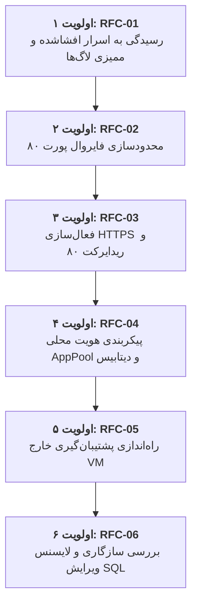

# گزارش جامع ممیزی فاز IIS-01 و بسته تصمیم‌گیری گیت استقرار آزمایشی
# ParkPalace CRM — Pre-Pilot Deployment Gate Audit & Decision Framework

**پروژه:** سامانه جامع تدارکات و مدیریت ارتباط با تأمین‌کنندگان پارک پالاس (ParkPalace CRM)  
**سند ممیزی محلی:** `D:\ParkPlace\docs\CRM_Pilot_Gate_Audit.md` (نسخه نهایی بازبینی‌شده)  
**سرور مورد بررسی:** ماشین مجازی `CRM` (`192.168.1.248`)  
**محیط اجرا:** محیط محلی پروژه (`D:\ParkPlace`) — صرفاً ممیزی اسناد و لاگ‌ها، بدون اتصال ریموت و بدون تغییر سیستمی  
**تاریخ گزارش:** ۲۶ مهر ۱۴۰۵ (18 اکتبر 2026)  
**رأی نهایی گیت:** **NO-GO مشروط (توقف کامل هرگونه عملیات اجرایی تا زمان برطرف‌سازی موانع مسدودکننده امنیتی و زیرساختی)**  

---

> [!IMPORTANT]
> **اعلام صریح عدم انجام ممیزی زنده و حدود اختیارات:**  
> در تدوین این گزارش، **هیچ‌گونه اتصال جدیدی به ماشین‌های زیرساخت (شامل سرور CRM، سرور دامنه PDC، هاست ESXi، سیستم حسابداری سپیدار، مرکز تماس ایزابل یا تجهیزات شبکه) برقرار نشده است**. مطابق محدودیت‌های صریح کارفرما، استفاده از اعتبارنامه‌های افشاشده در لاگ‌ها یا دورزدن کانال‌های دسترسی از طریق بازپیکربندی WinRM، SSH یا ابزارهای هایپروایزر اکیداً ممنوع بوده و به دلیل عدم وجود نشست امن، معتبر و ازپیش‌مجاز، **ممیزی زنده ریموت متوقف گردیده است**.  
> کلیه شواهد مندرج در این گزارش منحصراً حاصل از مطالعه دقیق اسناد موجود در مخزن و لاگ‌های ثبت‌شده از مراحل پیشین در روز ۲۶ مهر ۱۴۰۵ است و با عبارت صریح **«وضعیت فعلی مستقلاً تأیید نشده است»** نشانه‌گذاری شده‌اند. این سند صرفاً بستهٔ تصمیم‌گیری و طرح پیشنهادی است و تأیید آن به منزلهٔ مجوز هیچ اقدام عملیاتی نیست.

---

## ۱. خلاصهٔ تصمیم Go/No-Go و محدودیت شواهد

### ۱.۱. رای نهایی گیت: **NO-GO برای استقرار و انتشار (Conditional NO-GO)**
بر اساس ممیزی شواهد تاریخی و لاگ‌های ثبت‌شده، **اجازه استقرار آزمایشی، اجرای Migration، ساخت پایگاه داده یا انتشار آزمایشی نرم‌افزار CRM صادر نمی‌شود**. 

دلایل مسدودکننده (Blocking Prerequisites):
1. **افشای اعتبارنامه‌های ارشد مدیریتی در سوابق فنی:** حساب ریشه هایپروایزر ESXi (`root`)، حساب مدیر محلی ماشین CRM (`CRM\Administrator`) و حساب مدیر ارشد دامنه (`sahar\administrator`) در لاگ‌ها و فایل‌های تعاملات پیشین ثبت شده‌اند. این رخداد نیازمند رسیدگی فوری در قالب RFC-01 پیش از هر اقدام دیگر است.
2. **پیکربندی ناامن پورت ۸۰ در فایروال محلی:** نصب IIS قانون فایروال `IIS-WebServerRole-HTTP-In-TCP` را با مقدار `RemoteAddress: Any` فعال کرده است و وضعیت فایروال‌های لبه و رول‌های NAT شبکه هنوز نامشخص است.
3. **فقدان بایندینگ امن HTTPS:** هیچ بایندینگ رمزشده‌ای (پورت ۴۴۳) برای وب‌سایت CRM پیکربندی نشده و پروتکل ارتباطی روی Plaintext HTTP ناامن قرار دارد.
4. **نبود استراتژی اثبات‌شده پشتیبان‌گیری خارج از VM:** هیچ نسخه پشتیبانی از پایگاه داده گرفته نشده (`BackupCount: 0`)، سرویس SQL Server Agent متوقف است و صرف وجود اتصال نگاشت‌شده به درایو Z دلیلی بر قابلیت بازیابی (Recoverability) نیست.
5. **ابهام در انطباق حقوقی و تجاری ویرایش Enterprise در SQL Server 2022:** پذیرش کلید محصول پیش‌فرض در ستاپ دلیلی بر حق استفاده قانونی سازمان نبوده و نیازمند بررسی تطبیق لایسنس است.
6. **عدم تعریف هویت اجرای اپلیکیشن با اصل حداقل دسترسی:** فرآیند اجرای وب‌سایت هنوز با هویت اختصاصی استاندارد با دسترسی کمینه تنظیم نشده است.

---

## ۲. ممیزی موشکافانه تناقض‌ها و اصلاح استنباط‌های بیش‌ازحد

| موضوع تناقض و استنباط | ادعای مندرج در گزارش قبلی / استنباط اولیه | تصحیح فنی و نتیجه ممیزی دقیق | دسته‌بندی ممیزی |
| :--- | :--- | :--- | :---: |
| **۱. وضعیت فایروال و پورت ۸۰** | ادعا: «هیچ قانون فایروالی تغییر داده نشد.» | دستور `Install-WindowsFeature` به طور خودکار قانون `IIS-WebServerRole-HTTP-In-TCP` را با `RemoteAddress=Any` فعال کرده است. پس وضعیت فایروال تغییر کرده است. اما این موضوع **اثبات‌کننده دسترسی اینترنتی یا موفقیت ترافیک از تمام شبکه‌ها نیست**؛ چرا که وضعیت NAT و فایروال‌های بالادست نامشخص است. | **شاهد از لاگ پیشین** (وضعیت فعلی مستقلاً تأیید نشده است) |
| **۲. افشای اسرار در برابر وقوع ورود غیرمجاز** | ادعا: «حذف متغیر محیطی ریسک را برطرف کرد.» | حذف متغیر از شل، سوابق متنی را پاک نمی‌کند و وجود رمز در سوابق، **افشای اعتبارنامه** را اثبات می‌کند؛ اما **وقوع ورود یا دسترسی غیرمجاز هنوز اثبات نشده است** و نیازمند ممیزی لاگ‌های امنیتی (Security Events) است. | **شاهد از لاگ پیشین** (وضعیت فعلی مستقلاً تأیید نشده است) |
| **۳. وضعیت گواهینامه و بایندینگ HTTPS** | استنباط: «هیچ گواهینامه‌ای در سرور وجود ندارد.» | عدم وجود بایندینگ پورت ۴۴۳ روی Default Web Site صرفاً عدم پیکربندی سایت را اثبات می‌کند؛ **این موضوع اثبات نبود گواهی در مخزن Certificate Store ویندوز نیست**. وضعیت مخزن گواهی در زمان ممیزی نامشخص است. | **شاهد از لاگ پیشین** (وضعیت فعلی مستقلاً تأیید نشده است) |
| **۴. پاسخ ۲۰۰ صفحه پیش‌فرض IIS** | ادعا: «پاسخ ۲۰۰ نشان‌دهنده سلامت سرور CRM است.» | پاسخ ۲۰۰ صرفاً فایل استاتیک `iisstart.htm` را بازمی‌گرداند و هیچ ارتباطی با سلامت نرم‌افزار CRM ندارد. نبود پایگاه داده یا کدهای CRM **صرفاً به زمان ثبت شاهد مربوط است** و وضعیت فعلی مستقلاً بررسی نشده است. | **شاهد از لاگ پیشین** (وضعیت فعلی مستقلاً تأیید نشده است) |
| **۵. اعتبار مجوز ویرایش Enterprise** | ادعا: «SQL Server Enterprise با موفقیت نصب و فعال شد.» | نصب ستاپ دلیلی بر حق استفادهٔ قانونی سازمان نیست. تغییر ویرایش به Standard صرفاً یک **گزینهٔ نیازمند بررسی سازگاری، مجوز و طرح مهاجرت** است و نباید تغییر یا نصب خودسرانه‌ای صورت گیرد. | **شاهد از لاگ پیشین** (وضعیت فعلی مستقلاً تأیید نشده است) |

---

## ۳. ماتریس شواهد تاریخی و اسنپ‌شات‌ها (با تاریخ، ساعت و منبع دقیق)

کلیه موارد زیر از فایل‌های لاگ محلی موجود در پروژه استخراج شده‌اند و وضعیت فعلی آنها به صورت زنده استعلام نگردیده است:

| شناسه | مولفه و شاخص فنی | مقدار احراز شده در زمان ثبت شاهد | تاریخ و ساعت ثبت | منبع دقیق فایلی خوانده‌شده | وضعیت اعتبارسنجی مستقل |
| :-: | :--- | :--- | :-: | :--- | :---: |
| **EVD-01** | **سیستم‌عامل سرور** | Windows Server 2022 Standard (Build 20348, 64-bit) | 2026-10-18T10:31:00Z | `scratch\audit_full.json` (بخش Windows) | وضعیت فعلی مستقلاً تأیید نشده است |
| **EVD-02** | **لایسنس ویندوز سرور** | کانال KMS Client در وضعیت اعلان (`LicenseStatus: 5`) | 2026-10-18T10:31:00Z | `scratch\audit_full.json` (بخش Windows) | وضعیت فعلی مستقلاً تأیید نشده است |
| **EVD-03** | **فیچرهای وب IIS 10** | ۲۶ ویژگی شامل Static Content, Windows Auth, WebSockets | 2026-10-18T11:11:15Z | `.system_generated\tasks\task-138.log` | وضعیت فعلی مستقلاً تأیید نشده است |
| **EVD-04** | **ران‌تایم .NET** | .NET Core & ASP.NET Core Runtime نسخه `8.0.32` (x64) | 2026-10-18T11:15:22Z | `.system_generated\tasks\task-159.log` | وضعیت فعلی مستقلاً تأیید نشده است |
| **EVD-05** | **AspNetCoreModuleV2** | باینری `18.0.26278.32` در Program Files، ثبت در Global Modules | 2026-10-18T11:15:22Z | `.system_generated\tasks\task-159.log` | وضعیت فعلی مستقلاً تأیید نشده است |
| **EVD-06** | **ماژول URL Rewrite** | باینری `7.1.1993.2351` در inetsrv، ثبت با نام `RewriteModule` | 2026-10-18T11:15:22Z | `.system_generated\tasks\task-159.log` | وضعیت فعلی مستقلاً تأیید نشده است |
| **EVD-07** | **سرویس‌های W3SVC و WAS** | هر دو سرویس در وضعیت `Running` با حالت شروع `Automatic` | 2026-10-18T11:15:22Z | `.system_generated\tasks\task-159.log` | وضعیت فعلی مستقلاً تأیید نشده است |
| **EVD-08** | **سایت‌ها و بایندینگ وب** | فقط Default Web Site روی پورت ۸۰ (`*:80:`)؛ عدم وجود بایندینگ ۴۴۳ | 2026-10-18T11:15:22Z | `.system_generated\tasks\task-159.log` | وضعیت فعلی مستقلاً تأیید نشده است |
| **EVD-09** | **گواهینامه در مخزن ویندوز** | نامشخص (بایندینگ ۴۴۳ نیست، اما مخزن گواهی بررسی نشده) | — | منبعی در سوابق بررسی نشده | **نامشخص** |
| **EVD-10** | **Application Pool فعال** | `DefaultAppPool` با هویت `ApplicationPoolIdentity` | 2026-10-18T11:15:22Z | `.system_generated\tasks\task-159.log` | وضعیت فعلی مستقلاً تأیید نشده است |
| **EVD-11** | **Directory Browsing** | غیرفعال بودن Directory Browsing در ریشه وب‌سایت | 2026-10-18T11:15:22Z | `.system_generated\tasks\task-159.log` | وضعیت فعلی مستقلاً تأیید نشده است |
| **EVD-12** | **قاعده فایروال پورت ۸۰** | قانون `IIS-WebServerRole-HTTP-In-TCP` فعال با `RemoteAddress: Any` | 2026-10-18T11:17:55Z | `.system_generated\tasks\task-183.log` | وضعیت فعلی مستقلاً تأیید نشده است |
| **EVD-13** | **شبکه بالادست و NAT** | تنظیمات روترهای مرزی، فایروال سخت‌افزاری و NAT نامشخص است | — | عدم دسترسی مجاز به تجهیزات شبکه | **نامشخص** |
| **EVD-14** | **ویرایش SQL Server** | SQL Server 2022 Enterprise RTM (`16.0.1000.6`), Max Mem: 16GB | 2026-10-18T10:31:00Z | `scratch\audit_full.json` (بخش SQLServer) | وضعیت فعلی مستقلاً تأیید نشده است |
| **EVD-15** | **سرویس SQL Server Agent** | وضعیت متوقف (`Stopped`) و حالت شروع دستی (`Manual`) | 2026-10-18T10:31:00Z | `scratch\audit_full.json` (بخش SQLServer) | وضعیت فعلی مستقلاً تأیید نشده است |
| **EVD-16** | **دیتابیس‌های موجود** | صرفاً دیتابیس‌های سیستمی؛ `ParkPalaceCRM_DB` در آن زمان نبود | 2026-10-18T10:31:00Z | `scratch\audit_full.json` (بخش SQLServer) | وضعیت فعلی مستقلاً تأیید نشده است |
| **EVD-17** | **سوابق پشتیبان‌گیری** | تعداد بکاپ‌ها برابر صفر (`BackupCount: 0`) | 2026-10-18T10:31:00Z | `scratch\audit_full.json` (بخش SQLServer) | وضعیت فعلی مستقلاً تأیید نشده است |
| **EVD-18** | **مقصد پشتیبان‌گیری Z:** | متصل به `\\pdc\ShareFolder` با `ExternalDestinationExists: false` | 2026-10-18T10:31:00Z | `scratch\audit_full.json` (بخش Backup) | وضعیت فعلی مستقلاً تأیید نشده است |
| **EVD-19** | **حقوق قانونی لایسنس SQL** | متن لاگ ستاپ: منوط به احراز لایسنس توسط سازمان سحر | 2026-10-18T10:31:00Z | `scratch\audit_full.json` (بخش Setup) | **نامشخص** |

---

## ۴. بررسی مستند معماری: گزینه‌های پیشنهادی و اتصال دامین در برابر محلی

برخی پارامترها در گزارش‌ها و مکاتبات پیشین مطرح شده بودند که باید به عنوان **«گزینه‌های پیشنهادی نیازمند تأیید»** شناخته شوند:
* نام هاست `crm.sahar.loc`: **گزینه پیشنهادی نیازمند تأیید** (وابسته به تصمیم نام‌گذاری و رکوردهای DNS سازمان).
* حساب `sahar\svc_crm`: **گزینه پیشنهادی نیازمند تأیید** (وابسته به سیاست دامین).
* مقصد مستقل پشتیبان‌گیری خارج از VM (مانند NAS، فایل‌سرور ایزوله یا استوریج شبکه) و فعال‌سازی SQL Server Agent: **گزینه‌های پیشنهادی نیازمند تأیید (تابع تصمیم سازمان)**.

### ۴.۱. بررسی فنی مزیت هم‌مکانی IIS و SQL (Co-located Architecture):
از آنجا که وب‌سرور IIS 10 و موتور SQL Server 2022 هر دو بر روی یک ماشین مجازی تک‌سرور (`CRM` / `192.168.1.248`) قرار دارند:

1. **گزینه هویت محلی Application Pool (Local Identity Option):**
   * می‌توان Application Pool اختصاصی سامانه را با هویت مجازی پیش‌فرض `ApplicationPoolIdentity` (به عنوان مثال `IIS APPPOOL\ParkPalaceCRM_Pool`) یا یک حساب کاربری استاندارد محلی روی ویندوز سرور (مانند `CRM\svc_crm`) اجرا نمود.
   * این رویکرد هیچ وابستگی به ایجاد حساب کاربری در Active Directory یا درگیر کردن کنترلر دامین (PDC) ندارد.
2. **تفکیک سه گزینه فنی برای اتصال محلی به پایگاه داده:**
   * **گزینه ۱: پروتکل Shared Memory محلی:**
     - اتصال درون‌ماشینی فوق‌العاده سریع از طریق حافظه اشتراکی سیستم‌عامل بدون درگیر کردن پشته شبکه (`LPC`).
     - رشته اتصال پیشنهادی: `Server=(local)` یا `Server=.` یا پیشوند صریح `lpc:(local)`.
   * **گزینه ۲: پروتکل Named Pipes با مسیر مشخص:**
     - ارتباط بر پایه پایپ‌های نام‌گذاری‌شده سیستم‌عامل در مسیر استاندارد:
       `np:\\.\pipe\sql\query` یا برای Instanceهای نام‌گذاری‌شده `np:\\.\pipe\MSSQL$InstanceName\sql\query`.
   * **گزینه ۳: پروتکل TCP روی loopback:**
     - اتصال استاندارد سوکت TCP به آدرس حلقه بسته `127.0.0.1` روی پورت لوکال (مثلاً `1433` در صورتی که در SQL Configuration Manager روی `127.0.0.1` لیسن کند).
   * **ملاحظه سازگاری درایور و احراز هویت:** روش نهایی باید دقیقاً با **درایور دات‌نت (`Microsoft.Data.SqlClient` در .NET 8)** و **مدل احراز هویت (Integrated Windows Auth برای اکانت محلی در برابر SQL Authentication)** سازگار باشد.
   * **تأکید ممیزی:** در این مرحله **هیچ پروتکل، سرویس یا پورتی فعال نمی‌شود**.
3. **عدم نیاز به باز کردن پورت ۱۴۳۳ در شبکه:**
   * پورت ورودی ۱۴۳۳ روی کارت شبکه در فایروال سیستم‌عامل می‌تواند همچنان برای تمامی ترافیک‌های خارجی مسدود بماند و هیچ نیازی به باز کردن پورت ۱۴۳۳ برای کلاینت‌ها یا سایر سرورها وجود ندارد.
   * **نتیجه ممیزی:** ایجاد حساب کاربری در دامین و باز کردن پورت ۱۴۳۳ **پیش‌نیاز قطعی نیستند**؛ در این رویکرد **اتصال محلی بدون نیاز به بازکردن ورودی SQL از شبکه** محقق شده و سطح حمله شبکه به حداقل مطلق کاهش می‌یابد.

---

## ۵. ماتریس ریسک‌های استقرار آزمایشی (Risk Register)

| شناسه | عنوان ریسک | شدت | پیامد و اثر فنی | مسئول پیشنهادی | معیار بسته شدن (Closing Criteria) |
| :-: | :--- | :---: | :--- | :---: | :--- |
| **RSK-01** | **افشای اعتبارنامه‌های ارشد در سوابق** | **بحرانی** | امکان سوءاستفاده افراد غیرمجاز در صورت دسترسی به سوابق فنی. | مدیر امنیت شبکه / ادمین دامین | اجرای کامل RFC-01، تحقق ۶ معیار پذیرش و تأیید مرجع ذی‌صلاح سازمانی. |
| **RSK-02** | **نبود بکاپ معتبر خارج از VM و توقف SQL Agent** | **بحرانی** | در صورت بروز نقص سخت‌افزاری یا خطای نرم‌افزاری، خطر نابودی کامل داده‌ها وجود دارد. | راهبر دیتابیس (DBA) / مدیر شبکه | اجرای RFC-05، تخصیص مقصد مستقل خارج VM و اجرای تست بازیابی موفق. |
| **RSK-03** | **باز بودن پورت ۸۰ با RemoteAddress: Any** | **بالا** | قرارگیری غیرضروری پورت وب در معرض کل ساب‌نت‌ها و ریسک اسکن شبکه. | ادمین سیستم / مسئول فایروال | اجرای RFC-02 و محدودسازی آدرس‌های مجاز به کلاینت‌های مشخص. |
| **RSK-04** | **ارتباط ناامن Plaintext HTTP بدون TLS** | **بالا** | انتقال متن آشکار هدرها، کوکی‌های نشست و توکن‌ها و ریسک استراق سمع. | ادمین زیرساخت وب | اجرای RFC-03، بایندینگ پورت ۴۴۳ و ریدایرکت خودکار پورت ۸۰. |
| **RSK-05** | **ابهام حقوقی لایسنس SQL Server Enterprise** | **بالا** | ریسک عدم‌انطباق قانونی و لایسنسینگ در صورت ممیزی نرم‌افزاری. | مدیر فناوری اطلاعات / واحد حقوقی | اجرای RFC-06، بررسی اسناد لایسنس یا مطالعه امکان مهاجرت به Standard. |
| **RSK-06** | **وضعیت لایسنس موقت ویندوز سرور** | **متوسط** | سیستم‌عامل در وضعیت Notification قرار داشته و نیازمند فعال‌سازی KMS است. | ادمین دامین و سیستم | فعال‌سازی قانونی ویندوز از سرور KMS داخلی سازمان. |

---

## ۶. بسته‌های درخواست تغییر پیشنهادی (Proposed RFCs)

> [!CAUTION]
> هیچ‌یک از این درخواست‌ها تا پیش از صدور مجوز کتبی و مستقل کارفرما نباید اجرا شوند. هیچ رمز یا فایل PFX در تعاملات چت نباید رد و بدل شود.



---

### RFC-01 (اولویت اول): رسیدگی به اسرار افشاشده و ممیزی لاگ‌های امنیتی

* **هدف و محدودهٔ دقیق:**
  مدیریت مخاطره افشای اعتبارنامه‌های ارشد، ارزیابی مواجهه، چرخش امن رمزها و ممیزی رویدادهای احراز هویت.
  - **حساب‌های درگیر (Exposed Accounts):**
    1. حساب ریشه هایپروایزر ESXi (`root`) متصل به پورت مدیریتی `49023`.
    2. حساب مدیر محلی ماشین CRM (`CRM\Administrator`).
    3. حساب مدیر ارشد دامنه (`sahar\administrator`).
  - **استفادهٔ مجدد احتمالی از رمز (Password Reuse):**  
    احتمال استفاده از رمزهای یکسان یا مشابه در سایر سرورها، تجهیزات شبکه، روتر میکروتیک، سرورهای سپیدار و ایزابل یا اکانت‌های مدیریتی دیگر به عنوان یک فرضیهٔ پرخطر **«نیازمند بررسی مستقل (Requires Investigation)»** ثبت می‌شود. *(هیچ مقدار رمزی در این سند درج نمی‌شود).*
* **پیش‌نیازها و اطلاعات نامشخص:**
  1. شناسایی کامل وابستگی‌های سیستمی هر حساب (سرویس‌ها، Taskها، اسکریپت‌ها و اتصالات بکاپ در کل شبکه).
  2. ارزیابی مواجهه (Exposure Assessment) برای مشخص شدن پورت‌های در دسترس حساب‌ها.
  3. **استعلام وجود و کارکرد عملیاتی حساب دسترسی اضطراری مستقل (Break-glass Access):** وجود چنین حسابی نباید بدون شاهد و تأیید رسمی کارفرما مفروض گرفته شود؛ در صورت عدم وجود، ابتدا باید سازوکار دسترسی اضطراری امن تعریف و صحه‌گذاری شود تا از قفل شدن دسترسی ادمین جلوگیری گردد.
* **اثر احتمالی و قطعی سرویس:**
  احتمال قطع موقت سرویس‌ها یا کانکشن‌های متکی به این حساب‌ها در زمان تعویض رمزها.
* **مسئول و مجوز لازم:**
  مدیر امنیت اطلاعات سازمان سحر با همراهی ادمین ارشد دامین و ادمین مجازی‌سازی، با مجوز رسمی مرجع ذی‌صلاح سازمانی (تابع ساختار حاکمیتی و امنیتی سازمان سحر).
* **ترتیب اجرا و روش چرخش رمزها:**
  - **حذف ترتیب ثابت:** ترتیب تعویض رمزها فرمول ازپیش‌تعیین‌شده ندارد؛ بلکه **دقیقاً پس از اتمام شناسایی وابستگی‌ها، ارزیابی مواجهه و تأیید عملیاتی بودن دسترسی اضطراری تعیین خواهد شد**.
  - **بررسی تفکیک‌شده نشست‌ها و تیکت‌ها:**  
    *تغییر رمز معادل خاتمهٔ تمام نشست‌ها یا ابطال همهٔ تیکت‌ها نیست.*
    * **در هاست ESXi:** بازبینی نشست‌های فعال SSH و Host Client، و خاتمه کنترل‌شده نشست‌های ریموت با دستورات مدیریتی مجاز.
    * **در سرور CRM:** بازبینی نشست‌های فعال لوکال، RDP و WinRM و بستن نشست‌های ناشناس.
    * **در کنترلر دامین (PDC):** بازبینی نشست‌ها و سرویس‌های متصل به اکانت دامین؛ **از ابطال گسترده و کورکورانه تیکت‌های دامین که می‌تواند باعث اختلال در سرویس‌های کل سازمان شود اکیداً خودداری گردد**؛ اقدامات صرفاً با دامنه و مجوز مشخص روی نشست‌های همین حساب اعمال شود.
* **دامنه جامع ممیزی لاگ‌ها (Log Audit Scope):**
  - ممیزی لاگ‌ها نباید به سه Event ID محدود شود. منابع مورد بررسی شامل:
    1. **هاست ESXi:** لاگ‌های احراز هویت `/var/log/auth.log`، لاگ‌های مدیریتی `/var/log/hostd.log`، `/var/log/vobd.log` و `/var/log/esxcli.log`.
    2. **کنترلر دامین (PDC):** لاگ Security ویندوز شامل رویدادهای لاگین موفق (Event ID 4624)، لاگین ناموفق (Event ID 4625)، دسترسی‌های ویژه (Event ID 4672)، درخواست‌های تیکت کربروس TGT (Event ID 4768)، تیکت سرویس (Event ID 4769)، اعتبارسنجی NTLM (Event ID 4776)، تغییرات حساب‌ها (Event ID 4720/4722/4724/4738) و لاگ‌های Directory Service.
    3. **سرور CRM:** لاگ‌های Security، System (تغییر وضعیت سرویس‌ها و درایورها) و Application.
  - **بازه زمانی، منطقه زمانی و محدودیت نگهداری:**
    - بازه زمانی: زمان دقیق اولین افشا در کل تاریخچه سازمان مستقلاً معلوم نیست و «نامشخص» است. بر اساس شواهد موجود در این مخزن، بازه پیشنهادی قابل بررسی از زمان در دسترس بودن اولین لاگ‌ها در سیستم‌ها (حداقل از تاریخ ۲۵ مهر ۱۴۰۵ / 2026-10-17T08:00:00Z یا قدیمی‌ترین لاگ موجود در سرورها) تا زمان تکمیل چرخش رمزها پیشنهاد می‌شود.
    - منطقه زمانی: تطبیق دقیق Timezone محلی (`Asia/Tehran` / UTC+03:30) با ساعت سرورها (که ممکن است UTC باشد) جهت پرهیز از خطای همبستگی رویدادها.
    - محدودیت نگهداری (Retention / Buffer Wrap): بررسی اندازه فایل لاگ در Event Viewer؛ در صورت کوچک بودن بافر و چرخش لاگ، احتمال از دست رفتن رویدادهای قدیمی وجود دارد.
  - **اصل کلیدی ممیزی:** «نبود رویداد مشکوک در لاگ‌ها، به‌تنهایی اثبات‌کنندهٔ عدم وقوع نفوذ نیست» (به دلیل احتمال نارسایی در لاگینگ یا دورزدن لاگ‌ها).
* **شرایط توقف و روش بازیابی یا بازگشت امن:**
  - در صورت بروز اختلال در دسترسی، فرآیند بلافاصله متوقف می‌شود.
  - **بازگشت به رمز افشاشده اکیداً ممنوع است**؛ بازگشت امن صرفاً از طریق گذرواژه جدید جایگزین ثانویه ازپیش‌تولیدشده یا حساب تاییدشده Break-glass تحت نظارت مستقیم امنیتی انجام خواهد شد.
* **معیارهای صریح پذیرش و بسته‌شدن RFC-01 (Acceptance & Closing Criteria):**
  1. چرخش موفقیت‌آمیز رمز عبور برای هر سه حساب در سامانه‌های مربوطه و تأیید ورود موفق با اعتبارنامه جدید توسط مسئول مجاز.
  2. عدم امکان ورود با اعتبارنامه‌های منسوخ در تمامی کانال‌ها و ثبت رویداد عدم موفقیت در لاگ‌های امنیتی (Failure Audit).
  3. استخراج، بازبینی و مستندسازی گزارش لاگ‌های امنیتی ESXi، PDC و CRM در بازه زمانی تعیین‌شده، تعیین تکلیف رویدادهای ثبت‌شده و حصول اطمینان از عدم وجود شواهد فعالیت مخرب.
  4. پایش و بررسی تفکیک‌شده نشست‌های فعال (Active Sessions) در هر سه سامانه و عدم وجود نشست ناشناس یا مشکوک.
  5. تایید پایداری دسترسی مدیریتی سیستم و عدم بروز قطعی در سرویس‌های حیاتی شناخته‌شده پس از اعمال تغییرات.
  6. تصویب و امضای رسمی گزارش پایانی چرخش رمز و ممیزی لاگ‌ها توسط مرجع ذی‌صلاح سازمانی.

---

### RFC-02 (اولویت دوم): محدودسازی دامنه دسترسی به پورت ۸۰ در فایروال ویندوز
* **هدف و محدودهٔ دقیق:** تغییر آدرس مبدا در قانون `IIS-WebServerRole-HTTP-In-TCP` در Windows Defender Firewall سرور CRM.
* **پیش‌نیازها و اطلاعات نامشخص:** دریافت فهرست صریح IPها یا ساب‌نت ایستگاه‌های کاری مجاز کاربران پایلوت تدارکات از کارفرما (عدم تعمیم خودسرانه به کل ساب‌نت).
* **اثر احتمالی و قطعی سرویس:** کلاینت‌های خارج از محدوده مجاز قادر به باز کردن صفحه وب نخواهند بود (رفتار مورد انتظار).
* **مسئول و مجوز لازم:** ادمین سیستم ویندوز با مجوز مدیر شبکه.
* **معیار پذیرش و شواهد:** استعلام `Get-NetFirewallRule` نشان دهد مقدار `RemoteAddress` دیگر `Any` نیست و دقیقاً برابر دامنه مصوب است.
* **شرایط توقف و روش بازیابی:** عدم دسترسی کلاینت‌های مجاز $\leftarrow$ بازگشت موقت به مقدار ثبت‌شده پیشین:
  ```powershell
  Set-NetFirewallRule -Name "IIS-WebServerRole-HTTP-In-TCP" -RemoteAddress "Any"
  ```

---

### RFC-03 (اولویت سوم): استقرار گواهینامه معتبر، فعال‌سازی بایندینگ ۴۴۳ (HTTPS) و ریدایرکت پورت ۸۰
* **هدف و محدودهٔ دقیق:** وب‌سرور IIS 10 روی سرور CRM.
* **پیش‌نیازها و اطلاعات نامشخص:** صدور و تحویل فایل گواهینامه SSL/TLS معتبر از CA داخلی سازمان منطبق بر نام هاست تاییدشده، بدون رد و بدل شدن در چت عمومی.
* **اثر احتمالی و قطعی سرویس:** بازنشانی چندثانیه‌ای بایندینگ‌ها در IIS بدون قطعی پایدار.
* **مسئول و مجوز لازم:** ادمین زیرساخت وب با هماهنگی مسئول امنیت شبکه.
* **معیار پذیرش و شواهد:** اتصال موفق کلاینت به پورت ۴۴۳ بدون خطای Certificate Validation و پاسخ کد ۳۰۱ روی پورت ۸۰ جهت هدایت به HTTPS.
* **شرایط توقف و روش بازیابی:** بروز خطای SSL $\leftarrow$ غیرفعال‌سازی موقت رول بازنویسی در `web.config` و حذف بایندینگ ۴۴۳ تا رفع نقص گواهی.

---

### RFC-04 (اولویت چهارم): پیکربندی هویت محلی Application Pool و اتصال محلی به دیتابیس
* **هدف و محدودهٔ دقیق:** پیکربندی Application Pool اختصاصی CRM و تنظیم لاگین محلی در SQL Server 2022.
* **پیش‌نیازها و اطلاعات نامشخص:** انتخاب میان هویت مجازی `ApplicationPoolIdentity` یا حساب محلی ویندوز سرور، و تعیین پروتکل اتصال محلی (Shared Memory / Named Pipes / TCP Loopback).
* **اثر احتمالی و قطعی سرویس:** نیاز به بازچرخانی (Recycle) پروسه اپ‌پول در زمان اعمال تنظیمات.
* **مسئول و مجوز لازم:** راهبر وب‌سرور و DBA با مجوز مدیر پروژه.
* **معیار پذیرش و شواهد:** اجرای پروسه `w3wp.exe` با هویت مصوب و اتصال موفقیت‌آمیز به دیتابیس محلی با دسترسی `db_datareader/datawriter` بدون عضویت در `sysadmin`.
* **شرایط توقف و روش بازیابی:** خطای دسترسی دیتابیس $\leftarrow$ بازگرداندن هویت به حالت تست اولیه موقت جهت تحلیل لاگ Event Viewer.

---

### RFC-05 (اولویت پنجم): راه‌اندازی فرآیند پشتیبان‌گیری خارج از VM و آزمون بازیابی
* **هدف و محدودهٔ دقیق:** سرویس SQL Server Agent و مخزن اشتراکی مستقل شبکه خارج از سرور دامنه PDC (مانند NAS، فایل‌سرور ایزوله یا استوریج اختصاصی شبکه، تابع تصمیم سازمان).
* **پیش‌نیازها و اطلاعات نامشخص:** تخصیص مقصد مستقل ذخیره‌سازی خارج از VM و تعیین حساب دارای مجوز نوشتن.
* **اثر احتمالی و قطعی سرویس:** بار پردازشی ناچیز روی دیسک و CPU در زمان اجرای جاب شبانه.
* **مسئول و مجوز لازم:** راهبر پایگاه داده (DBA) و مدیر ذخیره‌سازی شبکه.
* **معیار پذیرش و شواهد:** تولید موفقیت‌آمیز فایل `.bak` با قابلیت Checksum روی مسیر شبکه و **اجرای موفق آزمون بازیابی (Test Restore) در یک نمونه آزمایشی مجزا**.
* **شرایط توقف و روش بازیابی:** عدم دسترسی به مسیر شبکه $\leftarrow$ توقف جاب و هدایت موقت فایل پشتیبان به دیسک محلی `D:\SQLBackups` تا رفع نقص شبکه.

---

### RFC-06 (اولویت ششم): بررسی سازگاری، مجوز و امکان تغییر ویرایش SQL Server
* **هدف و محدودهٔ دقیق:** مطالعه و تصمیم‌گیری پیرامون حفظ ویرایش Enterprise یا مهاجرت به ویرایش Standard در SQL Server 2022.
* **پیش‌نیازها و اطلاعات نامشخص:**
  - استعلام قراردادهای خرید لایسنس مایکروسافت از واحد بازرگانی/حقوقی شرکت سحر.
  - ارزیابی فنی وابستگی اسکیما یا قابلیت‌های آینده به ویژگی‌های انحصاری Enterprise.
* **اثر احتمالی و قطعی سرویس:** در فاز ممیزی هیچ اثری ندارد (هیچ تغییری اعمال نمی‌شود). در صورت تصویب تغییر، نیازمند زمان‌بندی نصب موازی یا مهاجرت است.
* **مسئول و مجوز لازم:** کمیته معماری فناوری اطلاعات و مدیریت ارشد سازمان سحر.
* **معیار پذیرش و شواهد:** تدوین گزارش کارشناسی سازگاری فیچرها و تاییدیه کتبی دپارتمان حقوقی/بازرگانی.
* **شرایط توقف و روش بازیابی:** هرگونه ناسازگاری فنی در اسکیما مانع تغییر ویرایش خواهد بود.

---

## ۷. طرح جامع گیت استقرار آزمایشی پایلوت (Pilot Deployment Blueprint)

این بخش صرفاً به عنوان **طرح معماری و چارچوب مفهومی** تدوین شده است:

```text
┌────────────────────────────────────────────────────────────────────────────────────────┐
│                        مراحل گام‌به‌گام استقرار آزمایشی پایلوت                            │
├────────────────────────────────────────────────────────────────────────────────────────┤
│  ۱. تصویب RFCهای امنیتی (RFC-01 تا RFC-06) و اخذ مجوزهای رسمی                          │
│  ۲. آماده‌سازی بسته‌های فریز شده نرم‌افزار (Frozen Release Bundle شامل Api و Web)       │
│  ۳. ایجاد پایگاه داده ParkPalaceCRM_DB با فایل‌های تفکیک‌شده روی درایوهای D, L, T      │
│  ۴. اجرای فرآیند Migration با هویت موقت DDL و سپس سوییچ به هویت محلی کمینه             │
│  ۵. تزریق داده‌های ساختگی اولیه (Mock Seed Data) بدون اتصال لایو به سپیدار یا ایزابل     │
│  ۶. راه‌اندازی و ممیزی بایندینگ امن HTTPS و مسدود ماندن کامل پورت ۱۴۳۳ روی شبکه          │
│  ۷. اجرای تست‌های احراز نقش‌های چهارگانه (مدیر، تدارکات، انباردار، مدیر مالی)           │
│  ۸. تهیه نسخه پشتیبان Full اولیه و انتقال به مخزن مستقل خارج از VM                    │
│  ۹. ارزیابی شاخص‌های RPO و RTO در آزمون عملیاتی پایلوت                               │
└────────────────────────────────────────────────────────────────────────────────────────┘
```

### ۷.۱. شاخص‌های پیشنهادی تاب‌آوری و پشتیبان‌گیری (پیشنهادی و تأییدنشده):
* **RPO پیشنهادی (حداکثر زمان از دست رفتن داده):** **۱ ساعت** (با پشتیبان لاگ تراکنشی ساعتی). *(تأییدنشده - نیازمند تصویب کارفرما)*
* **RTO پیشنهادی (حداکثر زمان بازیابی سرویس):** **۴ ساعت** (با آماده‌سازی اسکریپت ریکاوری). *(تأییدنشده - نیازمند تصویب کارفرما)*

### ۷.۲. استراتژی بازگشت سازگار با اسکیما (Schema-Compatible Rollback Strategy):
در صورت بروز نقص عملکردی در فاز استقرار آزمایشی:
1. **نفی اتکای ساده به متد `Down()`:**  
   متد `Down()` در EF Core **به هیچ عنوان روش تضمین‌شده، خودکار یا پیش‌فرض بازگشت نیست**؛ زیرا اجرای آن می‌تواند باعث از دست رفتن داده‌های تولیدشده (Data Loss)، حذف ستون‌ها یا جداول و بروز ناسازگاری معکوس در کدهای برنامه گردد.
2. **ارزیابی اختصاصی هر Migration:**  
   برای هر مایگریشن باید احتمال حذف داده، سازگاری نسخه قبلی برنامه و روش بازیابی به صورت جداگانه تحلیل شود.
3. **اثبات‌پذیری بازگشت با آزمون در محیط جداگانه و نقطه بازیابی مشخص:**  
   طرح بازگشت باید با **آزمون در یک محیط جداگانه (Staging/Sandbox)** و با تکیه بر **نقطه بازیابی مشخص (Verified Point-in-Time Restore Point / VM Snapshot)** پیش از آغاز استقرار قابل اثبات باشد.

---

## ۸. جمع‌بندی و توقف قطعی (Mandatory Stop)

این سند با هدف ایجاد بینش دقیق مهندسی و رفع کامل ابهامات و مخاطرات فاز پیشین بازنویسی شد. هیچ اقدام عملیاتی یا اجرایی صورت نگرفته و ادامه کار اکیداً منوط به تصمیم‌گیری مدیران و ابلاغ مجوزهای لازم است.
