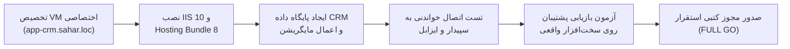

# ماتریس تصمیم‌گیری نهایی پیش‌استقرار (PPA Go / No-Go Decision)
# ParkPalace Procurement CRM — Pre-Production Acceptance (PPA)
## Formal Audit Decision Matrix, Risk Register & Strategic Next Steps

**پروژه:** سامانه جامع تدارکات و ارتباط با تأمین‌کنندگان پارک پالاس (ParkPalace Procurement CRM)  
**سند:** ماتریس تصمیم‌گیری رسمی پیش‌استقرار (PPA Go/No-Go Decision Report)  
**مسیر پروژه:** `D:\ParkPlace`  
**هدف ارزیابی:** سرور کنترل‌کننده دامنه `pdc.sahar.loc` (`192.168.1.250`) و سامانه CRM  
**حالت ممیزی:** ممیزی ارشد امنیت، زیرساخت و سیستم‌های سازمانی (READ-ONLY AUDIT & PLANNING ONLY)  
**تاریخ صدور:** ۲۶ مهر ۱۴۰۵ (2026-10-18)  
**نسخه:** ۱.۰.۰  

---

## ۱. تصمیم نهایی ممیزی (Final PPA Decision)

```
╔═════════════════════════════════════════════════════════════════════════════════════╗
║                                                                                     ║
║                           وضعیت نهایی ارزیابی: NO-GO                               ║
║                    (استقرار روی سرور PDC اکیداً غیرمجاز است)                         ║
║                                                                                     ║
║   ۱. آمادگی کد و منطق نرم‌افزار در محیط Staging:           تأیید شد (PASS)          ║
║   ۲. آمادگی زیرساخت میزبانی روی Domain Controller (PDC):  مردود و مسدود (BLOCKED)   ║
║   ۳. اتصالات عملیاتی و زنده سپیدار و ایزابل:             تاییدنشده (NOT VERIFIED)  ║
║                                                                                     ║
╚═════════════════════════════════════════════════════════════════════════════════════╝
```

### خلاصه راهبردی تصمیم:
* **نرم‌افزار پارک پالاس در بالاترین سطح آمادگی قرار دارد:** تمامی ۱۱۵ تست خودکار (یونیت، یکپارچگی، سناریوی ۱۸‌گانه سرتاسری تدارکات، آزمون‌های همروندی و ممیزی‌های امنیتی ضدتزریق) با موفقیت ۱۰۰٪ پاس شده‌اند و بیلد فرانت‌اند React با صفر خطا آماده است.
* **اما میزبانی روی Domain Controller خط قرمز امنیت زیرساخت است:** استقرار IIS، ماژول‌های وب، وب‌سوکت‌های دائمی و پردازش‌های سنگین گزارش‌گیری بر روی کنترل‌کننده اصلی دامنه سازمان (`pdc.sahar.loc`)، نقض صریح معماری لایه‌بندی امنیتی (Tier-0 Assets) بوده و ریسک از دست رفتن کل اکتیودایرکتوری شرکت سحر را در بر دارد.
* **نتیجه:** استقرار روی سرور PDC در وضعیت **NO-GO / BLOCKED** قرار دارد. مسیر رسمی استقرار باید به سمت یک **ماشین مجازی اختصاصی (Dedicated Application Server VM)** هدایت گردد.

---

## ۲. ماتریس تصمیم‌گیری حوزه‌های شش‌گانه (PPA Decision Matrix)

| ردیف | حوزه ارزیابی پیش‌استقرار | وضعیت ممیزی | شواهد و دلایل فنی تصمیم |
| :---: | :--- | :---: | :--- |
| **۱** | **آمادگی نرم‌افزار و منطق تجاری (Application Readiness)** | **PASS** | قبولی ۱۰۰٪ آزمون‌ها (۱۱۵/۱۱۵)؛ بیلد سالم کلاینت در ۱۲ ثانیه؛ پیاده‌سازی کامل سناریوی تدارکات، تطبیق سه‌جانبه، حل مغایرت مالی، صدور مستقیم PO توسط خرید، و هدرهای امنیتی OWASP. |
| **۲** | **آمادگی محیط پیش‌استقرار (Staging Readiness)** | **PASS** | ایزولاسیون کامل با `appsettings.Staging.json`؛ استفاده از پایگاه داده مجزای آزمایشی؛ شبیه‌سازهای امن سپیدار و ایزابل؛ عدم استفاده از اطلاعات واقعی در تست‌ها. |
| **۳** | **تناسب میزبانی روی PDC (PDC Hosting Suitability)** | **BLOCKED / FAIL** | **عدم انطباق با استاندارد Tier-0**؛ نبود SAM محلی جهت ایزولاسیون استخر IIS؛ امکان ارتقای دسترسی به SYSTEM روی DC با مجوز `SeImpersonate`؛ خطر قطعی لاگین دامین و DNS؛ خطر تخریب اکتیودایرکتوری با USN Rollback. |
| **۴** | **آمادگی اتصال زنده سپیدار (Sepidar Live Readiness)** | **NOT VERIFIED** | سناریو با آداپتور شبیه‌ساز پاس شد؛ اتصال زنده و دسترسی به پورت `62753` روی `192.168.1.242` و اعتبارسنجی لاگین SELECT-Only نیازمند مجوز جداگانه و تست شبکه است. |
| **۵** | **آمادگی اتصال زنده ایزابل (Issabel Live Readiness)** | **NOT VERIFIED** | سناریوی دریافت پاپ‌آپ با شبیه‌ساز پاس شد؛ بررسی پورت `5038` روی `192.168.1.241`، کریدنشال AMI و دسترسی به فایل‌های ضبط در شبکه واقعی نیازمند مجوز کتبی است. |
| **۶** | **آمادگی بازیابی عملیاتی (Operational Recovery Readiness)** | **NOT VERIFIED** | اسکریپت‌های Backup با Checksum و متدهای Down مایگریشن‌ها در استیجینگ تایید شدند؛ اجرای تست بازیابی فیزیکی روی سخت‌افزار واقعی سرور هنوز انجام نشده است. |

---

## ۳. فهرست موانع بحرانی (Blockers)

1. **مانع B-01 (معماری و امنیت زیرساخت):** تلاش برای میزبانی وب بر روی کنترل‌کننده دامنه (`pdc.sahar.loc`).  
   * *راهکار رفع:* تخصیص یک ماشین مجازی مستقل به عنوان وب‌سرور (`app-crm.sahar.loc`).
2. **مانع B-02 (حفاظت از پایگاه داده مالی):** فقدان مجوز مکتوب برای اعتبارسنجی کاربر SELECT-Only در سرور SQL سپیدار.  
   * *راهکار رفع:* صدور مجوز آزمون اتصال صرفاً خواندنی توسط مدیر مالی و مدیر شبکه.
3. **مانع B-03 (ارتباط مرکز تماس):** فقدان مجوز اتصال زنده به پورت ۵۰۳۸ سرور ایزابل (`192.168.1.241`).  
   * *راهکار رفع:* ارائه حساب کاربری محدود AMI صرفاً برای دریافت Eventهای Call و بدون دسترسی Originate/Dialplan.

---

## ۴. ثبت ریسک‌های باقیمانده و بدهی فنی (Residual Risk Register)

| شناسه ریسک | عنوان ریسک | شدت | احتمال | استراتژی کاهش ریسک |
| :---: | :--- | :---: | :---: | :--- |
| **RSK-01** | تداخل فرآیند GC دات‌نت با سرویس‌های دامین | بحرانی | بالا | انتقال قطعی به سرور مجزا؛ عدم نصب روی PDC تحت هر شرایطی. |
| **RSK-02** | ارتقای سطح دسترسی از طریق پروسس وب‌سایت | بحرانی | متوسط | تفکیک سرور، اجرای AppPool با هویت مجازی ایزوله بدون دسترسی ادمین. |
| **RSK-03** | قطعی موقت ارتباط AMI ایزابل در زمان بار ترافیکی | متوسط | متوسط | منطق Reconnection با Exponential Backoff در `SimulatedTelephonyAdapter` تعبیه شده و در آداپتور لایو نیز پیاده شده است. |
| **RSK-04** | خطای Timeout در گزارش‌های اکسپورت بالای ۱۰ هزار رکورد | کم | کم | اعمال سقف مجاز ۵۰۰۰ رکورد در `ExportService` و پشتیبانی از پجینیشن. |

---

## ۵. ماتریس مجوزهای الزامی پیش از استقرار عملیاتی

```
┌──────────────────────────────────────┬────────────────────────┬──────────────────────┐
│ عنوان مجوز مکتوب الزامی             │ مرجع تأییدکننده        │ وضعیت فعلی           │
├──────────────────────────────────────┼────────────────────────┼──────────────────────┤
│ عدم میزبانی روی PDC و تخصیص VM مجزا  │ مدیر ارشد زیرساخت/IT   │ در انتظار تصمیم‌گیری │
│ ایجاد حساب کاربری سرویس sahar\svc_crm │ مدیر امنیت شبکه / AD   │ در انتظار تصمیم‌گیری │
│ گواهینامه معتبر TLS برای crm.sahar.loc│ مرجع صدور گواهی (CA)   │ در انتظار صدور       │
│ اتصال صرفاً خواندنی به دیتابیس سپیدار │ مدیر مالی و تدارکات    │ در انتظار صدور مجوز  │
│ اتصال مانیتورینگ تماس به سرور ایزابل │ مدیر سیستم‌های تلفنی   │ در انتظار صدور مجوز  │
└──────────────────────────────────────┴────────────────────────┴──────────────────────┘
```

---

## ۶. نقشه راه و اقدامات اجرایی پیشنهادی جهت دستیابی به وضعیت GO

برای تبدیل وضعیت پروژه از **NO-GO** به **CONDITIONAL GO** و در نهایت **FULL GO**، مراحل زیر توصیه می‌شود:



### گام‌های عملیاتی:
1. **گام ۱ — آماده‌سازی سرور مجازی مستقل (Target VM):**
   * ایجاد یک ماشین مجازی جدید در هاست مجازی‌سازی شرکت با مشخصات: ۴ هسته پردازنده، ۱۶ گیگابایت حافظه رم، ۱۰۰ گیگابایت دیسک SSD، سیستم‌عامل Windows Server 2022 عضو دامین `sahar.loc`.
   * اختصاص آدرس IP ثابت (مثلاً `192.168.1.248`) و ثبت رکورد DNS `crm.sahar.loc` اشاره‌کننده به این سرور.
2. **گام ۲ — نصب پیش‌نیازهای وب‌سرور:**
   * فعال‌سازی IIS 10، ماژول WebSocket، و Windows Authentication.
   * نصب رسمی ASP.NET Core 8 Hosting Bundle و URL Rewrite 2.1.
3. **گام ۳ — آماده‌سازی پایگاه داده:**
   * ایجاد پایگاه داده `ParkPalaceCRM_DB` روی سرور SQL استاندارد سازمان.
   * اجرای مایگریشن‌های EF Core و اجرای یک تست پشتیبان‌گیری و بازیابی آزمایشی.
4. **گام ۴ — آزمون‌های کنترل‌شده ارتباطی:**
   * اعتبارسنجی اتصال پورت ۶۲۷۵۳ سپیدار با اکانت فقط خواندنی.
   * اعتبارسنجی اتصال پورت ۵۰۳۸ ایزابل با اکانت AMI بدون مجوز شماره‌گیری.
5. **گام ۵ — انتشار نهایی و مانیتورینگ:**
   * انتشار بسته وب و بک‌اند روی سرور جدید.
   * مانیتورینگ کارایی به مدت ۴۸ ساعت در ساعات کاری کارخانه.

---

## ۷. توقف قطعی (Mandatory Audit Stop)

ممیزی در این نقطه متوقف می‌شود:
* هیچ تغییری روی سرور PDC (`192.168.1.250`)، فایروال، اکتیودایرکتوری، سپیدار یا ایزابل ایجاد نشده است.
* کلیه کدهای برنامه در وضعیت انجماد (Code Freeze) قرار دارند.
* مستندات چهارگانه PPA جهت بررسی مدیران ارشد در پوشه `D:\ParkPlace\docs` مستقر گردید.
