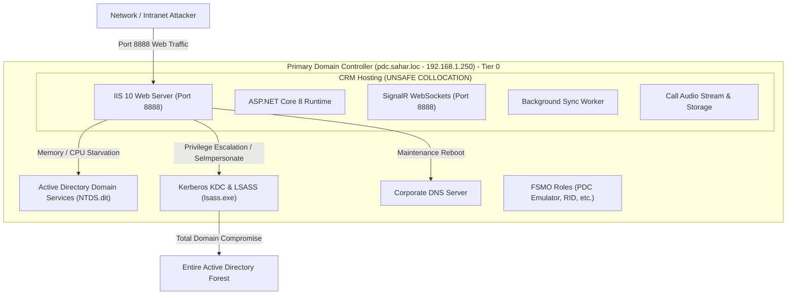

# ارزیابی ریسک معماری و امنیتی میزبانی سامانه روی کنترل‌کننده دامنه (PDC)
# ParkPalace CRM — Pre-Production Acceptance (PPA)
## Technical Risk Assessment: Deploying IIS & CRM on Primary Domain Controller (`pdc.sahar.loc`)

**پروژه:** سامانه جامع تدارکات و ارتباط با تأمین‌کنندگان پارک پالاس (ParkPalace Procurement CRM)  
**سند:** ارزیابی ریسک امنیتی و عملیاتی میزبانی روی PDC  
**مسیر پروژه:** `D:\ParkPlace`  
**سرور تحت بررسی:** `pdc.sahar.loc` (`192.168.1.250`) — کنترل‌کننده اصلی دامنه (Primary Domain Controller)  
**حالت ممیزی:** بررسی صرفاً خواندنی، تحلیل معماری و انطباق امنیتی (READ-ONLY AUDIT & PLANNING ONLY)  
**تاریخ انتشار:** ۲۶ مهر ۱۴۰۵ (2026-10-18)  
**نسخه:** ۱.۰.۰  

---

## ۱. خلاصه مدیریتی و هدف ممیزی (Executive Summary)

در جریان بررسی‌های پیش‌استقرار (PPA)، استقرار وب‌سرور IIS 10، ماژول ASP.NET Core 8 Hosting Bundle، وب‌سوکت‌های بلادرنگ SignalR، سرویس ورکر پس‌زمینه و فایل‌های نرم‌افزاری سامانه تدارکات پارک پالاس بر روی سرور `pdc.sahar.loc` (با آدرس IP `192.168.1.250`) به عنوان گزینه اولیه میزبانی مطرح شده است.

این سرور در حال حاضر به عنوان **Primary Domain Controller (PDC)** شبکه `sahar.loc`، متولی نگهداری پایگاه داده Active Directory (`NTDS.dit`)، ارائه‌دهنده سرویس احراز هویت متمرکز (Kerberos KDC / NTLM)، سرویس نام دامنه داخلی (DNS Server) و دارنده نقش‌های عملیاتی FSMO می‌باشد.

> [!CAUTION]
> **نتیجه قطعی ممیزی ارشد امنیت و زیرساخت:**  
> استقرار وب‌سایت سازمانی و نرم‌افزار کاربردی CRM بر روی Domain Controller، بر اساس استانداردهای امنیت سایبری مایکروسافت (Tier-0 Infrastructure Model)، چارچوب‌های CIS Benchmark و اصول مهندسی پایداری سامانه، **اکیداً مردود (FAIL / NO-GO)** است. موفقیت سامانه در پاس کردن آزمون‌های محیط Staging به هیچ عنوان توجیه‌کننده نادیده گرفتن خطرات بنیادی میزبانی وب روی کنترل‌کننده دامنه نمی‌باشد.

---

## ۲. ابعاد ده‌گانه مخاطرات استقرار روی Domain Controller



### ۲.۱. مخاطرات دسترسی‌پذیری سرویس‌های دامین و DNS (AD DS & DNS Availability)
* **عملکرد حیاتی PDC:** کلیه کلاینت‌ها، ایستگاه‌های کاری، فایل‌سرورها و سیستم‌های مالی کارخانه جهت لاگین، دریافت پالیسی‌های Group Policy، همگام‌سازی زمان (NTP) و ترجمه نام‌های دامنه‌ای به PDC وابسته‌اند.
* **اثر تداخل وب‌سرور:** چنانچه وب‌سرور IIS یا اپلیکیشن CRM دچار نشت حافظه (Memory Leak)، پردازش سنگین فیلترینگ گزارشات یا هجوم درخواست‌های همزمان شبکه گردد، فرآیندهای `lsass.exe` و `dns.exe` با کمبود ریسورس مواجه شده و کل شبکه داخلی سازمان دچار فلج در احراز هویت و قطعی نام‌گذاری خواهد شد.

### ۲.۲. گسترش سطح حمله (Attack Surface Expansion)
* **وضعیت فعلی PDC:** پورت‌های باز روی یک DC استاندارد صرفاً محدود به پورت‌های سیستمی و مدیریتی است (TCP 88 Kerberos, TCP/UDP 53 DNS, TCP 389/636 LDAP/LDAPS, TCP 445 SMB, TCP 135 RPC).
* **تأثیر میزبانی CRM:** باز کردن پورت TCP 8888 بر روی کنترل‌کننده دامنه برای دریافت درخواست‌های HTTP/HTTPS و اتصالات پایدار WebSocket از سراسر شبکه اداری، کنترل‌کننده دامنه را مستقیماً در معرض ترافیک و ورودی‌های کاربران قرار می‌دهد.

### ۲.۳. بحران هویت Application Pool و نبود پایگاه داده SAM محلی
* **عدم وجود Local Accounts:** کنترل‌کننده‌های دامنه ویندوز **فاقد پایگاه داده محلی SAM (Security Account Manager)** هستند. تمامی حساب‌ها در Active Directory عمومی ذخیره می‌شوند.
* **شکست ایزولاسیون استخری IIS:**
  * در سرورهای معمولی، Application Pool تحت هویت `IIS AppPool\DefaultAppPool` یا `IIS_IUSRS` اجرا می‌شود که دسترسی محدودی به سرور دارد.
  * در یک Domain Controller، قابلیت‌های ایزولاسیون محلی IIS کارایی خود را از دست می‌دهند. اجرای پروسس تحت حساب‌های پیش‌فرض سیستم عامل، اغلب به `NT AUTHORITY\NETWORK SERVICE` یا `LOCAL SYSTEM` نگاشت می‌شود که در کنترل‌کننده دامنه دارای دسترسی فوق‌العاده بالا به آبجکت‌های دامین است.
  * چنانچه یک Domain Service Account (`sahar\svc_crm`) تعریف شود، این اکانت در سطح کل دامین معتبر بوده و ایزوله به یک ماشین نیست.

### ۲.۴. مسیرهای ارتقای سطح دسترسی (Privilege Escalation Paths)
* **مجوز `SeImpersonatePrivilege`:** وب‌سرور IIS جهت اجرای احراز هویت Windows Authentication (Negotiate/Kerberos) نیازمند مجوز `SeImpersonatePrivilege` در پروسس `w3wp.exe` است.
* **بردار حمله Potato:** در محیط Domain Controller، هر پروسسی که دارای `SeImpersonatePrivilege` باشد، در صورت وجود حتی یک رخنه اجرای کد (RCE) یا تزریق دستور، می‌تواند از طریق اکسپلویت‌های خانواده Potato (مانند GodPotato, SweetPotato یا CoerceAuthentication) به دسترسی **`NT AUTHORITY\SYSTEM`** ارتقا یابد.
* **دسترسی سیستم روی DC = دسترسی ادمین کل سازمان:** به دست آوردن دسترسی `SYSTEM` روی Domain Controller به معنای کنترل فوری و ۱۰۰ درصدی پایگاه داده `NTDS.dit`، دسترسی به هش‌های NTLM کل پرسنل، و تسخیر کامل Forest دامین است.

### ۲.۵. تداخل منابع پردازشی و حافظه (Resource Contention)
* **رفتار Garbage Collection در .NET 8:** سامانه ASP.NET Core 8 در حالت Server GC، بخش بزرگی از RAM سرور را برای پرفورمنس بالا در هیپ‌های حافظه رزرو می‌کند.
* **رفتار حافظه NTDS و LSASS:** ماژول ESE (Extensible Storage Engine) دیتابیس اکتیودایرکتوری تلاش می‌کند حداکثر حافظه کش در دسترس را برای کش کردن دیتابیس دامین اشغال نماید.
* **سناریوی بحران:** تولید خروجی‌های حجیم گزارش‌گیری (گزارش‌های چند هزار سطری اقلام، فایل‌های اکسل)، باز کردن اتصالات وب‌سوکت توسط صدها کاربر و استریم فایل‌های صوتی مکالمات، منجر به رقابت بر سر RAM و I/O دیسک می‌شود که می‌تواند زمان احراز هویت Kerberos را از چند میلی‌ثانیه به چندین ثانیه افزایش داده و باعث خطاهای Time-out در کلاینت‌های شبکه شود.

### ۲.۶. تداخل در نگهداری، اصلاحیه‌ها و بازراه‌اندازی (Patch & Reboot Conflicts)
* **سیکل نگهداری CRM:** به‌روزرسانی کد وب‌سایت، ارتقای پکیج‌های نوگت، ارتقای ASP.NET Core Runtime و بازتولید سایت ممکن است نیازمند توقف IIS یا ری‌استارت دوره‌ای سیستم باشد.
* **تداخل با دامین:** ری‌استارت کردن یک کنترل‌کننده دامنه به منظور به‌روزرسانی یک وب‌سایت تجاری، باعث قطع شدن سرویس‌های احراز هویت، اختلال در عملکرد اتصالات سرورهای دیگر و قطع شدن دسترسی اشتراک‌های شبکه در ساعات کاری خواهد شد.

### ۲.۷. پیچیدگی پشتیبان‌گیری، بازیابی و خطر مرگبار USN Rollback
* **پشتیبان‌گیری System State:** پشتیبان‌گیری از یک Domain Controller باید با مکانیزم‌های خاص VSS و سازگار با اکتیودایرکتوری انجام شود.
* **ریسک بازگردانی دیتابیس روی سرور دامین:** چنانچه خطایی در دیتابیس CRM رخ دهد و ادمین بخواهد کل درایو یا اسنپ‌شات ماشین را بازیابی کند، این اقدام می‌تواند منجر به **USN Rollback** شود. بازگشت شمارنده USN در اکتیودایرکتوری موجب از کار افتادن همگام‌سازی (Replication) با سایر DCها، فساد پایگاه داده دامین و در نهایت انهدام ساختار هویتی سازمان می‌گردد.

### ۲.۸. افشای اطلاعات احراز هویت در حافظه (Credential Exposure)
* فرآیند `lsass.exe` بر روی Domain Controller، غنی‌ترین مخزن تیکت‌های Kerberos، هش‌های NTLM و کریدنشال‌های حساب‌های ارشد شبکه (Domain Admins) است.
* میزبانی وب‌سرور و پروسس‌های دات‌نت بر روی همین سرور، خطرات ناشی از حملات Memory Dumping را به شدت افزایش می‌دهد.

### ۲.۹. عدم انطباق با خطوط پایه امنیتی (Security Baseline Non-Compliance)
* کلیه مراجع امنیتی رسمی نظیر **Microsoft Security Compliance Toolkit (SCT)**، استانداردهای **DISA STIG** و بنچ‌مارک‌های **CIS Windows Server**:
  * به صراحت فعال‌سازی وب‌سرور IIS بر روی Domain Controller را ممنوع کرده‌اند.
  * سیاست‌های سخت‌گیرانه امنیتی کنترل‌کننده دامنه (Domain Controller GPO)، اجرای بسیاری از سرویس‌ها و پورت‌های جانبی را مسدود یا محدود می‌سازد که خود باعث خطاهای پیش‌بینی‌نشده در عملکرد وب‌اپلیکیشن خواهد شد.

---

## ۳. جدول مقایسه‌ای: میزبانی روی PDC در برابر سرور اختصاصی (Dedicated App Server VM)

| شاخص ارزیابی معماری و امنیت | میزبانی روی Domain Controller (`pdc.sahar.loc`) | میزبانی روی ماشین اختصاصی (`app-crm.sahar.loc`) | ارزیابی استاندارد |
| :--- | :--- | :--- | :---: |
| **سطح ایزولاسیون امنیتی** | **صفر (Tier-0 نقض شده است)** | **کامل (سرور تک‌ماشین عضو دامین در سطح Tier-1)** | ماشین اختصاصی CRM |
| **ایزولاسیون هویت AppPool** | غیرممکن (نبود SAM محلی و ارتقا به حساب‌های دامین) | کاملاً ایزوله با `IIS AppPool\ParkPalaceCRM` | ماشین اختصاصی CRM |
| **پیامد آسیب‌پذیری احتمالی وب** | **تسخیر کل اکتیودایرکتوری و دامین سحر** | نهایتاً دسترسی محدود به همان سرور وب | ماشین اختصاصی CRM |
| **تداخل پردازنده و حافظه** | تداخل شدید با `lsass.exe` و `NTDS.dit` | مدیریت حافظه با سقف ۲۰ گیگابایت برای SQL Server | ماشین اختصاصی CRM |
| **پایداری سرویس DNS و دامین** | در معرض ریسک نشت حافظه یا کرش وب‌سایت | پایداری ۱۰۰٪ سرویس‌های هویتی شرکت | ماشین اختصاصی CRM |
| **مدیریت ری‌استارت و پچ‌ها** | نیازمند هماهنگی قطعی کل سازمان جهت ریبوت | امکان ری‌استارت وب‌سرور در هر زمان بدون قطعی دامین | ماشین اختصاصی CRM |
| **پشتیبان‌گیری و بازگردانی** | بسیار پیچیده و دارای ریسک تخریب USN اکتیودایرکتوری | بسیار ساده (اسنپ‌شات استاندارد و پشتیبان SQL به NAS) | ماشین اختصاصی CRM |
| **انطباق با ممیزی و استاندارد** | **مردود بر اساس استانداردهای مایکروسافت و CIS** | **منطبق بر بهترین الگوهای سازمانی (Best Practice)** | ماشین اختصاصی CRM |

---

## ۴. استراتژی معماری مصوب تک‌ماشین مجازی (Target Single VM Topology - VM-01)

```
[ Active Directory Infrastructure ]
  └─ pdc.sahar.loc (192.168.1.250) ──────────► صرفاً متولی احراز هویت Kerberos/LDAP و DNS
                                                       ▲
                                                       │ (Windows Negotiate / Kerberos)
[ Single Host Layer (Approved VM-01: CRM - 192.168.1.248) ] │
  └─ crm.sahar.loc (عضو دامین / ساب‌نت اداری / پورت ۸۰) ───┤
       ├─ IIS 10 (Port 80 / HTTP)
       ├─ ASP.NET Core 8 Runtime + React SPA
       ├─ SignalR WebSockets (Port 80)
       ├─ Telephony / Storage Worker
       └─ SQL Server 2022 (Local Only - Max RAM 20 GB) ──► دیتابیس CRM (ParkPalaceCRM_DB)
                                                       │
                                                       ▼
[ Integration Layer (External Hosts & Storage) ]
  ├─ Off-VM Backup Repository (\\nas.sahar.loc\backups\CRM) ──► مخزن بک‌آپ شبکه
  ├─ Sepidar ERP Host (192.168.1.242,62753) ──────────────────► پایگاه داده سپیدار (دسترسی SELECT-Only)
  └─ Issabel PBX (192.168.1.241) ─────────────────────────────► پورت 5038 AMI و آرشیو ضبط مکالمات
```

---

## ۵. نتیجه‌گیری و حکم نهایی ارزیابی ریسک PDC

1. **حکم قطعی: مردود (UNSUITABLE / HIGH RISK FOR PRODUCTION).**  
   اجرای سامانه تدارکات پارک پالاس بر روی سرور کنترل‌کننده دامنه (`pdc.sahar.loc`) به دلیل نقض حریم‌های امنیتی Tier-0، خطرات ارتقای سطح دسترسی و احتمال از کار افتادن سرویس‌های هویتی سازمان، به هیچ عنوان مورد تأیید فنی و امنیتی نمی‌باشد.
2. **اقدام الزامی:** استقرار عملیاتی سامانه منحصراً بر روی ماشین مجازی اختصاصی **`CRM` (طرح تک‌ماشین VM-01)** پیگیری شود و سرور PDC صرفاً نقش مرجع احراز هویت شبکه را ایفا نماید.
