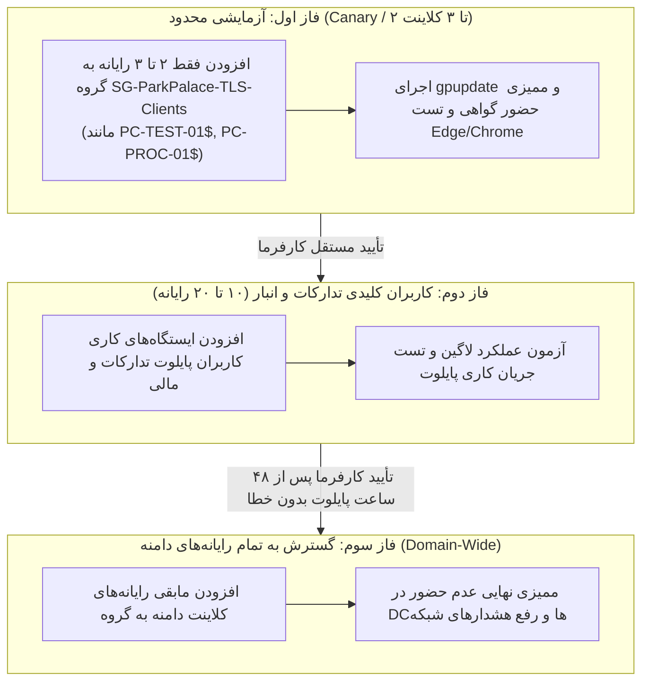
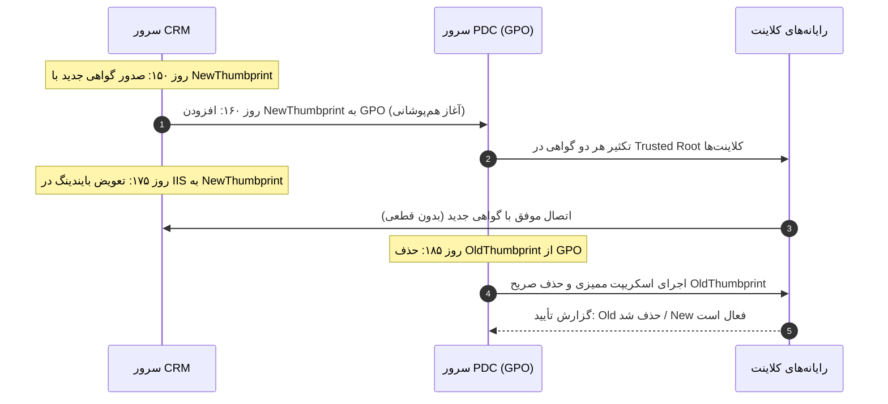

# سند طرح جامع استقرار اعتماد گواهینامه TLS در سطح دامنه (Domain-Wide Trust Framework)
# ParkPalace CRM — Active Directory Group Policy (GPO) TLS Deployment & Governance Plan
## نسخه ۲.۰.۰ — بازبینی‌شده بر اساس الزامات تکمیلی کارفرما (Final Corrections)

**پروژه:** سامانه جامع تدارکات و مدیریت ارتباط با تأمین‌کنندگان پارک پالاس (ParkPalace CRM)  
**سند:** `D:\ParkPlace\docs\ParkPalace_DomainWide_TLS_Trust_Plan.md`  
**تاریخ بازبینی:** ۲۶ مهر ۱۴۰۵ (18 اکتبر 2026)  
**نسخه:** ۲.۰.۰ (طرح نهایی بازبینی‌شده — بدون اجرای عملیاتی)  
**دامنه هدف:** `sahar.loc`  
**نام سرویس:** `crm.sahar.loc`  
**سرور میزبان CRM:** ماشین مجازی `CRM` (`192.168.1.248`)  
**سرور کنترلر دامنه:** `PDC` (`192.168.1.250`)  
**رأی پیشنهادی طرح:** **CONDITIONAL GO برای فاز آماده‌سازی کلاینت‌های آزمایشی / STRICT NO-GO برای اعمال خودکار و تغییرات عملیاتی تا صدور مجوز مستقل**  

---

> [!IMPORTANT]
> **محدوده اختیارات و عدم اجرای عملیاتی (Mandatory Hold):**  
> مطابق دستور اکید کارفرما:
> ۱. **هیچ GPO ایجاد یا Link نشده است.**
> ۲. **هیچ گواهینامه‌ای در شبکه توزیع نشده است.**
> ۳. **هیچ تغییری روی PDC، DNS، IIS یا فایروال انجام نشده است.**
> ۴. این سند صرفاً چارچوب مهندسی و تحلیل ساختار زیرساخت است و آغاز هر اقدام مستلزم صدور مجوز رسمی مستقل از سوی کارفرما خواهد بود.

---

## ۱. ممیزی وضعیت ساختار اکتیودایرکتوری، OUها و عضویت رایانه‌ها (Read-Only Audit)

### ۱.۱. وضعیت استخراج‌شده از سوابق و شواهد تاریخی
* **دامنه:** دامنه تک‌دامنه `sahar.loc` با کنترل‌کننده اصلی دامنه (PDC) به نشانی `192.168.1.250` روی Windows Server 2022.
* **زیرساخت گواهی (CA):** تأیید قطعی مبنی بر نبود هیچ‌گونه سرویس AD CS یا CA داخلی در دامنه؛ لذا راهکار گواهینامه اختصاصی Self-Signed با شرط `CA=FALSE` مبنای معماری است.
* **کانتینرهای پیش‌فرض اکتیودایرکتوری:**
  * ریشه دامنه: `DC=sahar,DC=loc`
  * کنترلرهای دامنه: `OU=Domain Controllers,DC=sahar,DC=loc`
  * کانتینر پیش‌فرض رایانه‌ها: `CN=Computers,DC=sahar,DC=loc` (توجه: کانتینرهای پیش‌فرض CN قابلیت پیوند مستقیم GPO ندارند و نیازمند پیوند در سطح ریشه با Security Filtering یا انتقال رایانه‌ها به OU هستند).

### ۱.۲. دستورات صرفاً خواندنی (Read-Only) جهت اجرای ممیزی ساختار توسط ادمین دامین روی PDC
جهت احراز دقیق چیدمان OUها، فهرست رایانه‌ها و پالیسی‌های فعال پیش از هر اقدام، فرامین خواندنی زیر بر روی کنسول PDC اجرا می‌شوند (فاقد هرگونه تغییر یا اثر جانبی):
```powershell
# ۱. استخراج درخت کامل واحدهای سازمانی (OU Hierarchy)
Get-ADOrganizationalUnit -Filter * -Properties CanonicalName, DistinguishedName | 
    Select-Object Name, CanonicalName, DistinguishedName | 
    Sort-Object CanonicalName | Format-Table -AutoSize

# ۲. استعلام کلیه رایانه‌های عضو دامنه، سیستم‌عامل و کانتینر والد آن‌ها
Get-ADComputer -Filter * -Properties OperatingSystem, Enabled, CanonicalName, MemberOf | 
    Select-Object Name, OperatingSystem, Enabled, CanonicalName | 
    Sort-Object CanonicalName | Format-Table -AutoSize

# ۳. استعلام کلیه GPOهای موجود و وضعیت پیوند (Link) آن‌ها
Get-GPO -All | 
    Select-Object DisplayName, Id, GpoStatus, CreationTime, ModificationTime | 
    Format-Table -AutoSize

# ۴. استعلام گروه‌های امنیتی موجود در دامنه مرتبط با کلاینت‌ها
Get-ADGroup -Filter "Name -like '*Computer*' -or Name -like '*Client*' -or Name -like '*Workstation*'" | 
    Select-Object Name, GroupScope, GroupCategory, DistinguishedName | Format-Table -AutoSize
```

---

## ۲. طراحی گروه امنیتی اختصاصی و فیلترینگ توزیع (Target Security Group & Filtering)

### ۲.۱. ایجاد گروه امنیتی اختصاصی: `SG-ParkPalace-TLS-Clients`
به جای توزیع کورکورانه در سطح کل اشیای دامنه، یک گروه امنیتی فراگیر در اکتیودایرکتوری تعریف می‌شود:
* **نام گروه:** `SG-ParkPalace-TLS-Clients`
* **نوع گروه:** Global Security Group
* **مسیر ایجاد:** `OU=Groups` (یا کانتینر مصوب مدیر دامین)
* **فلسفه طراحی:** توزیع تدریجی و مرحله‌به‌مرحله؛ ابتدا صرفاً رایانه‌های کلاینت آزمایشی عضو این گروه می‌شوند و پس از صحه‌گذاری، سایر رایانه‌ها به تدریج اضافه می‌گردند.

### ۲.۲. استثنا کردن صریح و قطعی Domain Controllerها
سرورهای کنترل‌کننده دامنه به دلایل امنیتی اکیداً نباید به گواهینامه‌های سلف‌سایند وب اعتماد کنند:
1. **عدم عضویت در گروه:** اکانت رایانه‌ای `PDC$` یا هر سرور DC دیگر هرگز عضو گروه `SG-ParkPalace-TLS-Clients` نخواهد شد.
2. **استثنا کردن در سطح Delegation پالیسی (Explicit Deny):**  
   در تب *Delegation -> Advanced* در کنسول GPMC، به گروه **`Domain Controllers`** دسترسی **`Deny: Apply Group Policy`** اعطا می‌شود.
3. **عدم پیوند به کانتینر DCها:** پالیسی به هیچ عنوان به `OU=Domain Controllers,DC=sahar,DC=loc` پیوند نخواهد شد.
4. **دستور اعتبارسنجی روی PDC:**
   ```powershell
   # این دستور روی PDC اجرا می‌شود و باید حتماً خروجی False بازگرداند (عدم حضور گواهی):
   Test-Path "Cert:\LocalMachine\Root\$Thumbprint"
   ```

---

## ۳. طراحی GPO اختصاصی: `ParkPalace-CRM-TLS-Trust`

### ۳.۱. مشخصات فنی پالیسی
* **نام GPO:** `ParkPalace-CRM-TLS-Trust`
* **مسیر تزریق کلید عمومی:**
  `Computer Configuration → Policies → Windows Settings → Security Settings → Public Key Policies → Trusted Root Certification Authorities`
* **محتوا:** منحصراً گواهینامه عمومی `crm.sahar.loc.cer` با مشخصات: RSA 3072-bit، SHA-256، SAN برابر `DNS:crm.sahar.loc, DNS:crm`، کاربرد Server Authentication و شرط حیاتی **`Basic Constraints: CA=FALSE`**.
* **عدم ویرایش پالیسی‌های پیش‌فرض:** دستکاری `Default Domain Policy` یا `Default Domain Controllers Policy` **اکیداً ممنوع** است.

### ۳.۲. چیدمان پیوند و Security Filtering
* **محل پیوند (GPO Link):** در سطح ریشه دامنه (`DC=sahar,DC=loc`) یا OU تجمیعی ایستگاه‌های کاری (در صورت وجود).
* **تنظیمات Security Filtering:**
  * گروه پیش‌فرض `Authenticated Users` از لیست اعمال پالیسی حذف می‌شود (صرفاً دسترسی `Read` به آن داده می‌شود تا بتواند ساختار را بخواند).
  * گروه **`SG-ParkPalace-TLS-Clients`** با مجوزهای **`Read`** و **`Apply Group Policy`** جایگزین می‌گردد.

---

## ۴. برنامه فازبندی‌شده توزیع (Canary Deployment & Rollout Schedule)



* **فاز اول (کلاینت‌های آزمایشی محدود — ۲ تا ۳ سیستم):**
  * عضویت صرفاً ۲ یا ۳ کلاینت مشخص (مانند ایستگاه کاری ادمین تست و یک کاربر تدارکات).
  * اجرای آزمون، پایش پایداری و اطمینان از عملکرد شفاف بدون هشدار.
* **فاز دوم (توسعه به کاربران عملیاتی پایلوت — ۱۰ تا ۲۰ سیستم):**
  * پس از تأیید کتبی نتایج فاز اول، افزودن سیستم‌های انبار، تدارکات و حسابداری.
* **فاز سوم (گسترش سراسری به تمامی کلاینت‌های دامین):**
  * پس از سپری شدن دوره پایلوت و کسب اطمینان کامل، افزودن سایر ایستگاه‌های کاری شبکه به عضویت گروه.

---

## ۵. تأثیر GPO بر مرورگرها و مخازن اعتماد ویندوز (Impact Analysis)

1. **سازوکار ثبت در رجیستری ویندوز (CAPI2 Store):**  
   موتور Group Policy گواهینامه را در مسیر فیزیکی رجیستری زیر تزریق می‌کند:
   `HKLM\SOFTWARE\Microsoft\SystemCertificates\ROOT\Certificates\<Thumbprint>`
2. **مرورگرهای Microsoft Edge و Google Chrome:**  
   هر دو مرورگر در سیستم‌عامل ویندوز به صورت بی‌درنگ از Windows CryptoAPI استفاده می‌کنند. به محض دریافت پالیسی، در اولین فراخوانی HTTPS زنجیره اعتماد معتبر شناخته شده و آیکون **قفل بسته (Secure Lock)** بدون نیاز به ریستارت مرورگر نمایش داده می‌شود.
3. **مرورگر Mozilla Firefox (در صورت وجود در سازمان):**  
   فایرفاکس دارای مخزن مستقل NSS است؛ جهت پذیرش گواهی‌های رجیستری ویندوز باید کلید رجیستری زیر از قبل فعال باشد (که در اکثر سازمان‌ها تنظیم است):
   `HKLM\SOFTWARE\Policies\Mozilla\Firefox\Certificates\ImportEnterpriseRoots = 1`
4. **سایر نرم‌افزارهای تحت ویندوز (.NET / PowerShell / WinHTTP):**  
   تمام ابزارهای خط فرمان و برنامه‌های تجاری مستقر در ویندوز بدون هیچ هشداری به سرور CRM متصل خواهند شد.
5. **عدم تداخل با سایر مراجع صدور گواهی:**  
   این GPO صرفاً یک کلید عمومی مشخص را اضافه می‌کند و هیچ تغییری در گواهینامه‌های ریشه جهانی و تجاری (DigiCert, Sectigo, Microsoft) ایجاد نمی‌نماید.

---

## ۶. تفکیک امنیت انتقال از دسترسی کاربردی (Transport vs Application Authorization)

> [!CAUTION]
> **اعتماد TLS فقط امنیت کانال است و به هیچ عنوان دسترسی به اطلاعات را باز نمی‌کند.**

توزیع گواهینامه برای رفع هشدارهای قرمز مرورگر است. امنیت داده‌های CRM در سه لایه مستقل کنترل می‌شود:
* **فایروال سرور CRM:** پورت ۴۴۳ سرور CRM صرفاً برای ساب‌نت اداری باز است.
* **احراز هویت ویندوز (Windows Auth):** کاربر توسط دات‌نت شناسایی می‌شود.
* **کنترل دسترسی نقشی (RBAC در دیتابیس CRM):** تنها کاربران دارای نقش مصوب در جدول `UserRoles` (تدارکات، انبار، مالی، ادمین) قادر به مشاهده اطلاعات هستند. سایر کاربران دامنه با خطای **۴۰۳ (عدم دسترسی)** مواجه می‌شوند.

---

## ۷. فرآیند تمدید ۱۸۰ روزه و ممیزی حذف صریح نسخه قبلی (Auditable Lifecycle)



* **ممیزی حذف نسخه قبلی:**  
  جهت جلوگیری از انباشت گواهی‌های خودامضای منسوخ در رجیستری کلاینت‌ها، پس از سوئیچ کامل، اسکریپت ممیزی زیر در کلاینت‌ها اجرا شده و نتیجه بررسی می‌شود:
  ```powershell
  # اسکریپت ممیزی و حذف صریح نسخه منقضی‌شده بر اساس Thumbprint:
  $oldThumbprint = "OLD_THUMBPRINT_HEX"
  $newThumbprint = "NEW_THUMBPRINT_HEX"

  # ۱. بررسی حضور گواهی جدید
  $hasNew = Test-Path "Cert:\LocalMachine\Root\$newThumbprint"
  
  # ۲. حذف صریح گواهی قدیمی در صورت وجود
  if (Test-Path "Cert:\LocalMachine\Root\$oldThumbprint") {
      Get-ChildItem -Path Cert:\LocalMachine\Root | 
          Where-Object { $_.Thumbprint -eq $oldThumbprint } | 
          Remove-Item -Force
  }
  
  # ۳. اعتبارسنجی نهایی وضعیت کلاینت
  $hasOld = Test-Path "Cert:\LocalMachine\Root\$oldThumbprint"
  [PSCustomObject]@{
      ComputerName = $env:COMPUTERNAME
      NewCertActive = $hasNew
      OldCertPurged = (-not $hasOld)
      AuditPassed   = ($hasNew -and (-not $hasOld))
  }
  ```

---

## ۸. روش بازگشت صریح (Explicit Rollback Procedure) و رد فرضیه حذف خودکار

> [!WARNING]
> **تصحیح فنی حیاتی: گواهینامه‌های Root با Unlink شدن GPO به صورت خودکار حذف نمی‌شوند.**  
> در پشته امنیتی ویندوز، گواهی‌هایی که وارد مخزن `LocalMachine\Root` شده‌اند پس از حذف یا لغو پیوند GPO در رجیستری کلاینت باقی می‌مانند. لذا روش Rollback باید کاملاً صریح و مبتنی بر حذف مستقیم با Thumbprint باشد.

### مراحل بازگشت صریح و مستقل:
1. **لغو پیوند GPO:** غیرفعال‌سازی یا حذف لینک GPO `ParkPalace-CRM-TLS-Trust` در کنترلر دامنه.
2. **اجرای دستور صریح حذف بر اساس Thumbprint روی کلاینت‌ها:**
   ```powershell
   $targetThumbprint = "TARGET_THUMBPRINT_HEX"
   Get-ChildItem -Path Cert:\LocalMachine\Root | 
       Where-Object { $_.Thumbprint -eq $targetThumbprint } | 
       Remove-Item -Force
   ```
3. **اعتبارسنجی قطعی حذف از مخزن کلاینت:**
   ```powershell
   # نتیجه باید به صورت قطعی False بازگردد:
   Test-Path "Cert:\LocalMachine\Root\$targetThumbprint"
   ```
4. **توقف امن سرویس وب (Fail-Closed):**  
   حذف بایندینگ ۴۴۳ در IIS و توقف سایت؛ اکیداً هیچ ترافیکی به صورت پیش‌فرض به HTTP ناامن (پورت ۸۰) بازگردانده نخواهد شد.

---

## ۹. ماتریس فازهای اجرایی، معیارهای پذیرش و روش‌های بازگشت مستقل

| فاز عملیاتی | دامنه و هدف | معیار پذیرش مستقل (Acceptance Criteria) | روش بازگشت مستقل (Independent Rollback) |
| :---: | :--- | :--- | :--- |
| **گام ۱: ممیزی Read-Only** | PDC و کلاینت‌ها | خروجی کامل درخت OUها، لیست رایانه‌ها و تایید عدم وجود خطا. | فاقد اثر عملیاتی (نیاز به بازگشت ندارد). |
| **گام ۲: ایجاد گروه امنیتی** | Active Directory | ایجاد گروه `SG-ParkPalace-TLS-Clients` و عضویت ۲ تا ۳ کلاینت آزمایشی. | حذف گروه امنیتی: `Remove-ADGroup SG-ParkPalace-TLS-Clients`. |
| **گام ۳: پیکربندی GPO آزمایشی** | ساخت GPO در PDC | پیوند به ریشه با فیلترینگ گروه و Deny صریح به DCها. تایید عدم اعمال به PDC. | حذف پیوند (Unlink) یا حذف شیء GPO. |
| **گام ۴: صحه‌گذاری فاز اول (Canary)** | ۲ تا ۳ کلاینت تست | وجود گواهی در مخزن کلاینت تست (`Test-Path = True`)، تایید قفل سبز در Edge/Chrome بدون `-k` و عدم حضور در PDC (`Test-Path = False`). | اجرای اسکریپت حذف صریح با Thumbprint روی ۲ کلاینت تست و حذف اکانت آن‌ها از گروه امنیتی. |
| **گام ۵: گسترش مرحله‌ای (Rollout)** | کاربران تدارکات و دامین | اعمال تدریجی پالیسی به سایر رایانه‌ها، گزارش ممیزی سبز در کلاینت‌ها و تایید عدم بروز اختلال. | حذف گروه‌ها از عضویت `SG-ParkPalace-TLS-Clients` و اجرای اسکریپت پاکسازی صریح با Thumbprint. |
| **گام ۶: تمدید و پاکسازی دوره‌ای** | سرور CRM و دامین | نصب هم‌پوشان گواهی جدید، سوئیچ بایندینگ IIS و گزارش ممیزی مبنی بر `OldCertPurged = True`. | بازگرداندن بایندینگ IIS به گواهی قبلی (در صورت عدم انقضا) یا تمدید مجدد کلید. |

---

## ۱۰. جمع‌بندی و رأی پیشنهادی مهندسی (Decision Matrix & GO/NO-GO)

* **وضعیت فعلی عملیات:** **STRICT NO-GO برای اعمال تغییرات لایو زیرساخت** (هیچ تغییری در PDC، دامین، فایروال یا سرور CRM داده نشده است).
* **رأی پیشنهادی برای گام بعدی:** **CONDITIONAL GO منحصراً برای فاز ممیزی Read-Only و آماده‌سازی گروه امنیتی آزمایشی (فاز Canary)** منوط به ابلاغ مجوز رسمی کارفرما.
