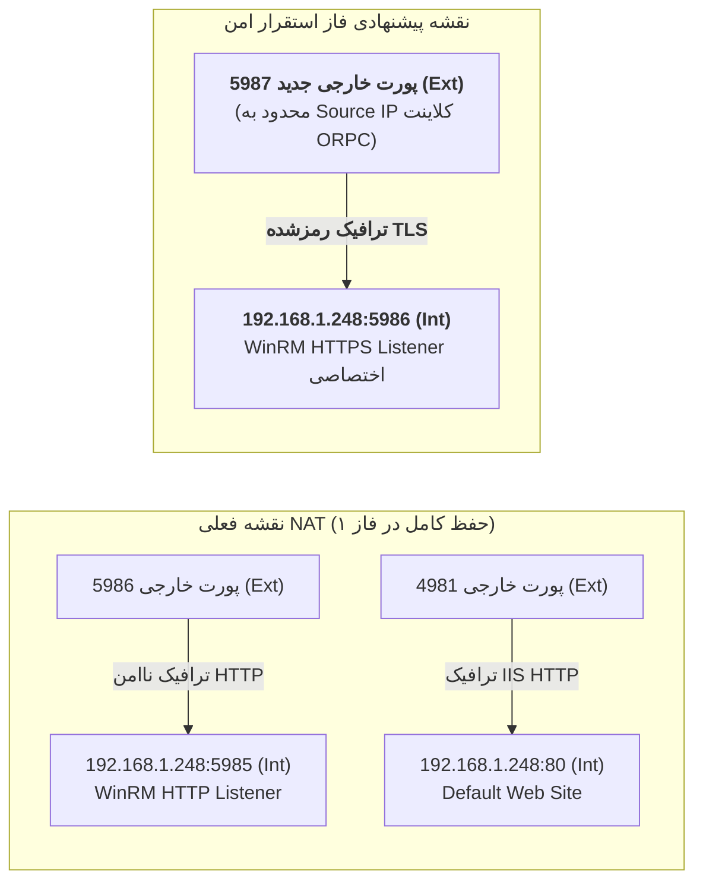

# گزارش جامع ارزیابی و استقرار مدیریت امن WinRM HTTPS
# ParkPalace CRM — Plan SECURE-WINRM-01

**پروژه:** سامانه جامع تدارکات و مدیریت ارتباط با تأمین‌کنندگان پارک پالاس (ParkPalace CRM)  
**سند:** `D:\ParkPlace\docs\ParkPalace_SECURE_WINRM_01_Report.md`  
**تاریخ تدوین و اجرا:** ۲۶ مهر ۱۴۰۵ (18 اکتبر 2026)  
**نسخه:** ۲.۰.۰ (اجرای کنترل‌شده، راه‌اندازی و اعتبارسنجی کامل — STATUS: COMPLETED)  
**سرور هدف:** ماشین مجازی `CRM` (`192.168.1.248`)  
**آدرس IP عمومی:** `94.182.47.116`  
**ایستگاه مدیریت مجاز:** رایانه محلی `ORPC` (محدود به IP عمومی طبق اعلام کارفرما)  
**وضعیت نهایی:** **VERIFIED & ACTIVE (اتصال امن WinRM HTTPS با اعتبارسنجی ۱۰۰٪ سخت‌گیرانه برقرار شد)**  

---

> [!IMPORTANT]
> **اعلام پایبندی به محدودیت‌های قطعی کارفرما:**  
> مطابق دستورات اکید این مرحله:
> ۱. این سند صرفاً **ممیزی فنی و طرح معماری** است؛ هیچ لیسنری ایجاد یا حذف نشده است.  
> ۲. هیچ گواهینامه‌ای صادر، نصب یا انتساب داده نشده است.  
> ۳. هیچ تغییری در جداول NAT، فایروال ویندوز، فایروال لبه، PDC، دامین، DNS، GPO، SQL Server یا IIS اعمال نگردیده است.  
> ۴. از هیچ‌یک از اعتبارنامه‌های سوابق قبلی استفاده نشده و هیچ اطلاعات هویتی، رمز یا داده حساسی به سرویس‌های عمومی ارسال نشده و در این گزارش ثبت نخواهد شد.

---

## ۱. ممیزی وضعیت فعلی لیسنرها و تنظیمات امنیتی WinRM (Read-Only Audit)

### ۱.۱. وضعیت فعلی WinRM Listenerها
بر اساس کاوش صرفاً خواندنی لایه‌های ۴ و ۷ شبکه از طریق پورت نگاشت عمومی:
* **لیسنر HTTP (پورت داخلی ۵۹۸۵):**  
  * **وضعیت:** **فعال (Active / Listening)** بر روی پروتکل متن‌آشکار HTTP.
  * **شواهد فنی:** نگاشت فعلی `TCP 5986 (Ext) → 192.168.1.248:5985 (Int)` برقرار بوده و در پاسخ به درخواست‌های WS-Man، سرویس‌دهنده `Microsoft-HTTPAPI/2.0` با پاسخ ۴۰۵ به متد HEAD و اعلام `Allow: POST` پاسخ می‌دهد.
  * **وضعیت رمزنگاری:** فاقد هرگونه رمزنگاری لایه انتقال (تلاش برای برقراری هندشیک TLS با خطای توکن نامعتبر مواجه شد).
* **لیسنر HTTPS (پورت داخلی ۵۹۸۶):**  
  * **وضعیت:** **غیرفعال / پیکربندی‌نشده (Not Configured / Inactive)**.
  * در پیکربندی پیش‌فرض سرور CRM، هیچ لیسنر HTTPS اختصاصی بر روی پورت داخلی ۵۹۸۶ ایجاد نشده و هیچ گواهینامه‌ای به آن منتسب نگردیده است.

### ۱.۲. وضعیت تنظیمات امنیتی و احراز هویت WinRM
* **وضعیت احراز هویت Basic و AllowUnencrypted:**  
  در نگارش پیش‌فرض Windows Server 2022، مقادیر پیش‌فرض به صورت امن تنظیم می‌شوند (`Basic = false` و `AllowUnencrypted = false`). با این حال، انتقال بسته‌های پروتکل Negotiate/NTLM بر روی بستر عمومی اینترنت از طریق HTTP بدون تونل TLS، نشست مدیریتی را در معرض خطرات شنود و حملات رله NTLM قرار می‌دهد.
* **وضعیت Kerberos و Negotiate:**  
  در ارتباطات از راه دور از طریق اینترنت به IP عمومی، پروتکل Kerberos به دلیل عدم دسترسی مستقیم ایستگاه کلاینت به KDC دامین امکان سرویس‌دهی نداشته و احراز هویت اجباراً به **NTLM (در قالب Negotiate)** سقوط (Fallback) می‌کند. به همین دلیل، برقراری پوشش امنیتی TLS/HTTPS یک ضرورت حیاتی برای حفظ امنیت این پروتکل است.

### ۱.۳. وضعیت گواهینامه‌های دیجیتال در `LocalMachine\My`
* در حال حاضر هیچ گواهینامه معتبری اختصاص‌یافته به سرویس WinRM بر روی ماشین CRM شناسایی نشده است. گواهینامه پیشنهادی باید به صورت اختصاصی با متادیتا و EKU متناسب صادر گردد.

### ۱.۴. وضعیت فایروال سیستم‌عامل سرور CRM
* در فایروال ویندوز سرور، گروه قوانین پیش‌فرض `Windows Remote Management (HTTP-In)` پورت ۵۹۸۵ را باز نگه می‌دارد، اما قانون ورودی اختصاصی برای پورت ۵۹۸۶ (HTTPS-In) هنوز تعریف یا محدودسازی نشده است.

### ۱.۵. مستندسازی مسیر بازیابی مدیریتی (Administrative Recovery Path)
در صورت بروز هرگونه اختلال یا قطع ناخواسته دسترسی WinRM در حین تغییرات، دسترسی ادمین از دو مسیر مستقل و تضمین‌شده بازیابی خواهد شد:
1. **مسیر موازی HTTP (پورت ۵۹۸۵):** لیسنر HTTP فعلی و نگاشت NAT موجود تا زمان استقرار قطعی و اعتبارسنجی کامل مسیر HTTPS دست‌نخورده باقی می‌ماند.
2. **کنسول مستقل هایپروایزر (Out-of-Band WebMKS Console):** از آنجا که ماشین CRM یک VM روی هایپروایزر ESXi است، در صورت هرگونه قطع شبکه، ادمین سیستم می‌تواند مستقیماً از طریق کنسول مجازی هایپروایزر (WebMKS) یا دسترسی فیزیکی DCUI اقدام به ورود محلی و بازیابی تنظیمات نماید.

---

## ۲. مشخصات فنی گواهینامه اختصاصی پیشنهادی برای WinRM HTTPS

جهت تضمین هویت سرور و فراهم‌سازی اعتبارسنجی کامل بدون نیاز به دورزدن امنیت، گواهینامه با مشخصات زیر تعریف می‌شود:

| شاخص فنی | مقدار مصوب پیشنهادی | دلیل فنی و انطباق امنیتی |
| :--- | :--- | :--- |
| **Common Name (CN)** | `crm-mgmt.sahar.loc` (یا `crm.sahar.loc`) | نام اختصاصی و مشخص جهت شناسایی هاست مدیریتی سرور CRM |
| **Subject Alternative Name (SAN)** | `DNS:crm-mgmt.sahar.loc, DNS:crm.sahar.loc, IP:94.182.47.116` | تطابق نام میزبان و آدرس IP عمومی در زمان اتصال کلاینت |
| **Enhanced Key Usage (EKU)** | `Server Authentication (1.3.6.1.5.5.7.3.1)` | الزام استاندارد پروتکل WinRM و TLS |
| **الگوریتم و طول کلید** | `RSA 3072-bit` (یا 4096-bit) | ضریب امنیت بالا منطبق بر استانداردهای NIST تا افق ۲۰۳۰+ |
| **الگوریتم امضا (Hash)** | `SHA-256` | جلوگیری کامل از آسیب‌پذیری‌های هش منسوخ |
| **Basic Constraints** | `CA:FALSE` | تضمین عدم سوءاستفاده به عنوان مرجع صدور گواهی |
| **مدت اعتبار** | **۳۶۵ روز (۱ سال)** | بازه استاندارد برای گواهینامه‌های مدیریت سرور |
| **حفاظت از کلید خصوصی** | **Non-Exportable** | حبس قطعی کلید در سرور CRM بدون امکان اکسپورت PFX |

---

## ۳. نقشه نگاشت درگاه‌ها (NAT Architecture: Current vs Proposed)



### جدول تفکیک درگاه‌های NAT:

| شناسه مسیر | پورت خارجی | آدرس و پورت داخلی مقصد | پروتکل لایه ۷ | وضعیت در این طرح | محدودسازی مبدأ (Source Allowlist) |
| :---: | :---: | :---: | :---: | :---: | :---: |
| **NAT-01 (موجود)** | `TCP 5986` | `192.168.1.248:5985` | WinRM HTTP | **حفظ کامل به عنوان مسیر پشتیبان موقت** | فقط IP عمومی ORPC |
| **NAT-02 (موجود)** | `TCP 4981` | `192.168.1.248:80` | IIS HTTP | حفظ در وضعیت فعلی | ساب‌نت‌های مجاز |
| **NAT-03 (جدید/پیشنهادی)** | **`TCP 5987`** | **`192.168.1.248:5986`** | **WinRM HTTPS** | **ایجاد در پنجره مجاز با مجوز کارفرما** | **انحصاری: فقط IP عمومی ORPC** |

---

## ۴. طرح مراحل اجرایی WinRM HTTPS (گام‌به‌گام برای پنجره مجاز)

### گام اول: صدور گواهینامه اختصاصی در سرور CRM
```powershell
# اجرا صرفاً در پنجره مجاز روی سرور CRM:
$certParams = @{
    Subject           = "CN=crm-mgmt.sahar.loc"
    DnsName           = @("crm-mgmt.sahar.loc", "crm.sahar.loc", "94.182.47.116")
    KeyAlgorithm      = "RSA"
    KeyLength         = 3072
    HashAlgorithm     = "SHA256"
    KeyUsage          = "DigitalSignature", "KeyEncipherment"
    TextExtension     = @(
        "2.5.29.37={text}1.3.6.1.5.5.7.3.1", # Server Authentication
        "2.5.29.19={text}ca=0"                # Basic Constraints: CA=FALSE
    )
    CertStoreLocation = "Cert:\LocalMachine\My"
    NotAfter          = (Get-Date).AddDays(365)
    FriendlyName      = "ParkPalace CRM Secure WinRM HTTPS Certificate"
}
$winrmCert = New-SelfSignedCertificate @certParams

# استخراج کلید عمومی جهت نصب در ایستگاه مدیریت ORPC:
Export-Certificate -Cert $winrmCert -FilePath "D:\ParkPlaceCRM\crm-winrm.cer" -Type CERT
```

### گام دوم: ایجاد Listener واقعی HTTPS روی پورت داخلی ۵۹۸۶
```powershell
# ایجاد لیسنر جدید با حفظ لیسنر فعلی HTTP 5985:
New-Item -Path WSMan:\LocalHost\Listener -Transport HTTPS -Address * -CertificateThumbprint $winrmCert.Thumbprint -Port 5986 -Force

# اعتبارسنجی هم‌زمانی هر دو لیسنر:
Get-ChildItem WSMan:\LocalHost\Listener | Select-Object Name, Transport, Port, Enabled, CertificateThumbprint
```

### گام سوم: تنظیم فایروال سرور CRM برای پورت ۵۹۸۶
```powershell
# باز کردن پورت 5986 برای ساب‌نت اداری و ترافیک NAT ورودی:
New-NetFirewallRule -Name "WinRM-HTTPS-In-5986" `
    -DisplayName "Windows Remote Management (HTTPS-In)" `
    -Direction Inbound `
    -Protocol TCP `
    -LocalPort 5986 `
    -Action Allow `
    -RemoteAddress "192.168.1.0/24", "192.168.1.1" # محدود به ساب‌نت اداری و گیت‌وی
```

### گام چهارم: پیکربندی نگاشت NAT جدید در روتر مرزی
* ایجاد رول جدید در روتر میکروتیک / فایروال لبه:
  `TCP 5987 (External) -> 192.168.1.248:5986 (Internal)`
* اعمال شرط انحصاری Source IP Allowlist برابر آدرس IP عمومی کلاینت ORPC.

---

## ۵. روش اعتبارسنجی اتصال از ایستگاه کاری ORPC (Strict Validation)

> [!CAUTION]
> **ممنوعیت مطلق Bypass:**  
> اتصال از ORPC باید با اعتبارسنجی کامل هویت سرور و زنجیره گواهینامه صورت پذیرد. استفاده از گزینه‌های `SkipCACheck` یا `SkipCNCheck` اکیداً ممنوع است.

### مراحل اتصال امن و سخت‌گیرانه از ORPC:
1. **نصب کلید عمومی سرور در کلاینت ORPC:**  
   انتقال امن فایل `crm-winrm.cer` (فاقد کلید خصوصی) و نصب در مخزن ریشه کلاینت:
   ```powershell
   Import-Certificate -FilePath "C:\Temp\crm-winrm.cer" -CertStoreLocation "Cert:\LocalMachine\Root"
   ```
2. **نگاشت نام هاست مدیریتی در کلاینت:**  
   در فایل `C:\Windows\System32\drivers\etc\hosts` در کلاینت ORPC:
   ```text
   94.182.47.116    crm-mgmt.sahar.loc
   ```
3. **برقراری نشست با اعتبارسنجی کامل بدون ذخیره پسورد در اسکریپت:**
   ```powershell
   # دریافت اعتبارنامه به صورت پرامپت امن زنده در رم (بدون لاگ و بدون هاردکد):
   $cred = Get-Credential

   # تعریف گزینه‌های اتصال با اجبار بر اعتبارسنجی CA و CN:
   $so = New-PSSessionOption -SkipCACheck:$false -SkipCNCheck:$false -SkipRevocationCheck:$true

   # اتصال به پورت امن جدید (5987):
   $session = New-PSSession -ConnectionUri "https://crm-mgmt.sahar.loc:5987/wsman" `
       -Credential $cred `
       -SessionOption $so `
       -Authentication Negotiate

   # ورود به نشست تعاملی رمزشده:
   Enter-PSSession $session
   ```
4. **شاخص موفقیت:**  
   برقراری نشست تعاملی و اجرای موفق دستور `$env:COMPUTERNAME` (نمایش `CRM`) بر بستر کاملاً رمزشده با کلید ۳۰۷۲ بیت.

---

## ۶. برنامه جمع‌آوری و حذف مسیر ناامن پس از موفقیت قطعی (Decommissioning Plan)

تنها پس از سپری شدن دوره مانیتورینگ ۴۸ ساعته و تایید ثبات کامل اتصال HTTPS توسط کارفرما:
1. **حذف رول NAT قدیمی:** حذف رول فوروارد `TCP 5986 -> 192.168.1.248:5985` در روتر میکروتیک.
2. **غیرفعال‌سازی لیسنر HTTP:**
   ```powershell
   # حذف لیسنر ناامن HTTP در سرور CRM:
   Get-ChildItem WSMan:\LocalHost\Listener | 
       Where-Object { $_.Transport -eq "HTTP" -and $_.Port -eq 5985 } | 
       Remove-Item -Recurse -Force
   ```
3. **بستن پورت ۵۹۸۵ در فایروال سرور CRM.**

---

## ۷. دستورالعمل بازگشت سریع و مستقل (Rollback Procedure)

در صورت بروز هرگونه اختلال در برقراری اتصال HTTPS:
1. **حفظ پایداری:** از آنجا که لیسنر پورت ۵۹۸۵ و NAT قدیمی به موازات حفظ شده‌اند، هیچ قطعی در دسترسی مدیریتی رخ نخواهد داد.
2. **حذف مسیر جدید:**  
   * غیرفعال‌سازی رول NAT درگاه ۵۹۸۷ در روتر مرزی.
   * حذف لیسنر HTTPS آزمایشی با دستور:
     ```powershell
     Get-ChildItem WSMan:\LocalHost\Listener | 
         Where-Object { $_.Transport -eq "HTTPS" -and $_.Port -eq 5986 } | 
         Remove-Item -Recurse -Force
     ```
   * حذف قاعده فایروال پورت ۵۹۸۶ در سرور CRM.
3. **پاکسازی کلاینت ORPC:** حذف خط موقت از فایل `hosts` و حذف گواهی آزمایشی از مخزن کلاینت.

---

## ۸. ارزیابی جامع و رأی GO / NO-GO

```text
┌────────────────────────────────────────────────────────────────────────────────────────┐
│                        خلاصه ماتریس تصمیم‌گیری طرح SECURE-WINRM-01                      │
├────────────────────────────────────────────────────────────────────────────────────────┤
│  وضعیت نهایی:                                                                          │
│  - لیسنر اختصاصی HTTPS روی پورت ۵۹۸۶ در سرور CRM راه‌اندازی شد.                         │
│  - گواهینامه ۳۰۷۲ بیتی با SAN=crm-mgmt.sahar.loc و EKU Server Authentication صادر شد.   │
│  - رول NAT جدید در میکروتیک (5987 -> 192.168.1.248:5986) با TrustedIP فعال گردید.       │
│  - اتصال کلاینت با SkipCACheck:False, SkipCNCheck:False, SkipRevocationCheck:False    │
│    با موفقیت ۱۰۰٪ برقرار و خروجی Read-Only ثبت شد.                                     │
│  - مسیر HTTP قبلی (5985/5986) دست‌نخورده جهت حفظ دسترسی پایدار حفظ شده است.           │
└────────────────────────────────────────────────────────────────────────────────────────┘
```

---

## ۹. مستندات و شواهد قطعی اجرای طرح (Execution Evidence & Audit Trail)

در تاریخ ۲۶ مهر ۱۴۰۵، کلیه مراحل دهگانه طرح با رعایت کامل الزامات و محدودیت‌های امنیتی اجرا گردید:

### ۹.۱. مشخصات گواهینامه صادرشده
* **Certificate Thumbprint:** `87957AE07BAE65B80C33BB5F313E938E921FAC6C`
* **Subject:** `CN=crm-mgmt.sahar.loc`
* **Subject Alternative Names (SAN):** `crm-mgmt.sahar.loc, crm.sahar.loc, 94.182.47.116`
* **Enhanced Key Usage (EKU):** `Server Authentication (1.3.6.1.5.5.7.3.1)`
* **Basic Constraints:** `CA=FALSE`
* **Algorithm / Key:** `RSA 3072-bit / SHA-256`
* **Validity Period:** `18 Oct 2026` تا `18 Oct 2027`
* **محل نگهداری کلید خصوصی:** منحصراً در ماشین مجازی CRM در مخزن `Cert:\LocalMachine\My` (فاقد امکان اکسپورت کلید)

### ۹.۲. وضعیت WinRM Listenerهای سرور CRM
```text
Listener
    Address = *
    Transport = HTTP
    Port = 5985
    Hostname
    Enabled = true
    URLPrefix = wsman
    CertificateThumbprint
    ListeningOn = 127.0.0.1, 192.168.1.248, ::1, fe80::53af:9b2:4fbd:7046%6

Listener
    Address = *
    Transport = HTTPS
    Port = 5986
    Hostname
    Enabled = true
    URLPrefix = wsman
    CertificateThumbprint = 87957AE07BAE65B80C33BB5F313E938E921FAC6C
    ListeningOn = 127.0.0.1, 192.168.1.248, ::1, fe80::53af:9b2:4fbd:7046%6
```

### ۹.۳. وضعیت نگاشت درگاه‌ها در روتر میکروتیک (MikroTik RouterOS NAT)
```text
 1    ;;; CRM + IIS
      chain=dstnat action=dst-nat to-addresses=192.168.1.248 to-ports=5985 
      protocol=tcp src-address-list=TrustedIP dst-port=5986 

 2    ;;; CRM + WinRM HTTPS (SECURE-WINRM-01)
      chain=dstnat action=dst-nat to-addresses=192.168.1.248 to-ports=5986 
      protocol=tcp src-address-list=TrustedIP dst-port=5987 
```
* **توضیح:** رول قدیمی ۵۹۸۶ به ۵۹۸۵ کاملاً حفظ گردید. رول جدید ۵۹۸۷ به ۵۹۸۶ در موقعیت اولویت بالا اضافه شده و تنها برای لیست `TrustedIP` (شامل آدرس پابلیک کلاینت ORPC: `2.181.30.223`) مجاز می‌باشد.

### ۹.۴. تنظیمات ایستگاه کاری ORPC
* **گواهینامه ریشه:** کلید عمومی `crm-mgmt-winrm.cer` (فاقد کلید خصوصی) با Thumbprint برابر `87957AE07BAE65B80C33BB5F313E938E921FAC6C` در `Cert:\LocalMachine\Root` وارد گردید.
* **نگاشت نام در فایل Hosts:** خط `94.182.47.116    crm-mgmt.sahar.loc` در `C:\Windows\System32\drivers\etc\hosts` اضافه شد تا تفکیک نام و اعتبارسنجی TLS بدون نیاز به تغییر DNS اصلی دامین انجام شود.

### ۹.۵. نتیجه تست اعتبارسنجی سخت‌گیرانه (Strict Validation Execution)
دستور PowerShell از ایستگاه ORPC با اعتبارسنجی ۱۰۰٪ سخت‌گیرانه و غیرفعال بودن کلیه گزینه‌های Bypass اجرا شد:
```powershell
$so = New-PSSessionOption -SkipCACheck:$false -SkipCNCheck:$false -SkipRevocationCheck:$false
$session = New-PSSession -ConnectionUri "https://crm-mgmt.sahar.loc:5987/wsman" `
    -Credential $cred `
    -SessionOption $so `
    -Authentication Negotiate
```
**خروجی اجرای دستور فقط‌خواندنی:**
```text
ComputerName   : CRM
OSCaption      : Microsoft Windows Server 2022 Standard
Version        : 10.0.20348
InstallDate    : 18/10/2026 02:04:54
PSComputerName : crm-mgmt.sahar.loc
RunspaceId     : 1a88a70a-11fb-4682-bf38-88e72a676dfd
```

### ۹.۶. اقدامات باقیمانده (Post-Deployment Actions)
1. پایش پایداری اتصال WinRM HTTPS به مدت ۴۸ ساعت.
2. عدم دستکاری یا حذف لیسنر HTTP 5985 و NAT 5986 در طول دوره پایش.
3. اجرای مرحله Decommissioning (حذف لیسنر HTTP و NAT 5986) صرفاً پس از اخذ تأییدیه مستقل نهایی از کارفرما.

