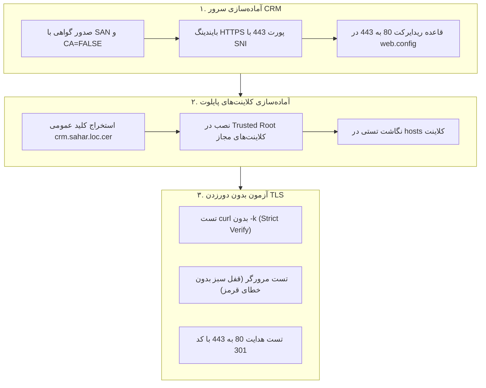

# سند طرح استقرار گواهینامه TLS اختصاصی (Self-Signed) بدون وابستگی به CA داخلی
# ParkPalace CRM — Dedicated Self-Signed TLS Certificate Architecture & Security Framework
## نسخه ۲.۰.۰ — بازبینی‌شده بر اساس الزامات تکمیلی کارفرما

**پروژه:** سامانه جامع تدارکات و مدیریت ارتباط با تأمین‌کنندگان پارک پالاس (ParkPalace CRM)  
**سند:** `D:\ParkPlace\docs\ParkPalace_TLS_SelfSigned_Plan.md`  
**تاریخ تدوین:** ۲۶ مهر ۱۴۰۵ (18 اکتبر 2026)  
**نسخه:** ۲.۰.۰ (طرح اصلاح‌شده نهایی — بدون اجرای عملیاتی)  
**دامنه هدف:** `crm.sahar.loc`  
**سرور میزبان:** ماشین مجازی اختصاصی `CRM` (`192.168.1.248`)  
**وضعیت اجرا:** **طرح توقف‌یافته — منوط به صدور مجوز کتبی و مستقل کارفرما (Mandatory Hold)**  

---

> [!IMPORTANT]
> **محدوده اختیارات و عدم اجرای عملیاتی:**  
> مطابق دستور صریح کارفرما، این سند صرفاً **طرح معماری و چارچوب امنیتی تصمیم‌گیری** است. در این مرحله **هیچ گواهینامه‌ای صادر یا نصب نشده، هیچ تغییری در Active Directory یا GPO داده نشده، هیچ سرویسی (مانند AD CS) روی سرور PDC نصب نخواهد شد و تنظیمات IIS، فایروال یا DNS تغییری نیافته است**.

---

## ۱. طرح صدور و نگهداری گواهینامه (Issuance & Key Custody Plan)

### ۱.۱. ابزار صدور و پارامترهای مهندسی گواهینامه
از آنجا که در دامنه `sahar.loc` هیچ سرویس صدور گواهی داخلی (AD CS) وجود ندارد، جهت برقراری ارتباط رمزشده و احراز اصالت‌شده در فاز پایلوت، یک گواهینامه خودامضاشده (Self-Signed) اختصاصی با مشخصات استاندارد زیر مستقیماً بر روی سرور CRM صادر خواهد شد:

| پارامتر فنی | مقدار مصوب | دلیل فنی و انطباق امنیتی |
| :--- | :--- | :--- |
| **Common Name (CN)** | `crm.sahar.loc` | نام کامل دامنه سازمانی FQDN سامانه CRM |
| **Subject Alternative Name (SAN)** | `DNS:crm.sahar.loc, DNS:crm` | الزام استاندارد RFC 2818 و مرورگرهای مدرن جهت تطابق نام میزبان |
| **Basic Constraints** | **`CA:FALSE`** (بخش حیاتی) | **تضمین قطعی اینکه این گواهینامه صرفاً گواهی نهایی (End-Entity) است و نمی‌تواند برای امضا یا صدور سایر گواهی‌ها سوءاستفاده شود.** |
| **الگوریتم کلید (Key Algorithm)** | `RSA` | سازگاری کامل با IIS 10 و تمامی پشته‌های کلاینت ویندوز |
| **طول کلید (Key Length)** | `3072-bit` | انطباق با الزامات NIST و BSI تا افق ۲۰۳۰+ با حفظ عملکرد بهینه پردازشی |
| **الگوریتم امضا (Signature Algorithm)** | `SHA-256` | پرهیز از آسیب‌پذیری‌های هش منسوخ SHA-1 و MD5 |
| **کاربرد کلید (Key Usage)** | `DigitalSignature, KeyEncipherment` | پشتیبانی از امضای دیجیتال و تبادل امن کلیدهای نشست |
| **کاربرد کلید پیشرفته (EKU)** | `Server Authentication (1.3.6.1.5.5.7.3.1)` | الزام احراز هویت سرور وب در پروتکل TLS/HTTPS |
| **مدت اعتبار دوره (Validity Period)** | **۱۸۰ روز (۶ ماه)** | بازه محدود و کنترل‌شده برای پایلوت جهت پرهیز از ماندگاری کلیدهای بلندمدت کنترل‌نشده |
| **محل نگهداری در سرور** | `Cert:\LocalMachine\My` | مخزن Personal ماشین محلی سرور CRM |

### ۱.۲. دستور پیشنهادی تولید گواهینامه در سرور CRM (صرفاً برای اجرا در پنجره مجاز)
```powershell
# این دستور صرفاً در پنجره عملیاتی مصوب و بر روی سرور CRM اجرا خواهد شد:
$certParams = @{
    Subject           = "CN=crm.sahar.loc"
    DnsName           = @("crm.sahar.loc", "crm")
    KeyAlgorithm      = "RSA"
    KeyLength         = 3072
    HashAlgorithm     = "SHA256"
    KeyUsage          = "DigitalSignature", "KeyEncipherment"
    TextExtension     = @(
        "2.5.29.37={text}1.3.6.1.5.5.7.3.1", # Enhanced Key Usage: Server Authentication
        "2.5.29.19={text}ca=0"                # Basic Constraints: CA=FALSE
    )
    CertStoreLocation = "Cert:\LocalMachine\My"
    NotAfter          = (Get-Date).AddDays(180)
    FriendlyName      = "ParkPalace CRM Pilot TLS Certificate"
}
$cert = New-SelfSignedCertificate @certParams
```

### ۱.۳. سیاست امنیت، حبس کلید خصوصی و پرهیز از دسترسی‌های اضافی
1. **حبس قطعی در سرور CRM:** کلید خصوصی گواهینامه منحصراً و قطعی بر روی همان سرور CRM باقی می‌ماند.
2. **غیرقابل استخراج بودن (Non-Exportable):** کلید خصوصی به صورت غیرقابل استخراج ایجاد می‌شود تا امکان اکسپورت آن به فایل PFX وجود نداشته باشد.
3. **عدم تعریف دسترسی اضافی برای Application Pool (اصلاحیه الزامی):**  
   *در معماری ویندوز سرور و IIS، عملیات هندشیک TLS و بارگذاری کلید خصوصی در لایه هسته سیستم‌عامل (`HTTP.sys`) و زیرسیستم `SCHANNEL` تحت کانتکست امنیتی ماشین (`LocalSystem` / سیستم‌عامل) انجام می‌شود. پروسه کاربردی `w3wp.exe` مربوط به Application Pool صرفاً درخواست‌های رمزگشایی‌شده HTTP را از ماژول ANCM دریافت می‌کند و **هیچ نیاز فنی به دسترسی فایل‌سیستمی مستقیم به کلید خصوصی در MachineKeys ندارد**. بنابراین هیچ‌گونه مجوز اضافی به اکانت `IIS APPPOOL\...` اعطا نخواهد شد.*
4. **ممنوعیت انتقال به PDC یا شبکه:** کلید خصوصی یا هر فایل محتوی اسرار هرگز به سرور PDC، فایل‌شیرینگ، ایمیل یا محیط‌های چت منتقل نخواهد شد.

### ۱.۴. استخراج گواهینامه عمومی (Public Certificate Export)
جهت ایجاد اعتماد در سیستم‌های کلاینت، صرفاً گواهینامه عمومی (فاقد کلید خصوصی) با فرمت استاندارد X.509 (`.cer`) استخراج می‌گردد:
```powershell
# استخراج کلید عمومی فاقد اسرار
Export-Certificate -Cert $cert -FilePath "D:\ParkPlaceCRM\crm.sahar.loc.cer" -Type CERT
```

---

## ۲. دسترسی کاربران پایلوت و ممنوعیت توزیع در سطح کل دامنه

### ۲.۱. نصب انحصاری روی کلاینت‌های پایلوت مورد اعتماد
* کلید عمومی `crm.sahar.loc.cer` **منحصراً و فقط بر روی ایستگاه‌های کاری چند کاربر معین و مورد اعتماد پایلوت تدارکات** (که توسط کارفرما معرفی می‌شوند) در مخزن `Cert:\LocalMachine\Root` وارد می‌گردد.
* این گواهینامه بر روی هیچ رایانه یا سرور دیگری خارج از محدوده پایلوت نصب نخواهد شد.

### ۲.۲. ممنوعیت قطعی توزیع در سطح کل دامنه (Domain-Wide Prohibition)
* **ممنوعیت اعمال در Default Domain Policy:** توزیع این گواهینامه خودامضا در سطح کل دامین یا ریشه اکتیودایرکتوری **اکیداً ممنوع است**؛ زیرا وارد کردن گواهی‌های سلف‌سایند به مخزن عمومی دامنه موجب آلودگی زنجیره اعتماد (Trust Store Pollution) و تضعیف پایگاه امنیتی کل شبکه می‌شود.
* هرگونه توزیع از طریق GPO در آینده (در صورت نیاز به توسعه به بیش از چند کلاینت)، صرفاً پس از بررسی دقیق ساختار OUهای دامین، تفکیک یک OU ایزوله برای رایانه‌های تدارکات و منوط به **تأیید کتبی و مستقل جداگانه از سوی کارفرما** امکان‌پذیر خواهد بود.

---

## ۳. مراحل گام‌به‌گام: استقرار، بایندینگ، تست، تمدید و Rollback امن



### ۳.۱. گام اول: بایندینگ پورت ۴۴۳ و ریدایرکت پورت ۸۰ در IIS
1. **بایندینگ امن HTTPS روی پورت ۴۴۳ با فعال‌سازی الزامی SNI:**
   ```powershell
   New-WebBinding -Name "ParkPalaceCRM" `
       -IPAddress "*" `
       -Port 443 `
       -Protocol "https" `
       -HostHeader "crm.sahar.loc" `
       -SslFlags 1  # 1 = Require Server Name Indication (SNI)
   
   $binding = Get-WebBinding -Name "ParkPalaceCRM" -Port 443 -Protocol "https"
   $binding.AddSslCertificate($cert.Thumbprint, "My")
   ```
2. **پیکربندی ریدایرکت پورت ۸۰ به ۴۴۳ در `web.config`:**
   ```xml
   <rewrite>
     <rules>
       <rule name="Redirect to HTTPS" stopProcessing="true">
         <match url="(.*)" />
         <conditions>
           <add input="{HTTPS}" pattern="off" ignoreCase="true" />
         </conditions>
         <action type="Redirect" url="https://{HTTP_HOST}/{R:1}" redirectType="Permanent" />
       </rule>
     </rules>
   </rewrite>
   ```

### ۳.۲. گام دوم: نصب کلید عمومی در ایستگاه‌های کاری منتخب پایلوت
در رایانه‌های مورد اعتماد پایلوت:
```powershell
Import-Certificate -FilePath "C:\Temp\crm.sahar.loc.cer" -CertStoreLocation "Cert:\LocalMachine\Root"
```

### ۳.۳. گام سوم: آزمون اعتبارسنجی دقیق بدون تغییر DNS و بدون Bypass TLS
> [!CAUTION]
> **ممنوعیت مطلق Bypass:** استفاده از گزینه‌های غیرفعال‌سازی بررسی TLS مانند `curl -k` یا `--insecure` اکیداً ممنوع است. آزمون باید اثبات کند که سیستم‌عامل و مرورگر کلاینت زنجیره اعتماد را کاملاً معتبر می‌دانند.

1. **نگاشت آزمایشی در کلاینت تست:**  
   در فایل `C:\Windows\System32\drivers\etc\hosts`:
   ```text
   192.168.1.248    crm.sahar.loc
   ```
2. **آزمون Strict TLS در خط فرمان:**
   ```bash
   curl -v https://crm.sahar.loc/api/health
   ```
   *معیار پذیرش:* مشاهده پیام صریح `SSL certificate verify ok` در هندشیک TLS، کد پاسخ `HTTP/1.1 200 OK` و خروجی `{"status":"Healthy"}` بدون نیاز به هیچ فلگ دورزدن اعتبارسنجی.
3. **آزمون در مرورگر وب کلاینت:**
   * باز کردن آدرس `https://crm.sahar.loc/`.
   * **معیار پذیرش بصری:** مشاهده نماد قفل امن (Secure Lock) در نوار آدرس بدون خطای `NET::ERR_CERT_AUTHORITY_INVALID`.
   * بازبینی جزئیات گواهینامه در مرورگر و تأیید پارامترهای: RSA 3072-bit، تطابق SAN با `crm.sahar.loc` و فیلد `CA=False`.
4. **آزمون ریدایرکت پورت ۸۰:**
   * درخواست `http://crm.sahar.loc/` و تأیید دریافت پاسخ ۳۰۱ با هدایت خودکار به `https://crm.sahar.loc/`.

---

### ۳.۴. گام چهارم: فرآیند مدون تمدید گواهینامه ۱۸۰ روزه و توزیع پیش‌دستانه (Overlap Lifecycle)

به دلیل ماهیت آفلاین گواهینامه‌های خودامضا، چرخه تمدید طبق گاه‌شمار مهندسی زیر اجرا می‌شود تا هیچ‌گونه قطعی یا خطای اعتبارسنجی به کاربران تحمیل نشود:

```mermaid
gantt
    title گاه‌شمار چرخه حیات گواهینامه ۱۸۰ روزه (Overlap Lifecycle)
    dateFormat  X
    axisFormat %d روز
    section چرخه گواهینامه اول
    بهره‌برداری فعال گواهینامه اول (180 روز) :active, c1, 0, 180
    section فرآیند تمدید پیش‌دستانه
    هشدار ممیزی و تولید گواهینامه دوم (روز 150) :milestone, m1, 150, 150
    توزیع کلید عمومی دوم به کلاینت‌ها (روز 170) :crit, m2, 170, 175
    سوئیچ بایندینگ IIS به گواهینامه دوم (روز 175) :milestone, m3, 175, 175
    حذف گواهینامه اول پس از انقضا (روز 180) :milestone, m4, 180, 180
```



* **نقطه عطف ۱ (روز ۱۵۰ — ۳۰ روز مانده به انقضا):**  
  آغاز فرآیند تمدید؛ تولید گواهینامه ۱۸۰ روزه جدید روی سرور CRM با مشخصات یکسان و Thumbprint مجزا.
* **نقطه عطف ۲ (روز ۱۷۰ — ۱۰ روز مانده به انقضا — پنجره هم‌پوشانی):**  
  استخراج کلید عمومی گواهینامه جدید و نصب آن در مخزن `Cert:\LocalMachine\Root` کلاینت‌های پایلوت. در این بازه، کلاینت به هر دو گواهی اعتماد کامل دارد.
* **نقطه عطف ۳ (روز ۱۷۵ — ۵ روز مانده به انقضا):**  
  سوئیچ بایندینگ پورت ۴۴۳ در IIS به Thumbprint گواهینامه جدید و اجرای آزمون‌های سلامت. به دلیل اعتماد قبلی کلاینت‌ها، مهاجرت با صفر ثانیه خطای گواهی انجام می‌شود.
* **نقطه عطف ۴ (روز ۱۸۰ — پس از انقضا):**  
  حذف امن گواهینامه قبلی از سرور و کلاینت‌ها جهت حفظ پاکیزگی مخازن گواهی.

---

### ۳.۵. گام پنجم: دستورالعمل بازگشت امن و منع بازگشت پیش‌فرض به HTTP ناامن (Safe Rollback Policy)

> [!CAUTION]
> **اصل توقف امن و امتناع از افشای ترافیک (Fail-Closed / No Insecure HTTP Fallback):**  
> در صورت بروز هرگونه اختلال در عملکرد HTTPS، خطای گواهی یا نقص در سرویس، **سیاست Rollback به هیچ وجه نباید بازگرداندن پیش‌فرض دسترسی به پروتکل ناامن HTTP (پورت ۸۰) باشد**. بازگشت خودکار به HTTP متن‌آشکار موجب افشای اعتبارنامه‌های ویندوز، هدرهای Negotiate و توکن‌های کاری کاربران در بستر شبکه می‌شود.

**مراحل بازگشت امن در زمان بروز مشکل (Safe Maintenance Hold):**
1. **توقف بایندینگ وب (Fail-Closed):**  
   بایندینگ پورت ۴۴۳ غیرفعال یا وب‌سایت در حالت توقف موقت نگهداری قرار می‌گیرد تا از ارسال درخواست‌های ناقص یا افشای ترافیک جلوگیری شود:
   ```powershell
   Remove-WebBinding -Name "ParkPalaceCRM" -Port 443 -Protocol "https"
   # اکیداً ریدایرکت پورت 80 به حالت باز کردن HTTP تغییر داده نمی‌شود
   ```
2. **پاکسازی نگاشت در کلاینت‌های تست:**  
   حذف خط آزمایشی از فایل `hosts` کلاینت‌های تست تا هیچ درخواستی به سرور CRM ارسال نشود.
3. **حذف گواهی مشکل‌دار از کلاینت‌های پایلوت (در صورت نقص کلید):**
   ```powershell
   Get-ChildItem Cert:\LocalMachine\Root | Where-Object { $_.Subject -like "*crm.sahar.loc*" } | Remove-Item
   ```
4. **تحلیل ریشه‌ای خطا (RCA) در محیط ایزوله:**  
   بررسی لاگ‌های SCHANNEL در Event Viewer سرور CRM و اعتبارسنجی مجدد پارامترهای گواهی بدون در معرض قرار دادن کلاینت‌ها در بستر ناامن.
5. **وضعیت دامین و PDC:**  
   از آنجا که هیچ تغییری در DNS سرور یا GPO دامین انجام نشده است، کنترلر دامنه و سایر اجزای شبکه کاملاً دست‌نخورده باقی می‌مانند.

---

## ۴. ماتریس ارزیابی و مهار ریسک‌های امنیتی گواهینامه Self-Signed

| شناسه | عنوان ریسک امنیتی | شدت | پیامد فنی | راهکار کنترلی و کاهش ریسک در این طرح |
| :---: | :--- | :---: | :--- | :--- |
| **SEC-01** | **نبود سازوکار متمرکز ابطال (No CRL / OCSP)** | **بالا** | گواهی خودامضا فاقد نقطه انتشار ابطال است؛ در صورت افشا، امکان ابطال آنی متمرکز وجود ندارد. | ۱. Non-exportable بودن کلید.<br/>۲. حبس کلید صرفاً روی CRM.<br/>۳. محدودسازی اعتبار به ۱۸۰ روز.<br/>۴. تهیه اسکریپت حذف دستی از کلاینت‌ها. |
| **SEC-02** | **سوءاستفاده احتمالی به عنوان CA** | **بحرانی** | اگر گواهینامه دارای حق صدور باشد، مهاجم می‌تواند گواهی سایر سایت‌ها را با آن جعل کند. | **افزودن صریح اکستنشن `Basic Constraints: CA=FALSE`** تا به عنوان صادرکننده شناسایی نشود. |
| **SEC-03** | **آلودگی مخزن اعتماد دامین (GPO Pollution)** | **بالا** | قرار دادن گواهی سلف‌سایند در پالیسی سراسری دامین، زنجیره اعتماد کل شبکه را مخدوش می‌کند. | **ممنوعیت مطلق اعمال در Default Domain Policy** و محدودسازی به کلاینت‌های مشخص پایلوت. |
| **SEC-04** | **افشای ترافیک در زمان بازگشت به HTTP** | **بالا** | در صورت بازگشت به پورت ۸۰ در زمان خرابی TLS، هدرهای حساس در شبکه شنود می‌شوند. | **قاعده منع بازگشت به HTTP ناامن (Fail-Closed)** و نگهداری سایت در حالت امن توقف تا رفع نقص. |
| **SEC-05** | **عادی‌سازی هشدارهای مرورگر (Warning Fatigue)** | **متوسط** | دیدن خطاهای قرمز SSL باعث کاهش حساسیت امنیتی کاربران به حملات واقعی می‌شود. | نصب قطعی کلید عمومی در مخزن Root کلاینت‌های پایلوت تا ارتباط با نماد قفل سبز و بدون هشدار برقرار شود. |

---

## ۵. تعهد توقف عملیاتی و انتظار برای مجوز کارفرما (Mandatory Hold)

کلیه اصلاحات هفت‌گانه در این سند نهایی و تثبیت گردید. تا پیش از ابلاغ مجوز کتبی و مشخص از سوی کارفرما، **هیچ تغییری در سرورها، IIS، فایروال، DNS، دامین یا کلاینت‌ها اعمال نخواهد شد**.
