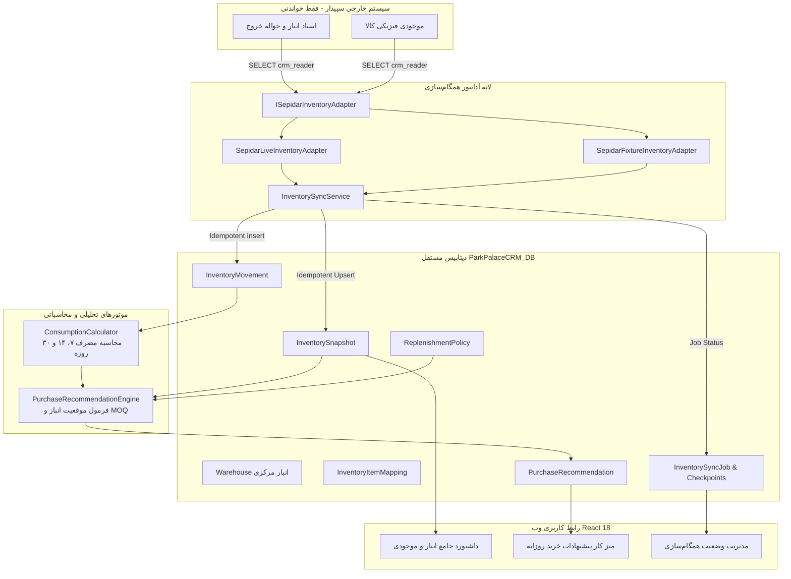

# ParkPalace Procurement CRM — Phase 4: Inventory Architecture Specification

**Phase:** 4 (Inventory Synchronization & Single Warehouse)  
**Author:** Lead Software Architect & Senior .NET Engineer  
**Date:** 2026-10-17  
**Status:** Approved Technical Architecture Document

---

## ۱. نمای کلی سیستم و معماری ماژول انبارداری (Overview)

هدف اصلی فاز ۴ سامانه CRM تدارکات پارک‌پالاس، اتصال جریان داده‌های انبار سپیدار، ثبت دقیق گردش و موجودی کالاها در دیتابیس مستقل CRM، محاسبه نرخ واقعی مصرف روزانه مواد اولیه (آرد، مخمر، روغن، ملزومات)، و فعال‌سازی **موتور پیشنهاد سفارش خرید خودکار (Purchase Recommendation Engine)** می‌باشد.

---

## ۲. موجودیت‌های دامنه انبارداری (Domain Entities)

در لایه دامنه (`src/ParkPalace.Domain/Entities/`)، ۱۰ موجودیت جدید طراحی و پیاده‌سازی شده‌اند:

1. **`Warehouse`**:
   - شناسه (`Id`)، کد انبار (`Code` مثلاً `WH-MAIN`)، نام فارسی (`Name` مثلاً `انبار مرکزی کارخانه نان`)، وضعیت فعالیت (`IsActive`) و آخرین زمان همگام‌سازی (`LastSyncUtc`).
2. **`InventoryItemMapping`**:
   - نگاشت بین شناسه ماده اولیه در CRM (`MaterialId`) و شناسه و کد کالا در سپیدار (`SepidarItemId`, `SepidarItemCode`, `SepidarItemTitle`, `SepidarBaseUnit`).
3. **`InventorySnapshot`**:
   - عکس لحظه‌ای از موجودی کالا در انبار؛ شامل موجودی فیزیکی (`OnHandQuantity`)، موجودی آزاد قابل استفاده (`ReservableQuantity`)، کالای در راه خرید (`IncomingQuantity`)، واحد سنجش، زمان عکس‌برداری (`SnapshotTimeUtc`) و پرچم هشداری منقضی/بیات بودن داده (`IsStale`).
4. **`InventoryMovement`**:
   - ریز گردش و تراکنش‌های انبار؛ شامل شماره سند (`VoucherNumber`)، نوع تراکنش (`VoucherType` اعم از مصرف در خط تولید، رسید خرید، انتقال، ضایعات، تعدیل و مرجوعی)، مقدار تراکنش (`Quantity`)، تاریخ سند (`TransactionDateUtc`)، وضعیت قطعی بودن سند (`PostingStatus`)، نشانگر ابطال سند (`IsCancelled`) و کلید یکتای منبع (`SourceMovementKey`) جهت تضمین عدم تکرار (Idempotency).
5. **`InventorySyncJob`**:
   - رهگیری هر اجرای همگام‌سازی؛ نوع جاب (کامل یا تدریجی)، وضعیت جاب (`Pending`, `Running`, `Success`, `Partial`, `Failed`)، زمان شروع و پایان، تعداد اقلام پردازش‌شده، پیام‌های خطا و شناسه رهگیری (`CorrelationId`).
6. **`InventorySyncCheckpoint`**:
   - نقطه نشانه (High-Water Mark) آخرین سند پردازش‌شده در همگام‌سازی‌های افزایشی.
7. **`InventorySyncError`**:
   - ثبت دقیق لاگ خطاهای احتمالی هنگام اعتبارسنجی اسناد منبع جهت ممیزی و مانیتورینگ.
8. **`MaterialConsumptionSummary`**:
   - خلاصه‌های از پیش محاسبه‌شده مصرف مواد اولیه در بازه‌های ۷، ۱۴ و ۳۰ روزه تقویمی با تفکیک روزهای فعال و روزهای با مصرف صفر.
9. **`ReplenishmentPolicy`**:
   - خط‌مشی و پارامترهای اختصاصی سفارش‌دهی به ازای هر کالا؛ شامل دوره بازبینی (`ReviewPeriodDays`)، زمان تدارک (`LeadTimeDays`)، ذخیره احتیاطی (`SafetyStock`)، حداقل سفارش (`MinOrderQuantity`)، مضرب بسته‌بندی یا گونی (`PackageMultiple`) و تأمین‌کننده دارای اولویت (`PreferredSupplierId`).
10. **`PurchaseRecommendation`**:
    - پیشنهادات خرید تولیدشده توسط موتور سفارش‌دهی؛ شامل متغیرهای فرمول، موجودی فیزیکی، مقدار پیشنهادی خام، مقدار گردشده نهایی به سمت مضرب بسته، نام تأمین‌کننده، دلایل و توضیحات تحلیلی، هشدارهای کسری داده و وضعیت (`Active`, `Dismissed`, `ConvertedToOrder`).

---

## ۳. موتور محاسبه مصرف واقعی روزانه (Daily Consumption Engine)

### الگوریتم محاسبه:
1. **فیلتر سخت‌گیرانه نوع سند:**
   - صرفاً اسناد با نوع `VoucherType.Consumption` (حواله خروج به خط تولید نان و قنادی) شمارش می‌شوند.
   - کلیه اسناد انتقال بین انباری، مرجوعی به فروشنده، رسید خرید و ضایعات از این محاسبه استثنا هستند.
2. **فیلتر وضعیت قطعی و عدم ابطال:**
   - `PostingStatus == 4` (قطعی / Posted) و `IsCancelled == false`.
3. **پنجره‌های زمانی استاندارد:**
   - پنجره‌های ۷، ۱۴ و ۳۰ روز گذشته بر مبنای تقویم استاندارد (UTC).
4. **رفتار در روزهای بدون مصرف (Zero-Consumption Days):**
   - روزهایی که هیچ حواله‌ای در آنها صادر نشده است (تعطیلات رسمی کارخانه، عدم پخت)، به عنوان مصرف صفر منظور می‌شوند.
   - فرمول میانگین:
     $$\text{AverageDailyConsumption} = \frac{\sum \text{Quantities in Period}}{\text{Total Days in Period (e.g. 7, 14, 30)}}$$
   - داده ساختگی یا بدون سند به هیچ عنوان تولید نمی‌شود.

---

## ۴. موتور پیشنهاد سفارش خرید (Purchase Recommendation Engine)

موتور سفارش‌دهی بر اساس مدل کنترل دوره‌ای موجودی (Periodic-Review Replenishment Policy) عمل می‌کند:

1. **سطح هدف موجودی (Target Stock / Order-Up-To Level):**
   $$\text{TargetStock} = \text{AverageDailyConsumption} \times (\text{LeadTimeDays} + \text{ReviewPeriodDays}) + \text{SafetyStock}$$
2. **موقعیت خالص موجودی (Inventory Position):**
   $$\text{InventoryPosition} = \text{UsableOnHand} + \text{EligibleIncomingOrders} - \text{ReservedQuantity}$$
3. **مقدار پیشنهادی اولیه (Raw Suggested Quantity):**
   $$\text{RawSuggested} = \max(0, \text{TargetStock} - \text{InventoryPosition})$$
4. **تطبیق با شرایط تأمین (MOQ & Package Multiple Rounding):**
   - اگر $\text{RawSuggested} > 0$ باشد:
     - در صورت کمتر بودن از حداقل سفارش ($\text{MOQ}$)، مقدار به $\text{MOQ}$ افزایش می‌یابد.
     - در صورت وجود مضرب بسته‌بندی ($\text{PackageMultiple}$ مانند کیسه‌های ۵۰ کیلویی آرد یا کارتن‌های ۲۴ عددی)، مقدار به مضرب بعدی به سمت بالا گرد (Ceiling) می‌شود.

---

## ۵. رابط‌های کاربری وب (React 18 + Vite)

1. **داشبورد انبار و موجودی (`WarehouseView.tsx`):**
   - جدول کالاها، دسته‌بندی، مقدار موجودی، واحد سنجش، وضعیت انبار، میانگین مصرف روزانه و نشانگر تازگی داده (Data Freshness Badge).
   - کارت‌های آماری کل اقلام، اقلام در وضعیت بحرانی زیر ذخیره احتیاطی، و ارزش مصرف روزانه.
   - دکمه اجرای دستی همگام‌سازی (`همگام‌سازی فوری`) برای نقش‌های مجاز.
   - مودال مشاهده سوابق گردش کالا (رسیدها، خروج‌ها، اسناد ابطالی) و ویرایش پارامترهای خط‌مشی سفارش.
2. **میز کار پیشنهادات خرید روزانه (`OrdersView.tsx`):**
   - لیست مواد اولیه نیازمند خرید با اولویت بالا و پایین.
   - نمایش مقدار پیشنهادی، موجودی فعلی، نرخ مصرف، زمان تأمین، و تأمین‌کننده اصلی با لینک ناوبری مستقیم به صفحه تأمین‌کنندگان.
   - هشدارهای شفاف درباره بیات بودن داده یا عدم ثبت سفارشات در راه.
