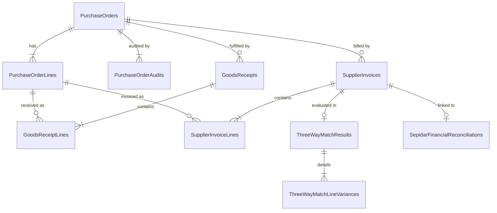

# معماری تدارکات و صدور مستقیم سفارش خرید — فاز پنجم
# ParkPalace Procurement Architecture — Phase 5

**نسخه:** ۱.۰.۰  
**تاریخ اجرا:** ۲۷ مهر ۱۴۰۵ (2026-10-18)  
**محیط اجرایی:** ایستگاه کاری توسعه (Development Environment: `D:\ParkPlace`)  
**مرجع نیازمندی‌ها:** `ParkPalace_SRS_v1.md` (FR-05, FR-06, FR-07, FR-08, FR-09) و پرامپت اجرایی فاز ۵  

---

## ۱. اهداف و اصول کلیدی معماری (Core Architecture Principles)

در فاز پنجم، سامانه جامع تدارکات پارک پالاس قابلیت‌های عملیاتی زنجیره خرید مستقیم و چرخه عمر اسناد را از نقطه نیاز تا تطبیق مالی پیاده‌سازی نموده است. اصول بنیادین این معماری عبارتند از:

1. **صدور مستقیم توسط تدارکات (Direct PO Issuance by Procurement):**
   - مطابق صریح بند FR-05 سند SRS، واحد تدارکات مجاز است سفارشات خرید را مستقیماً صادر کند.
   - **هیچ مرحله یا فیلد تأیید مدیر (Manager Approval) در فرآیند صدور سفارش خرید وارد نشده است.**
   - سفارش مستقیماً از وضعیت `Draft` به وضعیت `Issued` تغییر یافته یا در لحظه ایجاد با انتخاب گزینه `DirectIssue = true` صادر می‌گردد.
2. **اسنپ‌شات تغییرناپذیر اقلام و قیمت‌ها (Immutable Snapshot Guarantee):**
   - به محض صدور سفارش خرید (`Issued`)، مقادیر کلیدی شامل: نام کالا، کد کالا، واحد سنجش، نام تأمین‌کننده و نرخ توافق‌شده واحد در فیلدهای اختصاصی Snapshot در دیتابیس قفل می‌شوند.
   - هرگونه تغییرات آتی در کاتالوگ مواد، تغییر نام تأمین‌کننده یا تغییر قیمت در ماژول‌های دیگر، هیچ اثری بر سوابق تاریخی سفارش خرید صادرشده نخواهد داشت.
3. **همزمانی خوش‌بینانه و سوابق ممیزی (Optimistic Concurrency & Audit Trail):**
   - هر سفارش خرید مجهز به `ConcurrencyToken` تصادفی (Guid-based) است که از اوررایت ناخواسته و تداخل تغییرات همزمان جلوگیری می‌کند.
   - کلیه تغییرات وضعیت، صدور، و ابطال در جدول ممیزی `PurchaseOrderAudits` با ذکر نام کاربری (`PerformedBy`)، برچسب زمانی دقیق UTC و جزئیات JSON ثبت می‌شوند.
4. **قوانین ابطال سفارش (Cancellation Rules):**
   - سفارش خرید در وضعیت `Draft` یا `Issued` به شرطی که هیچ رسید کالای انبار (`GoodsReceipt`) برای آن صادر نشده باشد و هیچ فاکتوری برای آن ثبت نگردیده باشد، قابل ابطال است.
   - ابطال نیازمند درج الزامی دلیل ابطال (`Reason`) توسط کاربر تدارکات است و به عنوان یک رویداد قطعی در جدول Audit ثبت می‌گردد.

---

## ۲. مدل داده و ساختار جداول پایگاه داده CRM (Database Schema)

کلیه جداول در پایگاه داده مستقل CRM به نام `ParkPalaceCRM_DB_Dev` در سرور توسعه محلی ایجاد و پیکربندی شده‌اند.



### ۱.۲. جدول `PurchaseOrders` (سرفصل سفارشات خرید)

| نام فیلد | نوع داده | کلید / شاخص | توضیحات |
| :--- | :--- | :--- | :--- |
| `Id` | `UNIQUEIDENTIFIER` | PK | شناسه یکتای سفارش |
| `OrderNumber` | `NVARCHAR(50)` | UNIQUE INDEX | شماره رسمی سفارش (فرمت `PO-YYYYMM-XXXX`) |
| `SupplierId` | `UNIQUEIDENTIFIER` | FK -> `Parties` | طرف حساب تأمین‌کننده |
| `WarehouseId` | `UNIQUEIDENTIFIER` | FK -> `Warehouses` | انبار تحویل‌گیرنده (پیش‌فرض انبار مرکزی) |
| `Status` | `INT` | INDEX | وضعیت: Draft=0, Issued=1, PartiallyReceived=2, Received=3, Completed=4, Cancelled=5 |
| `Currency` | `NVARCHAR(10)` | - | واحد پول (پیش‌فرض `IRR`) |
| `ExchangeRate` | `DECIMAL(18,4)` | - | نرخ تسعیر |
| `SubTotal` | `DECIMAL(18,2)` | - | جمع کل ناخالص اقلام |
| `TaxTotal` | `DECIMAL(18,2)` | - | جمع کل مالیات ارزش افزوده (۱۰٪) |
| `DiscountTotal` | `DECIMAL(18,2)` | - | جمع کل تخفیفات |
| `GrandTotal` | `DECIMAL(18,2)` | - | مبلغ کل قابل پرداخت |
| `IssuedByUsername` | `NVARCHAR(100)` | - | کارشناس تدارکات صادرکننده |
| `IssuedAtUtc` | `DATETIME2` | - | زمان صدور قطعی سفارش |
| `ExpectedDeliveryDateUtc`| `DATETIME2` | - | موعد تحویل مورد توافق |
| `ConcurrencyToken` | `NVARCHAR(100)` | - | توکن کنترل همزمانی خوش‌بینانه |
| `CreatedAtUtc` | `DATETIME2` | - | زمان ثبت رکورد |
| `CreatedBy` | `NVARCHAR(100)` | - | کاربر ثبت‌کننده اولیه |

### ۲.۲. جدول `PurchaseOrderLines` (اقلام سفارش خرید)

| نام فیلد | نوع داده | توضیحات |
| :--- | :--- | :--- |
| `Id` | `UNIQUEIDENTIFIER` | کلید اصلی ردیف |
| `PurchaseOrderId` | `UNIQUEIDENTIFIER` | کلید خارجی به سربرگ سفارش |
| `LineNumber` | `INT` | شماره ردیف (۱، ۲، ...) |
| `MaterialId` | `UNIQUEIDENTIFIER` | ماده اولیه مرتبط در کاتالوگ |
| `OrderedQuantity` | `DECIMAL(18,4)` | مقدار سفارش داده شده |
| `UnitId` | `UNIQUEIDENTIFIER` | واحد سنجش |
| `UnitPrice` | `DECIMAL(18,2)` | نرخ واحد توافق‌شده |
| `TaxRate` | `DECIMAL(5,4)` | نرخ مالیات بر ارزش افزوده (۰.۱۰) |
| `TaxAmount` | `DECIMAL(18,2)` | مبلغ مالیات ردیف |
| `DiscountAmount`| `DECIMAL(18,2)` | مبلغ تخفیف ردیف |
| `LineTotal` | `DECIMAL(18,2)` | مبلغ کل ردیف |
| `ReceivedQuantity` | `DECIMAL(18,4)` | جمع مقادیر پذیرفته‌شده در رسیدهای انبار |
| `InvoicedQuantity` | `DECIMAL(18,4)` | جمع مقادیر فاکتورشده توسط تأمین‌کننده |
| **`MaterialCodeSnapshot`** | `NVARCHAR(50)` | **اسنپ‌شات تغییرناپذیر کد کالا در لحظه صدور** |
| **`MaterialNameSnapshot`** | `NVARCHAR(200)` | **اسنپ‌شات تغییرناپذیر نام کالا در لحظه صدور** |
| **`UnitCodeSnapshot`** | `NVARCHAR(50)` | **اسنپ‌شات تغییرناپذیر کد واحد در لحظه صدور** |
| **`UnitNameSnapshot`** | `NVARCHAR(100)` | **اسنپ‌شات تغییرناپذیر نام واحد در لحظه صدور** |
| **`SupplierNameSnapshot`** | `NVARCHAR(200)` | **اسنپ‌شات تغییرناپذیر نام تأمین‌کننده در لحظه صدور** |

### ۳.۲. جدول `PurchaseOrderAudits` (ممیزی و سوابق رویدادها)

| نام فیلد | نوع داده | توضیحات |
| :--- | :--- | :--- |
| `Id` | `UNIQUEIDENTIFIER` | کلید اصلی |
| `PurchaseOrderId` | `UNIQUEIDENTIFIER` | شناسه سفارش مورد ممیزی |
| `Action` | `NVARCHAR(50)` | نوع اقدام (Create, DirectIssue, Issue, Cancel, ConcurrencyConflict) |
| `PerformedBy` | `NVARCHAR(100)` | نام کاربری عامل |
| `TimestampUtc` | `DATETIME2` | زمان دقیق رویداد |
| `DetailsJson` | `NVARCHAR(MAX)` | جزئیات وضعیت، دلایل، یا خطاهای همزمانی به صورت ساختاریافته |

---

## ۳. معماری سرویس‌ها و منطق تجاری (Business Logic Implementation)

سرویس `PurchaseOrderService` در لایه زیرساخت با استفاده از اینترفیس `IPurchaseOrderService` وظایف زیر را به صورت ترنزکشنال مدیریت می‌کند:

### ۱.۳. فرآیند صدور مستقیم (Direct PO Issuance Workflow)
```csharp
// اگر کاربر پرچم صدور مستقیم را فعال کرده باشد:
if (req.DirectIssue)
{
    po.Status = PurchaseOrderStatus.Issued;
    po.IssuedByUsername = currentUser;
    po.IssuedAtUtc = DateTime.UtcNow;

    // ایجاد اسنپ‌شات‌های تغییرناپذیر
    line.MaterialCodeSnapshot = material.InternalCode;
    line.MaterialNameSnapshot = material.Name;
    line.UnitCodeSnapshot = unit.Code;
    line.UnitNameSnapshot = unit.Name;
    line.SupplierNameSnapshot = supplier.DisplayName;
}
```

### ۲.۳. انتقال خودکار وضعیت بر اساس دریافت انبار (Automatic Lifecycle Progression)
- با هر بار ثبت رسید کالا توسط انبار، جمع مقادیر پذیرفته‌شده (`AcceptedQuantity`) بر روی ردیف‌های متناظر سفارش به‌روزرسانی می‌شود.
- در صورتی که تمام ردیف‌ها کامل دریافت شوند: `Status = Received`
- در صورتی که بخشی از ردیف‌ها یا مقادیر دریافت شوند: `Status = PartiallyReceived`
- در صورتی که تمامی فاکتورها تطبیق سه‌طرفه موفق داشته باشند: `Status = Completed`

---

## ۴. رابط‌های کاربری فرانت‌اند (React Frontend UI)

صفحه فارسی و راست‌چین `OrdersView.tsx` شامل امکانات پیشرفته زیر است:
- **لیست جامع سفارشات:** فیلتر بر اساس وضعیت، شماره سفارش، و تأمین‌کننده با نشان‌های رنگی وضعیت.
- **مودال صدور مستقیم سفارش:** فرم ورود اقلام با امکان افزودن/حذف ردیف‌های پویا، محاسبه در لحظه مالیات و مبالغ کل، و انتخاب پیش‌فرض صدور مستقیم توسط تدارکات.
- **تبدیل یک‌کلیکی از پیشنهادات روزانه:** در زبانه «پیشنهادات هوشمند خرید روزانه»، دکمه «صدور سفارش مستقیم» فرم سفارش را با مقادیر بهینه‌سازی‌شده الگوریتم R, s, S و تأمین‌کننده مرجع پر می‌کند.
- **مشاهده اسنپ‌شات‌ها و لاگ ممیزی:** نمایشگر اختصاصی تضمین تغییرناپذیری اقلام در لحظه صدور و جدول تاریخچه رویدادهای ممیزی.
