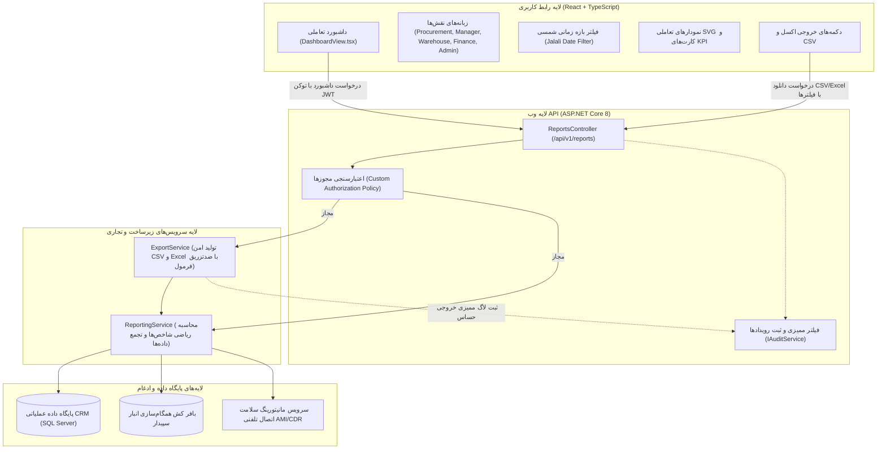

# معماری ماژول گزارش‌گیری و داشبوردهای عملیاتی — فاز ۷
# ParkPalace Procurement CRM — Phase 7 Reporting Architecture

**پروژه:** سامانه جامع تدارکات و خرید پارک پالاس (ParkPalace Procurement CRM)  
**فاز:** فاز ۷ — گزارش‌گیری، تحلیل‌های آماری، داشبوردهای نقش‌محور و تجربه کاربری (Reporting, Analytics, Operational Dashboards & UX)  
**تاریخ انتشار:** ۲۶ مهر ۱۴۰۵ (2026-10-18)  
**محیط اجرا:** محیط توسعه محلی (`D:\ParkPlace`)  
**نسخه سند:** ۱.۰.۰  

---

## ۱. اهداف و چشم‌انداز معماری (Architectural Vision & Scope)

در فاز هفتم سامانه تدارکات پارک پالاس، هدف استقرار یک زیرسیستم گزارش‌گیری، تحلیل آماری و داشبوردهای عملیاتی یکپارچه با رعایت اصول کلیدی زیر است:
1. **تولید بینش عملیاتی تفکیک‌شده بر اساس نقش سازمانی (Role-Based Dashboards):** ارائه پنج داشبورد کاملاً مجزا و تخصصی برای نقش‌های «کارشناس تدارکات (Procurement)»، «مدیر ارشد (Manager)»، «سرپرست انبار (Warehouse)»، «کارشناس مالی (Finance)» و «مدیر سیستم (System Administrator)».
2. **محاسبات آماری قطعی، مستند و قابل بازتولید (Reproducible Deterministic KPIs):** تضمین دقت ریاضی اعشاری، حذف محاسبات فرضی، شفافیت فیلترها و رفتار مشخص با داده‌های گمشده یا اسناد ابطال‌شده.
3. **شفافیت وضعیت سلامت و تازگی داده‌ها (Data Freshness & Integration Status):** تفکیک برچسب‌های داده واقعی تأییدشده CRM، داده کش‌شده همگام با سپیدار، داده استیل/تاریخ‌گذشته، داده شبیه‌سازی‌شده (Simulated/Fixture) و داده غیرقابل‌دسترس.
4. **موتور خروجی امن (Secure Export Engine):** تولید فایل‌های CSV و Excel (XML Spreadsheet) با انکودینگ UTF-8 به همراه BOM جهت پشتیبانی کامل از زبان فارسی در Excel، سقف مجاز ردیف‌ها (Row Limits)، لاگ ممیزی کامل رویدادهای خروجی و مقابله با تزریق فرمول (Formula Injection Defense).
5. **کنترل دسترسی نقشی دقیق (Strict RBAC):** تفکیک داده‌ها و جلوگیری از نشت اطلاعات حساس تلفنی، مالی و مدیریتی میان نقش‌ها با اعمال مجوزهای اختصاصی و پاسخ استاندارد RFC 7807 (403 ProblemDetails).

---

## ۲. نمودار جریان معماری گزارش‌گیری (Reporting Subsystem Flow)

---

## ۳. قراردادهای سرویس و ساختار DTOها (Contracts & DTOs)

### ۳.۱. رابط `IReportingService`
این رابط در لایه `ParkPalace.Application.Interfaces` تعریف شده و ارائه‌دهنده سرویس‌های تجمیع داده، شاخص‌های کلیدی عملکرد و ارزیابی سلامت سیستم است:
- `GetProcurementDashboardAsync(DateTime? from, DateTime? to, Guid? categoryId, Guid? supplierId, CancellationToken ct)`
- `GetManagerDashboardAsync(DateTime? from, DateTime? to, CancellationToken ct)`
- `GetWarehouseDashboardAsync(CancellationToken ct)`
- `GetFinanceDashboardAsync(DateTime? from, DateTime? to, CancellationToken ct)`
- `GetAdminHealthDashboardAsync(CancellationToken ct)`
- `GetKpiSummaryAsync(DateTime? from, DateTime? to, CancellationToken ct)`
- `GetPurchaseTrendsAsync(DateTime? from, DateTime? to, CancellationToken ct)`
- `GetSupplierPerformanceListAsync(DateTime? from, DateTime? to, CancellationToken ct)`

### ۳.۲. رابط `IExportService`
سرویس تولید و صدور فایل‌های گزارش:
- `ExportToCsvAsync<T>(IEnumerable<T> data, string reportTitle, CancellationToken ct)`
- `ExportToExcelXmlAsync<T>(IEnumerable<T> data, string reportTitle, CancellationToken ct)`

### ۳.۳. مدل جامع DTOها (`ReportDtos.cs`)
- **`DashboardDto`**: ظرف جامع داشبورد شامل آرایه شاخص‌ها (`KpiMetricDto`)، داده‌های سری زمانی (`TrendPointDto`)، رتبه‌بندی تأمین‌کنندگان (`SupplierPerformanceDto`)، اقلام اقدام فوری (`ActionItemDto`) و برچسب جامع وضعیت تازگی داده (`DataFreshnessDto`).
- **`KpiMetricDto`**: نام شاخص، مقدار نمایشی، مقدار خام عددی اعشاری (`decimal`)، واحد سنجش، درصد تغییر نسبت به دوره قبل، وضعیت مطلوب/هشدار/بحرانی (`Positive`, `Negative`, `Warning`, `Neutral`) و توضیحات شفاف محاسباتی.
- **`DataFreshnessDto`**: فیلد وضعیت (`LiveCrmVerified`, `CachedSync`, `Stale`, `Simulated`, `Unavailable`)، پیام فارسی، زمان آخرین همگام‌سازی موفق (UTC) و نشانگر وجود هشدار تاریخ‌گذشتگی داده.
- **`AdminHealthDto`**: وضعیت سلامت دیتابیس CRM، ارتباط با سرویس سپیدار، سلامت کانکشن AMI ایزابل، خطاهای ورکر و لاگ آخرین تلاش‌های همگام‌سازی.

---

## ۴. تفکیک داشبوردهای پنج‌گانه نقش‌محور (Role-Based Dashboards)

### ۴.۱. داشبورد تدارکات (Procurement Dashboard)
- **مخاطب:** کارشناسان و مأموران خرید
- **اقلام کلیدی:**
  - سفارش‌های خرید باز و معوق (`Open and Overdue POs`)
  - اقلام با موجودی بحرانی و زیر نقطه سفارش نیازمند اقدام فوری
  - استعلام‌های قیمت در انتظار پاسخ از تأمین‌کننده (`Pending Quotations`)
  - روند قیمت‌های خرید اخیر و مقایسه آخرین نرخ با میانگین تاریخی
  - اقلام نیازمند اقدام فوری جهت استعلام یا صدور سفارش خرید مستقیم

### ۴.۲. داشبورد مدیریتی (Manager Dashboard)
- **مخاطب:** مدیرعامل، معاون بازرگانی و مدیران عملیاتی
- **اقلام کلیدی:**
  - حجم کل ریالی خرید در بازه انتخابی و نمودار روند ماهانه/روزانه
  - نرخ موفقیت تطبیق سه‌جانبه (Three-Way Matching Success Rate)
  - نرخ تحویل به‌موقع تأمین‌کنندگان (On-Time Delivery Rate)
  - نرخ تحویل ناقص و کسری سفارش‌ها (Partial Receipt Rate)
  - ارزش ریالی مغایرت‌های مالی باز و وضعیت ریسک موجودی
  - رتبه‌بندی عملکرد تأمین‌کنندگان برتر و پرهزینه‌ترین اقلام خریداری‌شده

### ۴.۳. داشبورد انبار (Warehouse Dashboard)
- **مخاطب:** سرپرست انبار، انبارداران و کنترل موجودی
- **اقلام کلیدی:**
  - تعداد کل کالاهای انبار و اقلام نیازمند شارژ مجدد
  - هشدارهای موجودی راکد و بدون گردش بیش از ۹۰ روز (Stale Inventory Warnings)
  - حواله‌های در انتظار رسید انبار (Pending Goods Receipts)
  - گزارش اقلام تحویل‌ناقص و مقادیر مرجوعی/ردشده (Rejected Quantities)
  - وضعیت همگام‌سازی رسیدهای انبار با سیستم مالی سپیدار

### ۴.۴. داشبورد مالی (Finance Dashboard)
- **مخاطب:** کارشناسان حسابداری و مدیر مالی
- **اقلام کلیدی:**
  - فاکتورهای تأمین‌کننده تطبیق‌نیافته (Unmatched Invoices)
  - مغایرت‌های سه‌جانبه فاکتور، رسید و سفارش خرید (تفاوت‌های نرخ و مقدار)
  - بک‌لاگ اسناد نیازمند انتقال و سند حسابداری در سپیدار
  - تاریخچه تفکیک‌شده مغایرت‌های حل‌وفصل‌شده همراه با توضیحات ممیزی
  - مبلغ کل تعهدات باز به تفکیک تأمین‌کنندگان

### ۴.۵. داشبورد مدیر سیستم و سلامت زیرساخت (System Administrator Dashboard)
- **مخاطب:** مدیر شبکه، ادمین سیستم و راهبر فنی
- **اقلام کلیدی:**
  - وضعیت دسترسی و سلامت دیتابیس عملیاتی CRM
  - وضعیت آداپتور سپیدار (حالت Mock/Simulated یا Live) و زمان آخرین فراخوانی موفق
  - وضعیت اتصال AMI ایزابل و تطبیق رکوردهای CDR/CEL
  - هشدارهای تازگی داده (Data Freshness Warnings) در صورت توقف جاب‌های ورکر
  - وضعیت سلامت Background Worker و صف رویدادهای تلفنی

---

## ۵. امنیت خروجی‌ها و مقابله با تزریق فرمول (Export Engine & Security)

### ۵.۱. مقابله با تزریق فرمول (Formula Injection Defense / OWASP Compliance)
در خروجی‌های CSV و اکسل، مهاجمان یا کاربران مخرب ممکن است در نام کالا، فیلد توضیحات، شماره پیگیری یا نام تأمین‌کننده کاراکترهایی تزریق کنند که در صورت باز شدن فایل در Excel، موجب اجرای دستورات DDE یا کدهای مخرب شود.  
کاراکترهای حساس شناسایی‌شده عبارتند از: `=`, `+`, `-`, `@`, `\t`, `\r`.

**مکانیزم حفاظتی پیاده‌سازی‌شده در `ExportService.SanitizeForFormulaInjection`:**
1. بررسی کاراکتر اول رشته؛ چنانچه برابر با یکی از کاراکترهای فوق باشد، یک کوتیشن منفرد (`'`) به ابتدای آن اضافه می‌شود تا اکسل آن را صرفاً به عنوان متن خام (`Text literal`) پردازش کند.
2. رعایت استاندارد RFC 4180 برای محصورسازی مقادیر دارای کاما، خط جدید یا کوتیشن درون دابل‌کوتیشن (`"..."`).

### ۵.۲. پشتیبانی کامل از زبان فارسی در Excel (UTF-8 BOM Encoding)
هنگامی که فایل CSV حاوی متون فارسی در مایکروسافت اکسل بدون بایت‌های مشخصه BOM باز می‌شود، اکسل از انکودینگ محلی (ANSI/Windows-1252) استفاده کرده و متون فارسی به صورت کاراکترهای نامفهوم (Mojibake) نمایش می‌یابند.  
سرویس خروجی `ExportService` ابتدای جریان بایت‌های CSV را با بایت‌های استاندارد **UTF-8 BOM (`0xEF, 0xBB, 0xBF`)** پر می‌نماید تا اکسل به صورت خودکار فایل را با انکودینگ کامل UTF-8 و حروف‌چینی بی‌نقص فارسی نمایش دهد.

### ۵.۳. سقف مجاز ردیف‌ها و ممیزی (Row Limits & Audit Logging)
- اعمال سقف سخت‌افزاری **۵۰۰۰ ردیف** بر روی کوئری‌های خروجی جهت جلوگیری از حملات محروم‌سازی سرویس (DoS) و مصرف بیش‌ازحد حافظه سرور.
- ثبت رویداد ممیزی (`IAuditService.LogEventAsync`) برای هر درخواست خروجی با ثبت شناسه کاربر، نقش، نام گزارش، فیلترهای زمانی اعمال‌شده و تعداد ردیف‌های خروجی.

---

## ۶. عملکرد کوئری‌ها و کارایی پایگاه داده (Query Boundaries & Performance)

1. **پرهیز اکید از فراخوانی‌های سنگین روی ERP بیرونی:** محاسبات و تجمع داده‌های فاز ۷ منحصراً بر روی جداول بومی پایگاه داده CRM انجام شده و هیچ‌گونه کوئری Unbounded روی سرور دیتابیس سپیدار یا استریسک اجرا نمی‌گردد.
2. **پشتیبانی از توکن‌های انصراف (`CancellationToken`):** تمام فراخوانی‌های تجمیعی در `ReportingService` و `ReportsController` مجهز به توکن انصراف هستند تا در صورت لغو درخواست کاربر یا قطع ارتباط، کوئری‌های دیتابیس فوراً متوقف شوند.
3. **نمایه‌سازی (Indexing):** تمام کوئری‌ها بر پایه‌های ایندکس‌گذاری‌شده فازهای پیشین (`CreatedAtUtc`, `Status`, `SupplierId`, `MaterialId`) استوار هستند.
