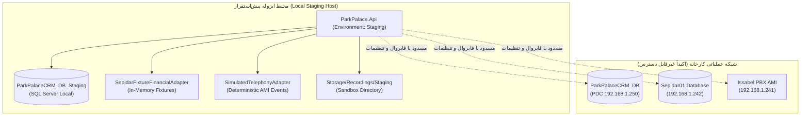

# معماری و مشخصات محیط پیش‌استقرار (Staging Architecture) — فاز ۸
# ParkPalace Procurement CRM — Phase 8 Staging Architecture

**پروژه:** سامانه جامع تدارکات و خرید پارک پالاس (ParkPalace Procurement CRM)  
**فاز:** فاز ۸ — مقاوم‌سازی امنیتی، آزمون یکپارچه سرتاسری و آمادگی استقرار  
**تاریخ انتشار:** ۲۶ مهر ۱۴۰۵ (2026-10-18)  
**محیط اجرا:** محیط ایزوله پیش‌استقرار محلی (`D:\ParkPlace`)  
**نسخه سند:** ۱.۰.۰  

---

## ۱. اهداف و راهبرد ایزوله‌سازی محیط استیجینگ (Isolation Strategy & Goals)

محیط پیش‌استقرار (Staging) سامانه تدارکات پارک پالاس با هدف فراهم‌آوردن بستری کاملاً شبیه‌سازی‌شده، قطعی (Deterministic) و تکرارپذیر جهت اجرای آزمون‌های یکپارچه و ارزیابی‌های امنیتی پیش از هرگونه اقدام در محیط تولید طراحی شده است.  
اصول بنیادین ایزوله‌سازی عبارتند از:
1. **جداسازی کامل پایگاه داده:** پایگاه داده استیجینگ (`ParkPalaceCRM_DB_Staging`) به صورت مستقل روی سرور محلی تعریف شده و هیچ‌گونه وابستگی به پایگاه داده عملیاتی مستقر بر روی سرور کنترل‌کننده دامین (`192.168.1.250`) ندارد.
2. **غیرفعال‌سازی پیش‌فرض آداپتورهای زنده:** ارتباط مستقیم با وب‌سرویس‌ها و پایگاه داده سپیدار (`192.168.1.242`) و همچنین سرور تلفنی ایزابل (`192.168.1.241`) به صورت پیش‌فرض غیرفعال (`"Enabled": false`) بوده و منحصراً از آداپتورهای شبیه‌ساز (Fixture/Simulated) استفاده می‌شود.
3. **تولید قطعی داده‌های آزمایشی سنتتیک:** کلیه اطلاعات کالاها، تأمین‌کنندگان، شماره‌های تماس و اسناد مالی به صورت ساختگی و کنترل‌شده تعریف شده و هیچ داده واقعی مالی یا اطلاعات هویتی پرسنل در استیجینگ وارد نمی‌شود.
4. **حفاظت در برابر اتصال تصادفی:** متغیرهای پیکربندی در فایل اختصاصی `appsettings.Staging.json` متمرکز شده و فاقد هرگونه رشته اتصال حاوی اطلاعات معتبر محیط پروداکشن است.

---

## ۲. ساختار و توپولوژی پایگاه داده استیجینگ (Staging Database Topology)



---

## ۳. پیکربندی محیطی و فایل `appsettings.Staging.json`

فایل پیکربندی اختصاصی محیط استیجینگ در مسیر [appsettings.Staging.json](file:///D:/ParkPlace/src/ParkPalace.Api/appsettings.Staging.json) با مشخصات زیر مستقر گردیده است:

```json
{
  "Logging": {
    "LogLevel": {
      "Default": "Information",
      "Microsoft.AspNetCore": "Warning",
      "Microsoft.EntityFrameworkCore.Database.Command": "Warning"
    }
  },
  "AllowedHosts": "*",
  "ConnectionStrings": {
    "CrmDatabase": "Server=localhost;Database=ParkPalaceCRM_DB_Staging;Integrated Security=True;TrustServerCertificate=True;"
  },
  "Auth": {
    "Provider": "Dev",
    "Domain": "sahar.loc"
  },
  "Integrations": {
    "Sepidar": {
      "Enabled": false,
      "Mode": "Simulated",
      "Description": "Sepidar Fixture Adapter strictly active in Staging (zero live connections)"
    },
    "Issabel": {
      "Enabled": false,
      "Mode": "Simulated",
      "Description": "Issabel Simulated Telephony Adapter strictly active in Staging (zero live PBX connections)"
    }
  }
}
```

---

## ۴. آداپتورهای شبیه‌ساز و فیچرهای تستی (Simulated Adapters)

### ۴.۱. آداپتور شبیه‌ساز مالی سپیدار (`SepidarFixtureFinancialAdapter`)
- **رفتار:** پیاده‌سازی اینترفیس `ISepidarFinancialAdapter`. بدون برقراری کانکشن TCP/IP یا SQL به سرور سپیدار، فهرستی از پیش‌فاکتورها و رکوردهای دفتر روزنامه متناظر را در حافظه بازتولید می‌کند.
- **انطباق داده‌ها:** پشتیبانی از حالت‌های مغایرت نرخی، مقداری و انطباق کامل جهت اعتبارسنجی موتور تطبیق سه‌جانبه.
- **تضمین ایمنی:** عدم وجود هرگونه متد با قابلیت نوشتن (`INSERT`/`UPDATE`) بر روی دیتابیس حسابداری سپیدار.

### ۴.۲. آداپتور شبیه‌ساز تلفنی ایزابل (`SimulatedTelephonyAdapter`)
- **رفتار:** پیاده‌سازی اینترفیس `ITelephonyAdapter`. شبیه‌سازی قطعی و بلادرنگ رویدادهای پروتکل Asterisk AMI (نظیر `Newchannel`, `Dial`, `Link`, `Hangup`).
- **تست پاپ‌آپ زنده:** ارسال اعلان‌های وب به مشترکین متصل به هاب SignalR (`/hubs/telephony`) با حفظ نرمال‌سازی شماره‌های ایران و شناسایی تأمین‌کننده.
- **تست عدم دسترسی:** تضمین عدم ارسال درخواست به پورت ۵۰۳۸ سرور ایزابل کارخانه در حین اجرای تست‌های استیجینگ.

### ۴.۳. فضای ایزوله فایل‌های صوتی مکالمات (`Recording Sandbox`)
- ذخیره‌سازی فایل‌های صوتی تستی در یک مسیر کنترل‌شده محلی با ساختار فرمت مجاز `.wav`.
- مسدودسازی هرگونه پویش دایرکتوری یا حملات Path Traversal (`../` یا `..\`) از طریق لایه `RecordingService`.

---

## ۵. سیستم احراز هویت و نگاشت نقش‌های تستی در استیجینگ

در محیط پیش‌استقرار، جهت تسهیل اجرای سناریوهای خودکار چندنقشی بدون نیاز به لاگین مداوم با حساب‌های اکتیودایرکتوری، از سرویس [DevCurrentUserService.cs](file:///D:/ParkPlace/src/ParkPalace.Infrastructure/Identity/DevCurrentUserService.cs) استفاده می‌شود که از طریق هدرهای استاندارد درخواست، هویت تستی را شبیه‌سازی می‌کند:
- `X-Dev-Role: Procurement`: شبیه‌سازی کارشناس خرید و تدارکات (مجوز صدور مستقیم PO و ثبت یادداشت تماس).
- `X-Dev-Role: Warehouse`: شبیه‌سازی انباردار (مجوز ثبت رسید انبار و کنترل موجودی؛ مسدود در برابر کارتابل مالی).
- `X-Dev-Role: Finance`: شبیه‌سازی کارشناس مالی (مجوز تطبیق سه‌جانبه، حل‌وفصل مغایرت‌ها و اتصال اسناد سپیدار).
- `X-Dev-Role: Manager`: شبیه‌سازی مدیر ناظر (دسترسی نظارتی و داشبورد جامع).
- `X-Dev-Role: Admin`: شبیه‌سازی مدیر ارشد سامانه (دسترسی کامل مدیریتی و تنظیمات).
- `X-Dev-Role: None`: شبیه‌سازی کاربر فاقد صلاحیت جهت آزمون‌های رد دسترسی (HTTP 403 Forbidden).

---

## ۶. پایش سلامت و لاگ‌های ساختاریافته (Health Checks & Observability)

- **اندپوینت سلامت عمومی (`GET /api/health`):** بازگرداندن وضعیت سلامت پایگاه داده CRM محلی و آداپتورهای فعال.
- **اندپوینت سلامت تجمیعی (`GET /api/v1/reports/integration-health`):** گزارش وضعیت ارتباط با پایگاه داده، تأخیر میلی‌ثانیه‌ای، وضعیت آداپتور سپیدار، سلامت کانکشن ایزابل و شاخص‌های تازگی داده.
- **لاگ‌های ساختاریافته:** ثبت رویدادهای ممیزی (`AuditEvents`) با فرمت JSON در پایگاه داده CRM استیجینگ به منظور راستی‌آزمایی اقدامات هر نقش در پایان اجرای سناریوها.
