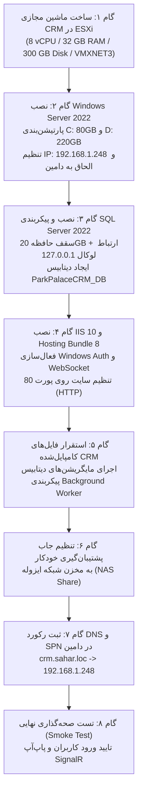

# برنامه اجرایی استقرار و راه‌اندازی ماشین مجازی تک‌سرور (VM-01)
# ParkPalace Procurement CRM — Single VM Installation & Deployment Runbook

**پروژه:** سامانه جامع تدارکات و ارتباط با تأمین‌کنندگان پارک پالاس (ParkPalace Procurement CRM)  
**سند:** برنامه گام‌به‌گام نصب و استقرار بر روی سرور تک‌ماشین مجازی (VM-01 Deployment Plan)  
**مسیر پروژه:** `D:\ParkPlace`  
**بستر مجازی‌سازی:** VMware ESXi  
**نام ماشین مجازی:** `CRM` | **نام ویندوز:** `CRM` | **دامنه:** `crm.sahar.loc`  
**آدرس IP:** `192.168.1.248` | **پورت وب:** `TCP 80` (HTTP)  
**پایگاه داده:** SQL Server 2022 لوکال روی همین ماشین (`ParkPalaceCRM_DB`)  
**وضعیت اجرا:** **طرح اجرایی مدون — اکیداً منتظر تایید منابع ESXi و فایل ISO (Mandatory Stop)**  
**تاریخ صدور:** ۲۶ مهر ۱۴۰۵ (2026-10-18)  
**نسخه:** ۲.۰.۰  

---

## ۱. پیش‌نیازها و پیش‌شرط‌های مرحله‌ای (Prerequisites & Preflight Checks)

پیش از اقدام به ایجاد ماشین مجازی و اجرای این برنامه، الزامات زیر باید به تایید کتبی کارفرما و مدیر زیرساخت شبکه برسد:
1. **گزارش شناسایی منابع سرور فیزیکی ESXi:**
   - فضای خالی دیتااستور هدف: حداقل **۳۵۰ گیگابایت** فضای آزاد برای دیسک ۳۰۰ گیگابایتی.
   - منابع پردازنده آزاد هاست: حداقل **۸ هسته فیزیکی/منطقی**.
   - حافظه RAM آزاد هاست: حداقل **۳۲ گیگابایت** بدون Overcommit.
2. **فایل‌های ISO و نصاب‌های تاییدشده:**
   - فایل ISO رسمی و دست‌نخورده **Windows Server 2022 Standard/Datacenter (64-bit)** با تطبیق هش SHA-256.
   - فایل ISO یا ستاپ رسمی **SQL Server 2022 (Standard یا Enterprise)**.
   - نصاب رسمی مایکروسافت **ASP.NET Core 8 Hosting Bundle** (آخرین بیلد 8.0.x).
   - نصاب رسمی مایکروسافت **URL Rewrite 2.1**.
3. **حساب کاربری سرویس دامین (Domain Service Account):**
   - ایجاد حساب کاربری استاندارد `sahar\svc_crm` در اکتیودایرکتوری با رمز عبور قوی و بدون تاریخ انقضا (Password Never Expires) و بدون عضویت در گروه‌های ادمین.
4. **مخزن پشتیبان‌گیری خارج از سرور (Off-VM Backup Share):**
   - ایجاد پوشه اشتراکی امن بر روی NAS یا فایل‌سرور سازمان با مسیر پیشنهادی:  
     `\\nas.sahar.loc\backups\CRM`  
     و اعطای مجوز Read/Write کامل به حساب `sahar\svc_crm` و حساب سرویس SQL Server.

---

## ۲. مراحل گام‌به‌گام استقرار ماشین مجازی تک‌سرور (VM-01 Execution Steps)



---

### گام ۱: ساخت ماشین مجازی در کنسول VMware ESXi
* **نام ماشین مجازی:** `CRM`
* **سیستم‌عامل میهمان:** `Microsoft Windows Server 2022 (64-bit)`
* **سازگاری سخت‌افزاری:** ESXi 7.0 Update 3 یا بالاتر
* **تخصیص پردازنده:** `8 vCPU` (سوکت: ۱ یا ۲، هسته: ۸)
* **تخصیص حافظه:** `32 GB` (فعال‌سازی گزینه **Reserve all guest memory** جهت پیشگیری از جابجایی حافظه روی دیسک)
* **تخصیص دیسک:** `300 GB` با کنترلر **VMware Paravirtual SCSI (PVSCSI)**
* **کارت شبکه:** **VMXNET3** متصل به ساب‌نت اداری (شبکه `192.168.1.0/24`)
* **اتصال مدیا:** اتصال به فایل ISO ویندوز سرور ۲۰۲۲ در دیتااستور

---

### گام ۲: نصب ویندوز سرور ۲۰۲۲ و تنظیمات پایه سیستم‌عامل
1. نصب ویندوز سرور در حالت `Windows Server 2022 Standard (Desktop Experience)`.
2. نصب **VMware Tools**.
3. **پارتیشن‌بندی دیسک ۳۰۰ گیگابایتی:**
   * **درایو `C:` (حجم ۸۰ گیگابایت):** سیستم‌عامل ویندوز، سرویس IIS، ران‌تایم دات‌نت و ابزارهای مانیتورینگ.
   * **درایو `D:` (حجم ۲۲۰ گیگابایت):** فایل‌های اجرایی اپلیکیشن (`D:\ParkPlaceCRM`) و فایل‌های پایگاه داده (`D:\SQLData`).
4. **تنظیمات شبکه در ویندوز:**
   ```powershell
   # نام‌گذاری کارت شبکه و اعمال IP ثابت
   New-NetIPAddress -InterfaceAlias "Ethernet0" -IPAddress "192.168.1.248" -PrefixLength 24 -DefaultGateway "192.168.1.1"
   Set-DnsClientServerAddress -InterfaceAlias "Ethernet0" -ServerAddresses ("192.168.1.250", "192.168.1.1")
   
   # تغییر نام سرور به CRM
   Rename-Computer -NewName "CRM" -Force
   
   # الحاق به دامین شرکت سحر
   Add-Computer -DomainName "sahar.loc" -Credential (Get-Credential) -Restart -Force
   ```

---

### گام ۳: نصب و سخت‌سازی محلی SQL Server 2022
1. **نصب ستاپ SQL Server 2022:**
   * انتخاب فقط ویژگی `Database Engine Services`.
   * Instance Name: پیش‌فرض (`MSSQLSERVER`).
   * مسیر دایرکتوری‌ها:
     * Data Root Directory: `D:\SQLData`
     * User Database Directory: `D:\SQLData\Data`
     * User Database Log Directory: `D:\SQLData\Logs`
     * TempDB Directory: `D:\SQLData\TempDB` (۸ فایل TempDB متناسب با ۸ هسته CPU با سایز اولیه ۱ گیگابایت و اتوگروث ۶۴ مگابایت).
2. **اعمال سقف مصرف حافظه (Memory Cap):**
   در نرم‌افزار SSMS اسکریپت زیر اجرا می‌شود:
   ```sql
   EXEC sys.sp_configure N'show advanced options', 1;
   RECONFIGURE WITH OVERRIDE;
   GO
   -- اختصاص سقف ۲۰ گیگابایت به دیتابیس
   EXEC sys.sp_configure N'max server memory (MB)', 20480;
   -- اختصاص حداقل ۴ گیگابایت
   EXEC sys.sp_configure N'min server memory (MB)', 4096;
   RECONFIGURE WITH OVERRIDE;
   GO
   ```
3. **محدودسازی دسترسی شبکه به ارتباطات محلی (Local-Only Hardening):**
   * در کنسول SQL Server Configuration Manager:
     * پروتکل **Shared Memory** فعال شود (`Enabled`).
     * پروتکل **Named Pipes** فعال شود.
     * در تنظیمات **TCP/IP**، گزینه `Listen All` روی `No` قرار گیرد و صرفاً آدرس `IP1` برابر با `127.0.0.1` روی پورت `1433` فعال گردد (یا در فایروال ویندوز هرگونه ترافیک ورودی به پورت ۱۴۳۳ از خارج ماشین مسدود شود).
4. **ایجاد پایگاه داده و کاربر اختصاصی:**
   ```sql
   CREATE DATABASE [ParkPalaceCRM_DB]
   ON PRIMARY 
   ( NAME = N'ParkPalaceCRM_DB_Data', FILENAME = N'D:\SQLData\Data\ParkPalaceCRM_DB.mdf', SIZE = 4096MB, FILEGROWTH = 256MB )
   LOG ON 
   ( NAME = N'ParkPalaceCRM_DB_Log', FILENAME = N'D:\SQLData\Logs\ParkPalaceCRM_DB_Log.ldf', SIZE = 1024MB, FILEGROWTH = 128MB );
   GO

   USE [ParkPalaceCRM_DB];
   CREATE USER [sahar\svc_crm] FOR LOGIN [sahar\svc_crm];
   ALTER ROLE [db_datareader] ADD MEMBER [sahar\svc_crm];
   ALTER ROLE [db_datawriter] ADD MEMBER [sahar\svc_crm];
   GRANT EXECUTE TO [sahar\svc_crm];
   GO
   ```

---

### گام ۴: نصب و پیکربندی وب‌سرور IIS 10
1. **فعال‌سازی ویژگی‌های وب‌سرور با پاورشل:**
   ```powershell
   Install-WindowsFeature -Name Web-Server, Web-WebServer, Web-Common-Http, `
       Web-Default-Doc, Web-Dir-Browsing, Web-Http-Errors, Web-Static-Content, `
       Web-Http-Redirect, Web-Health, Web-Http-Logging, Web-Log-Libraries, `
       Web-Request-Monitor, Web-Security, Web-Filtering, Web-Windows-Auth, `
       Web-Performance, Web-Stat-Compression, Web-Dyn-Compression, `
       Web-Mgmt-Console, Web-WebSockets, Web-Net-Ext45, Web-Asp-Net45
   ```
2. **نصب ASP.NET Core 8 Hosting Bundle و URL Rewrite:**
   ```powershell
   Start-Process -FilePath ".\dotnet-hosting-8.0.x-win.exe" -ArgumentList "/install /quiet /norestart" -Wait
   Start-Process -FilePath ".\urlrewrite2.msi" -ArgumentList "/quiet /norestart" -Wait
   net stop was /y
   net start w3svc
   ```
3. **ایجاد ساختار پوشه‌ها و استخر اپلیکیشن (Application Pool):**
   ```powershell
   New-Item -ItemType Directory -Path "D:\ParkPlaceCRM\api" -Force
   New-Item -ItemType Directory -Path "D:\ParkPlaceCRM\web" -Force
   New-Item -ItemType Directory -Path "D:\ParkPlaceCRM\worker" -Force
   New-Item -ItemType Directory -Path "D:\ParkPlaceCRM\recordings" -Force
   New-Item -ItemType Directory -Path "D:\ParkPlaceCRM\logs" -Force

   Import-Module WebAdministration
   New-WebAppPool -Name "ParkPalaceCRM_AppPool"
   Set-ItemProperty "IIS:\AppPools\ParkPalaceCRM_AppPool" -Name "managedRuntimeVersion" -Value ""
   Set-ItemProperty "IIS:\AppPools\ParkPalaceCRM_AppPool" -Name "processModel.identityType" -Value "SpecificUser"
   Set-ItemProperty "IIS:\AppPools\ParkPalaceCRM_AppPool" -Name "processModel.userName" -Value "sahar\svc_crm"
   Set-ItemProperty "IIS:\AppPools\ParkPalaceCRM_AppPool" -Name "processModel.password" -Value "YourSecurePasswordHere"
   ```
4. **ایجاد وب‌سایت روی پورت ۸۰:**
   ```powershell
   New-WebSite -Name "ParkPalaceCRM" `
       -Port 80 `
       -PhysicalPath "D:\ParkPlaceCRM\api" `
       -ApplicationPool "ParkPalaceCRM_AppPool" `
       -HostHeader "crm.sahar.loc"

   # غیرفعال‌سازی دسترسی ناشناس و فعال‌سازی احراز هویت ویندوز
   Set-WebConfigurationProperty -Filter "/system.webServer/security/authentication/anonymousAuthentication" `
       -Name "enabled" -Value "False" -PSPath "IIS:\Sites\ParkPalaceCRM"

   Set-WebConfigurationProperty -Filter "/system.webServer/security/authentication/windowsAuthentication" `
       -Name "enabled" -Value "True" -PSPath "IIS:\Sites\ParkPalaceCRM"
   ```

---

### گام ۵: استقرار پکیج برنامه و اجرای مایگریشن‌ها
1. کپی فایل‌های پابلیش‌شده پروژه در مسیر `D:\ParkPlaceCRM\api` و `D:\ParkPlaceCRM\worker`.
2. بررسی و تنظیم فایل `appsettings.Production.json`:
   ```json
   {
     "ConnectionStrings": {
       "CrmDatabase": "Server=127.0.0.1;Database=ParkPalaceCRM_DB;Integrated Security=True;TrustServerCertificate=True;Max Pool Size=100;"
     },
     "Auth": {
       "Provider": "Windows",
       "Domain": "sahar.loc"
     },
     "Integrations": {
       "Sepidar": {
         "Enabled": true,
         "Server": "192.168.1.242,62753",
         "Database": "Sepidar01"
       },
       "Issabel": {
         "Enabled": true,
         "Host": "192.168.1.241"
       }
     }
   }
   ```
3. **اعمال مایگریشن‌های دیتابیس با ابزار EF Core:**
   ```powershell
   # اجرای مایگریشن از طریق باینری دات‌نت یا اسکریپت مایگریشن باندل:
   .\ParkPalace.Api.exe --migrate
   ```
4. **راه‌اندازی سرویس ورکر پس‌زمینه:**
   ```powershell
   sc.exe create "ParkPalaceCRMWorker" `
       binPath= "D:\ParkPlaceCRM\worker\ParkPalace.Worker.exe" `
       start= auto `
       obj= "sahar\svc_crm" `
       password= "YourSecurePasswordHere"
   sc.exe start "ParkPalaceCRMWorker"
   ```

---

### گام ۶: پیکربندی پشتیبان‌گیری خارج از سرور به مخزن NAS
ایجاد یک اسکریپت و جاب SQL Agent روزانه که بک‌آپ‌ها را مستقیماً به اشتراک شبکه هدایت کند:
```sql
USE [msdb];
GO
-- ایجاد جاب پشتیبان‌گیری شبانه ساعت ۰۱:۰۰ بامداد
DECLARE @jobId BINARY(16);
EXEC sp_add_job @job_name = N'ParkPalaceCRM_Nightly_OffVM_Backup', 
    @enabled = 1, 
    @notify_level_eventlog = 2, 
    @job_id = @jobId OUTPUT;

EXEC sp_add_jobstep @job_id = @jobId, @step_name = N'BackupToNAS', 
    @command = N'
DECLARE @BackupFile NVARCHAR(500) = N''\\nas.sahar.loc\backups\CRM\ParkPalaceCRM_DB_'' + 
    CONVERT(NVARCHAR(20), GETDATE(), 112) + N''_'' + 
    REPLACE(CONVERT(NVARCHAR(20), GETDATE(), 108), '':'', '''') + N''.bak'';

BACKUP DATABASE [ParkPalaceCRM_DB]
TO DISK = @BackupFile
WITH FORMAT, INIT, COMPRESSION, CHECKSUM;

RESTORE VERIFYONLY FROM DISK = @BackupFile WITH CHECKSUM;
', 
    @database_name = N'master';

EXEC sp_add_jobschedule @job_id = @jobId, @name = N'DailySchedule_01AM', 
    @freq_type = 4, @freq_interval = 1, @active_start_time = 010000;

EXEC sp_add_jobserver @job_id = @jobId, @server_name = N'(local)';
GO
```

---

### گام ۷: ثبت رکوردهای DNS و SPN در کنترل‌کننده دامنه (`pdc.sahar.loc`)
توسط ادمین دامین روی سرور PDC دستورات زیر اجرا می‌شود:
```powershell
# ایجاد رکورد DNS
Add-DnsServerResourceRecordA -Name "crm" -ZoneName "sahar.loc" -IPv4Address "192.168.1.248" -CreatePtr

# ثبت SPN جهت احراز هویت بدون درنگ Kerberos برای پورت ۸۰
setspn -S "HTTP/crm.sahar.loc" "sahar\svc_crm"
setspn -S "HTTP/crm" "sahar\svc_crm"
```

---

### گام ۸: چک‌لیست اعتبارسنجی عملیاتی پس از نصب (Smoke Test)
1. باز کردن آدرس `http://crm.sahar.loc` از مرورگر کاربر عضو دامین و تایید لاگین خودکار با احراز هویت ویندوز بدون نمایش فرم نام کاربری/پسورد.
2. استعلام اندپوینت سلامت: `http://crm.sahar.loc/api/health` و دریافت کد ۲۰۰ با خروجی `"Status": "Healthy"`.
3. تست برقراری تماس تلفنی از سوی تأمین‌کننده و اطمینان از دریافت پاپ‌آپ بلادرنگ SignalR روی پورت ۸۰.
4. ممیزی تسک‌منیجر و اطمینان از اینکه مصرف حافظه SQL Server از سقف ۲۰ گیگابایت فراتر نمی‌رود.

---

## ۳. توقف الزامی و شرایط آغاز عملیات (Mandatory Stop)

> [!IMPORTANT]
> **شرایط قطعی آغاز مرحله نصب:**  
> ۱. این سند تا زمان دریافت گزارش شناسایی منابع سخت‌افزاری سرور ESXi و تایید سلامت فایل ISO ویندوز سرور ۲۰۲۲ در وضعیت **طرح و برنامه‌ریزی (Plan Only)** باقی می‌ماند.  
> ۲. هیچ اقدامی در سرورهای ESXi، اکتیودایرکتوری PDC، یا شبکه انجام نمی‌شود تا مجوز مرحله بعدی صادر گردد.
