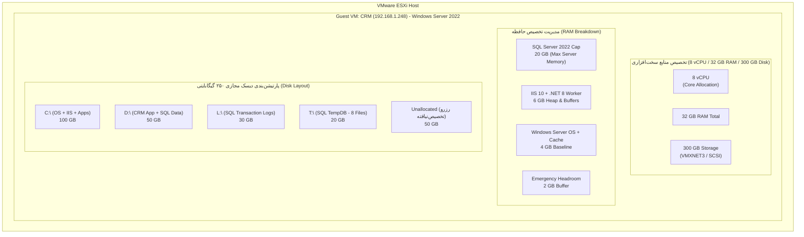
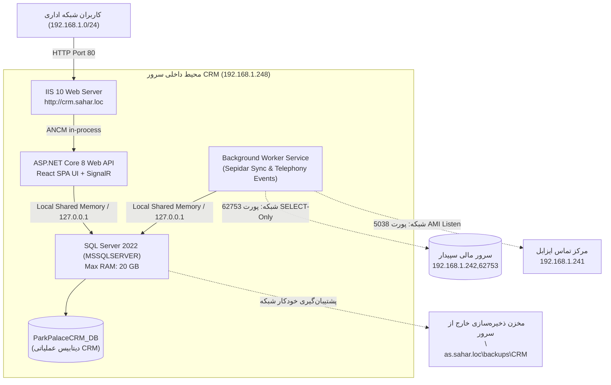

# سند بازبینی معماری تک‌ماشین مجازی (VM-01 Single VM Architecture Revision)
# ParkPalace Procurement CRM — Single VM Architecture Specification
## Unified Host Design: IIS 10, ASP.NET Core 8, React, SignalR, Background Worker & Local SQL Server 2022

**پروژه:** سامانه جامع تدارکات و ارتباط با تأمین‌کنندگان پارک پالاس (ParkPalace Procurement CRM)  
**سند:** مشخصات معماری قطعی سرور تک‌ماشین مجازی (VM-01)  
**مسیر پروژه:** `D:\ParkPlace`  
**محیط مجازی‌سازی:** VMware ESXi  
**نام ماشین مجازی و Computer Name ویندوز:** `CRM`  
**شناسه کامل دامنه (FQDN):** `crm.sahar.loc`  
**آدرس IP سرور:** `192.168.1.248` (ساب‌نت: `192.168.1.0/24` | Gateway: `192.168.1.1` | DNS: `192.168.1.250`)  
**پورت وب:** `TCP 80` (پروتکل: `HTTP` | آدرس دسترسی: `http://crm.sahar.loc`)  
**وضعیت:** طرح مصوب کارفرما — آماده‌سازی مستندات و طراحی (Mandatory Stop قبل از اجرا)  
**تاریخ صدور:** ۲۶ مهر ۱۴۰۵ (2026-10-18)  
**نسخه:** ۲.۰.۰ (جایگزین طرح سرور دوگانه)  

---

## ۱. خلاصه تصمیم کارفرما و دلایل بازبینی معماری

پیرو ارزیابی‌های پیش‌استقرار (PPA) و رد قاطعانه میزبانی سامانه بر روی کنترل‌کننده دامنه (`pdc.sahar.loc`)، کارفرمای محترم تصمیم به **تجمیع کلیه مؤلفه‌های نرم‌افزاری و پایگاه داده در یک ماشین مجازی منفرد (Single VM)** تحت عنوان طرح **VM-01** اتخاذ نمود.

### اصول کلیدی بازبینی معماری:
1. **حذف کامل طرح سرور مجزای SQL (حذف VM مستقل SQL-CRM):** هیچ ماشین مجازی جداگانه‌ای برای پایگاه داده ایجاد نخواهد شد. هر دو لایه وب/اپلیکیشن و پایگاه داده SQL Server 2022 روی همان ماشین مجازی `CRM` مستقر می‌شوند.
2. **پیکربندی لوکال پایگاه داده (Local-Only SQL Connection):** پایگاه داده SQL Server منحصراً برای پذیرش ارتباطات محلی وب‌سایت و ورکر (از طریق Shared Memory و Loopback `127.0.0.1`) پیکربندی می‌شود و پورت شبکه خارجی آن مسدود می‌گردد.
3. **اعمال سقف حافظه برای SQL Server:** جهت جلوگیری از تسخیر کامل حافظه RAM توسط موتور SQL و تضمین منابع کافی برای IIS، ورکر دات‌نت و سیستم‌عامل، سقف مصرف حافظه (`Max Server Memory`) برابر **۲۰ گیگابایت (20,480 مگابایت)** تعیین می‌گردد.
4. **استقلال ۱۰۰٪ دیتابیس CRM از سپیدار:** پایگاه داده `ParkPalaceCRM_DB` مستقل و مجزا است. ارتباط با سپیدار صرفاً از طریق شبکه به سرور مالی (`192.168.1.242,62753`) و در قالب کوئری‌های فقط‌خواندنی (**SELECT-Only**) صورت می‌پذیرد.
5. **پشتیبان‌گیری خارج از سرور (Off-VM External Backup):** فایل‌های پشتیبان پایگاه داده به دلیل ریسک پر شدن دیسک سرور و خرابی احتمالی VM، مستقیماً یا از طریق جاب‌های زمان‌بندی‌شده به یک مخزن ذخیره‌سازی خارج از ماشین (نظیر NAS یا فایل‌شیرینگ شبکه) منتقل می‌شوند.
6. **ثبت رسمی ریسک امنیتی پروتکل HTTP:** پورت وب بر اساس دستور کارفرما روی **TCP 80** بدون رمزنگاری TLS تعریف شده است؛ تبعات امنیتی و الزامات جبرانی این تصمیم در بخش ۵ این سند ثبت گردیده است.

---

## ۲. مشخصات و تخصیص منابع ماشین مجازی (VM Resource Allocation)



### ۲.۱. جدول مشخصات فنی ماشین مجازی در ESXi
| مؤلفه | مقدار مصوب | توضیحات فنی و استاندارد |
| :--- | :--- | :--- |
| **VM Name** | `CRM` | شناسه ماشین در کنسول vSphere / ESXi |
| **Computer Name** | `CRM` | نام کامپیوتر در سیستم‌عامل ویندوز سرور |
| **Domain FQDN** | `crm.sahar.loc` | عضو دامنه اکتیودایرکتوری `sahar.loc` |
| **IP Address** | `192.168.1.248` | آدرس IP ثابت در ساب‌نت اداری (`/24`) |
| **Default Gateway** | `192.168.1.1` | گیت‌وی اصلی شبکه سحر |
| **Preferred DNS** | `192.168.1.250` | کنترل‌کننده دامنه (`pdc.sahar.loc`) |
| **Operating System** | Windows Server 2022 Standard | نصب ۶۴ بیتی با آخرین آپدیت‌های امنیتی |
| **vCPU** | **8 vCPU** | ۲ سوکت با ۴ هسته (یا ۱ سوکت با ۸ هسته) |
| **Memory (RAM)** | **32 GB** | حافظه رزروشده جهت پایداری بدون Memory Ballooning |
| **Storage (Disk)** | **250 GB** | دیسک مجازی ۲۵۰ گیگابایتی (کنترلر PVSCSI) |
| **Storage Controller** | VMware Paravirtual (PVSCSI) | کنترلر دیسک بهینه‌شده برای دیتابیس‌های پرتراکنش |
| **Network Adapter** | **VMXNET3** | کارت شبکه مجازی سازمانی پرسرعت ۱۰ گیگابیت |

### ۲.۲. ساختار و طرح تفکیک پارتیشن‌های دیسک (Disk Partition Layout)
از مجموع **۲۵۰ گیگابایت** دیسک مجازی، پارتیشن‌های زیر با در نظر گرفتن پارتیشن‌های سیستمی UEFI (شامل EFI System Partition معادل ۱۰۰ مگابایت، MSR معادل ۱۶ مگابایت و Windows Recovery معادل ۵۰۰ مگابایت تا ۱ گیگابایت) طراحی شده‌اند:
* **درایو `C:` (ظرفیت ۱۰۰ گیگابایت):** سیستم‌عامل ویندوز سرور، وب‌سرور IIS 10، ران‌تایم‌های .NET 8 و نرم‌افزارهای پایه‌ای.
* **درایو `D:` (ظرفیت ۵۰ گیگابایت):** باینری‌های سامانه تدارکات (`D:\ParkPlaceCRM`) و فایل‌های داده‌ای SQL Server (`.mdf` / `.ndf`).
* **درایو `L:` (ظرفیت ۳۰ گیگابایت):** لاگ‌های تراکنشی دیتابیس SQL Server (`.ldf`) جهت جداسازی I/O متوالی (Sequential Write Isolation).
* **درایو `T:` (ظرفیت ۲۰ گیگابایت):** پایگاه داده موقت SQL Server (`TempDB`) شامل ۸ فایل متناسب با ۸ هسته پردازنده جهت جلوگیری از Bottleneck در جدول‌های موقت.
* **فضای تخصیص‌نیافته (Unallocated Space - معادل ۵۰ گیگابایت):** دست‌نخورده و بدون پارتیشن‌بندی رها می‌شود تا در آینده بنا به نیاز عملیاتی به هریک از درایوها توسعه یابد.

---

## ۳. معماری داخلی نرم‌افزار و پایگاه داده روی VM-01



### ۳.۱. پیکربندی و کنترل منابع SQL Server 2022
* **موتور پایگاه داده:** Microsoft SQL Server 2022 Standard یا Enterprise.
* **تنظیم سقف حافظه (Max Server Memory):**  
  جهت پیشگیری از تسخیر حافظه و بروز پدیده Paging در IIS و ورکر:
  ```sql
  EXEC sys.sp_configure N'show advanced options', 1;
  RECONFIGURE WITH OVERRIDE;
  GO
  -- اختصاص سقف ۲۰ گیگابایت (20,480 مگابایت) به بافر پول SQL Server
  EXEC sys.sp_configure N'max server memory (MB)', 20480;
  -- تنظیم کف حافظه حداقل ۴ گیگابایت
  EXEC sys.sp_configure N'min server memory (MB)', 4096;
  RECONFIGURE WITH OVERRIDE;
  GO
  ```
* **امن‌سازی ارتباطات و بستن پورت خارجی SQL:**
  * فعال بودن پروتکل **Shared Memory** برای سریع‌ترین تبادل داده محلی بین اپلیکیشن و دیتابیس (Zero-Copy inter-process communication).
  * تنظیم پروتکل TCP/IP منحصراً بر روی آدرس Loopback (`127.0.0.1`) یا بستن پورت TCP 1433 در فایروال ویندوز سرور برای اتصالات ورودی از شبکه.
  * هیچ سیستم دیگری در شبکه حق اتصال مستقیم به دیتابیس `ParkPalaceCRM_DB` را نخواهد داشت.

### ۳.۲. استقلال کامل پایگاه داده CRM از سپیدار
1. **عدم ایجاد Linked Server متقابل:** هیچ لینک سروری از سپیدار به CRM یا از CRM به سپیدار در سطح دیتابیس ایجاد نمی‌شود.
2. **ارتباط نرم‌افزاری ایزوله:** تنها رابط بین دو سیستم، سرویس `ISepidarInventoryAdapter` و `ISepidarFinancialAdapter` در کدهای دات‌نت است که با کانکشن‌استرینگ مجزا به پورت `62753` سرور `192.168.1.242` وصل می‌شود.
3. **محدودیت دسترسی SELECT-Only:** کاربر تعریف‌شده در سپیدار صرفاً عضویت نقش `db_datareader` را بر روی جداول کالای انبار و فاکتورها دارا بوده و فاقد هرگونه مجوز دستکاری، درج یا ویرایش است.

### ۳.۳. استراتژی پشتیبان‌گیری خارج از سرور (Off-VM External Backup)
* **چالش:** حجم دیسک ماشین مجازی محدود به ۳۰۰ گیگابایت است. نگهداری فایل‌های `.bak` روزانه روی همین دیسک به سرعت منجر به پر شدن درایو `D:` و از کار افتادن کل سرور می‌شود.
* **راهکار معماری:**
  1. مسیر پیش‌فرض بک‌آپ‌ها بر روی یک مسیر اشتراکی امن در شبکه (UNC Path) روی NAS یا فایل‌سرور سازمان هدایت می‌شود:
     `\\nas.sahar.loc\backups\CRM\Daily`
  2. استفاده اجباری از گزینه‌های **`COMPRESSION`** و **`CHECKSUM`**.
  3. اعمال سیاست نگهداری (Retention Policy): نگهداری بک‌آپ‌های هفتگی تا ۳۰ روز و لاگ‌های ساعتی تا ۴۸ ساعت.

---

## ۴. پیکربندی وب‌سرور IIS 10 روی پورت ۸۰

* **Binding سایت:** پروتکل `http`، پورت `80`، با نام هاست `crm.sahar.loc`.
* **احراز هویت:**
  * فعال بودن **Windows Authentication** (Negotiate / Kerberos / NTLM).
  * غیرفعال بودن قطعی **Anonymous Authentication**.
* **ماژول WebSocket:** نصب و فعال جهت پاپ‌آپ بلادرنگ SignalR روی پورت ۸۰ بدون نیاز به پورت مجزا.
* **کانکشن استرینگ در `appsettings.Production.json`:**
  ```json
  "ConnectionStrings": {
    "CrmDatabase": "Server=127.0.0.1;Database=ParkPalaceCRM_DB;Integrated Security=True;TrustServerCertificate=True;Max Pool Size=100;"
  }
  ```

---

## ۵. ارزیابی ریسک امنیتی پروتکل HTTP بدون TLS (Security Risk Assessment)

> [!WARNING]
> **ثبت رسمی ریسک امنیتی: استفاده از HTTP روی پورت ۸۰ بدون رمزنگاری TLS**  
> استفاده از پروتکل ناامن HTTP (Port 80) به جای HTTPS در محیط شبکه سازمانی، دارای پیامدهای امنیتی زیر است:

| شناسه ریسک | عنوان ریسک امنیتی | شدت ریسک | پیامد و سناریوی نفوذ | اقدامات تخفیف‌دهنده و جبرانی در معماری |
| :---: | :--- | :---: | :--- | :--- |
| **SEC-HTTP-01** | استراق سمع ترافیک داده‌ها (Eavesdropping / Sniffing) | بالا | مشاهده متن فاکتورها، مبالغ خرید و اطلاعات تماس تأمین‌کنندگان توسط افراد متصل به شبکه محلی با ابزارهایی نظیر Wireshark. | جداسازی VLAN کاربری از VLAN سرورها؛ جلوگیری از دسترسی پورت‌های غیرمجاز شبکه به ساب‌نت سرور. |
| **SEC-HTTP-02** | جعل هویت و شنود NTLM (NTLM Relay Attacks) | بحرانی | در صورت عدم فعال بودن Kerberos و سقوط به NTLM، هدرهای Negotiate در بستر متن آشکار ارسال شده و مهاجم در شبکه می‌تواند با ابزارهای Relay به دسترسی کاربر دست یابد. | **الزام فعال‌سازی EPA (Extended Protection for Authentication)** در تنظیمات Windows Authentication در IIS و ثبت SPN برای `HTTP/crm.sahar.loc`. |
| **SEC-HTTP-03** | دستکاری داده‌ها حین انتقال (Man-in-the-Middle - MITM) | متوسط | تغییر مقادیر تأیید سفارش‌ها یا پاسخ‌های وب در میانه مسیر توسط تجهیزات میانی ناامن. | بستن پورت‌های سوئیچ با قابلیت Port Security و DHCP Snooping در زیرساخت شبکه سیسکو. |
| **SEC-HTTP-04** | مسدود شدن قابلیت‌های امنیتی مدرن مرورگر | کم | برخی مرورگرهای جدید وب‌سوکت‌ها یا کوکی‌های بدون فلگ `Secure` را در حالت HTTP محدود یا هشدار ناامنی نمایش می‌دهند. | تنظیم کوکی‌های احراز هویت با فلگ `HttpOnly` و `SameSite=Strict`. |

### توصیه موکد ممیز امنیتی:
اگرچه راه‌اندازی اولیه بنا به تصمیم کارفرما روی پورت ۸۰ انجام می‌شود، اما به محض صدور گواهینامه معتبر داخلی توسط CA سازمان سحر، یک بایندینگ HTTPS روی پورت ۴۴۳ اضافه شده و ترافیک پورت ۸۰ با ماژول URL Rewrite به پورت ۴۴۳ هدایت (Redirect) گردد.

---

## ۶. مقایسه معماری دوماشینه سابق در برابر معماری تک‌ماشینه جدید (VM-01)

| شاخص مقایسه | طرح سابق (دو VM: اپلیکیشن + دیتابیس) | طرح مصوب جدید (تک VM-01: همه‌منظوره) | وضعیت تطابق |
| :--- | :--- | :--- | :---: |
| **تعداد ماشین مجازی** | ۲ عدد (`WEB-CRM` + `SQL-CRM`) | **۱ عدد (`CRM`)** | مصوب کارفرما |
| **مصرف منابع ESXi** | ۱۲ vCPU و ۴۸ گیگابایت RAM | **۸ vCPU و ۳۲ گیگابایت RAM** | صرفه‌جویی در منابع |
| **ارتباط وب با دیتابیس** | شبکه TCP (دارای تاخیر شبکه) | **محلی (Shared Memory سریع بدون تاخیر شبکه)** | ارتقای پرفورمنس |
| **پیچیدگی لایسنس و نگهداری** | ۲ ویندوز سرور مجزا | **۱ ویندوز سرور مجزا** | کاهش ۵۰٪ زحمت نگهداری |
| **ایزولاسیون پردازش‌ها** | ایزولاسیون کامل فیزیکی/مجازی | **ایزولاسیون منطقی با تنظیم Max Memory برای SQL** | با کانفیگ جبران شد |
| **استقلال دیتابیس سپیدار** | دیتابیس روی سرور دیگر بود | **دیتابیس CRM مستقل است و سپیدار SELECT-Only است** | کاملاً مستقل |
| **نقطه اشتراک بک‌آپ** | بک‌آپ روی سرور SQL بود | **بک‌آپ مستقیماً به NAS خارج از سرور هدایت می‌شود** | محافظت کامل دیسک |

---

## ۷. نتیجه‌گیری و توقف الزامی (Mandatory Stop)

طرح معماری تک‌ماشین مجازی (VM-01) با رعایت کلیه الزامات و قیود کارفرمای محترم تدوین گردید.  
**مطابق دستور اکید:** هیچ ماشین مجازی در ESXi ایجاد نشده و هیچ نرم‌افزاری نصب نگردیده است. اجرای عملیاتی منوط به دریافت گزارش شناسایی منابع ESXi و تایید فایل ISO ویندوز سرور می‌باشد.
